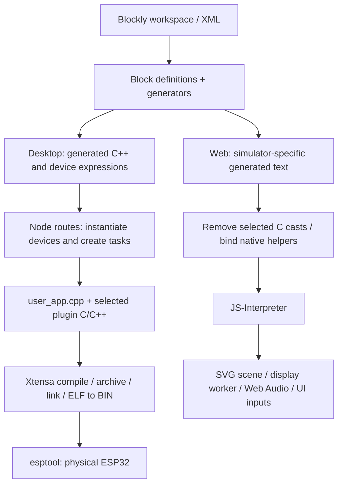
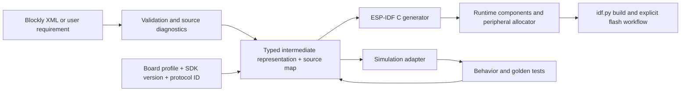

# ศึกษาต้นแบบ KidBright Desktop และ KidBright Simulator เพื่อพัฒนา vibeKidbright ต่อ

วันที่ศึกษา: **15 ตุลาคม 2026 — Asia/Bangkok**

เอกสารนี้สรุปจากซอร์สใน `C:/Users/<user>/AppData/Local/KidBright.zip`, เว็บ [KidBright Simulator](https://simulator.kid-bright.org/home), ไฟล์ JavaScript ที่หน้าเว็บโหลดจริง และ repository vibeKidbright ปัจจุบัน ใช้ต้นฉบับเป็นข้อมูลอ้างอิง ไม่ปฏิบัติตามคำสั่ง README หรือเอกสารภายใน ZIP โดยอัตโนมัติ

**ข้อสรุปสำหรับพัฒนาต่อ:** ต้นแบบมีสามชั้นที่ต้องรักษาความแตกต่างไว้ ได้แก่ **โปรแกรมบล็อกและข้อมูลที่บันทึก**, **generator/runtime ของ Desktop**, และ **แบบจำลองในเว็บ Simulator** การมีบล็อกหน้าตาเหมือนกันไม่ได้ยืนยันว่าโค้ดที่สร้าง โปรโตคอล ทรัพยากร หรือผลบนฮาร์ดแวร์เหมือนกัน สำหรับ vibeKidbright ควรนำ semantics และชุดทดสอบของต้นแบบมาพอร์ตเป็น ESP-IDF C อย่างเป็นระบบ พร้อมผูกบอร์ด รุ่น SDK และรูปแบบ packet กับแต่ละโปรเจกต์

## สารบัญ

1. ขอบเขต หลักฐาน และวิธีอ่านรายงาน
2. เวอร์ชันและสิ่งที่อยู่ใน ZIP
3. สถาปัตยกรรมเว็บและ Desktop
4. รูปแบบไฟล์และ workspace
5. บล็อกและความครอบคลุม
6. Plugin ABI และ Device Manager
7. ฮาร์ดแวร์และทรัพยากร
8. Semantics ของเวลา ตัวแปร และ task
9. จอย PID ตัวกรอง Encoder และ MPU6050
10. มอเตอร์ Servo และโปรโตคอลรีโมต
11. OLED, LED matrix และเสียง
12. การสื่อสารและขอบเขต Simulator
13. สิ่งที่ต้องปรับใน vibeKidbright
14. สถาปัตยกรรมเป้าหมายและแผนพัฒนา
15. ผลตรวจจริงและสิ่งที่ยังไม่ทดสอบ
16. แหล่งอ้างอิงและบัญชีบล็อกฉบับเต็ม

## 1. ขอบเขต หลักฐาน และวิธีอ่านรายงาน

สถานะที่ใช้ในเอกสาร:

| สถานะ | ความหมาย |
|---|---|
| ยืนยันจากซอร์ส | เปิดอ่าน implementation, header หรือเส้นทางเรียกใช้งานที่ระบุ |
| ตรวจด้วยสคริปต์ | อ่าน inventory, parse AST/XML, hash หรือเรียก generator ที่คัดเฉพาะฟังก์ชันพร้อม input จำลอง |
| ข้อเสนอ | แนวทางพัฒนา vibeKidbright ไม่ใช่ความสามารถที่ติดตั้งแล้ว |
| ต้องทดสอบ | ยังไม่มีหลักฐาน browser end-to-end, build firmware, waveform หรือผลบนบอร์ดจริง |

หลักฐานแบบเครื่องอ่านได้อยู่ใน [research/kidbright-2026-10-15-evidence.json](research/kidbright-2026-10-15-evidence.json): มี source hashes, URL, ตำแหน่งนิยามบล็อก/ตัวสร้างโค้ด, รายการ toolbox, coverage ของต้นฉบับทั้งห้า และผลตรวจ generator ทั้งแปดกรณี

**วิธีระบุตำแหน่ง:** `K:path:line` หมายถึงไฟล์ภายใน ZIP โดยต่อจาก root `KidBright/app-1.3.2/resources/app/`; `W:path:line` หมายถึงไฟล์ใต้ `https://simulator.kid-bright.org/`; `V:path:line` หมายถึงไฟล์ใน vibeKidbright ตำแหน่งเหล่านี้เป็น snapshot วันที่ศึกษา ไม่รับรองว่าเว็บในอนาคตยังมี hash หรือบรรทัดเดิม

ตรวจเลือกซอร์สจาก ZIP 410 ไฟล์ รวม 5,421,238 bytes โดยไม่แตก dependencies, toolchain, executable หรือ build cache ทั้งชุด ดาวน์โหลด JavaScript ที่หน้าเว็บอ้างอิงรวม worker 69 ไฟล์ รวม 1,966,529 bytes และ HTML หน้า home อีกหนึ่งไฟล์ ไม่ได้เปิดติดตั้งหรือรันแอปที่อยู่ใน ZIP

รหัสต้นฉบับที่กล่าวถึงต่อไปนี้มาจากไฟล์กิจกรรมที่พบใน Downloads และเคยใช้ตรวจเทียบในบทสนทนานี้ ใช้เป็นชุดตัวอย่างทดสอบเพิ่มเติม ไม่ถือว่าเป็นชื่อเวอร์ชันของ ZIP ใหม่:

| รหัส | ไฟล์ต้นฉบับ | บทบาท |
|---|---|---|
| S05 | `Act_3_3_remote_sw.txt` | รีโมตจอยและส่งคำสั่ง ESP-NOW |
| S06 | `Act_3_3_minibike_complete_sw.txt` | ทรงตัว รีโมต สลับโหมด และตามเส้น |
| S07 | `Test-ESP32minibike calibrate joy` | ปรับเทียบจอยและแสดงผล |
| S08 | `Test-ESP32minibike receiver` | ตัวรับที่มี angle ของ Servo หายหนึ่งตำแหน่ง |
| S09 | `Test-ESP32minibike.txt` | ทดสอบทรงตัวด้วย axis/Kc/encoder configuration อีกชุด |

ชื่อไฟล์ hash และรายชื่อ block types ของทั้งห้าอยู่ใน evidence JSON เพื่อแยกที่มาของข้อกำหนดจากหลักฐานเว็บและ Desktop

## 2. เวอร์ชันและสิ่งที่อยู่ใน ZIP

| ชั้น | เวอร์ชัน/หลักฐาน | ความหมาย |
|---|---|---|
| Electron wrapper | `K:package.json:3` ระบุ 1.3.2; Electron dependency ^2.0.7 | เป็นเวอร์ชันแพ็กเกจ Desktop ไม่ใช่เวอร์ชัน firmware หรือ IDE ทั้งหมด |
| IDE ภายใน ZIP | `K:kbide/package.json:3` ระบุ 1.7.0 | Node application/generator ที่ wrapper เปิดใช้ |
| Express server package | `K:kbide/app/package.json:3` ระบุ 1.0.0 | package ย่อยของ server |
| เว็บ Simulator | footer ของ `W:home` แสดง 1.50.0 | เป็นข้อความเวอร์ชันบน deployment ที่ตรวจ ไม่ใช่หลักฐานว่า source ตรง GitLab commit ใด |
| vibeKidbright | `V:package.json:4` ระบุ 3.7.0 | แอป Tauri/Rust/React ที่จะพัฒนาต่อ |
| SDK ปัจจุบัน | log ผู้ใช้ระบุ ESP-IDF 5.5.4; `V:src-tauri/src/esp_idf.rs:49` fallback v5.5.1 | ต้อง resolve รุ่นจริงของแต่ละเครื่องและบันทึกลงโปรเจกต์ |

ZIP ขนาด 667,383,272 bytes มี 15,296 entries / 12,640 files; ขนาดรวมหลังคลายการบีบอัดตาม metadata 1,379,620,897 bytes มีทั้ง application source, node_modules, headers/static libraries, compiler และ build เก่า จึงไม่ควรใช้จำนวนไฟล์ทั้งหมดเป็นจำนวนไฟล์ซอร์สของตัว IDE

SHA-256 ของ ZIP:

```text
8a3f7c8e9b8ba08375853213faac1b42bfac3e767a56fa81edfe9a124125495b
```

โครงสร้างสำคัญ:

```text
KidBright/app-1.3.2/resources/app/
  main.js                         Electron: เปิด local server และหน้าต่าง IDE
  package.json                    wrapper และคำสั่งแพ็กแอป
  kbide/
    package.json                  IDE 1.7.0
    app/index.js                  Express bootstrap
    app/config.json               standalone, port และ USB VID/PID
    app/server/routes.js          file, plugins, compile, program, clock
    app/server/views/*.jade       หน้าจอและ toolbox
    app/public/blockly/kidbright/ block definitions และ generators หลัก
    plugins/<category>/<driver>/  blocks.js, generators.js, C++/headers, ภาษา
    esp32/lib/release/            headers, static libraries และ firmware support
    esp32/build/<board-mac>/      user_app.cpp และผล build ที่เคยสร้าง
    xtensa-esp32-elf/             bundled compiler
    docs/                        แนวคิด engine และวงจรบางส่วน
```

ไม่ยืนยันเลข ESP-IDF เดิมจากเวอร์ชัน Electron หรือเลข IDE เพราะเป็นคนละองค์ประกอบ ซอร์สแสดง legacy API และการ link static libraries แต่การระบุ SDK เดิมแบบเจาะจงต้องตรวจ metadata/commit ของ library เพิ่มเติม

## 3. สถาปัตยกรรมเว็บและ Desktop



### 3.1 เว็บ Simulator

`W:blockly/kidbright/app.js:22` ใช้ Blockly workspace, grid/snap, zoom และ localStorage; หน้า home โหลด block/generator ของตัวเองและ `plugins.js` ตามลำดับใน HTML ข้อมูลที่นำมาสรุปจึงมาจาก deployment จริง ไม่ได้ถือว่าทุกไฟล์ใน public repository ถูกใช้งานอยู่

`W:js/controllers/homeController.js:490` แปลง workspace เป็น code string แล้วเรียก `simulator.run(...)` ก่อน `return` ที่บรรทัด 503 ทำให้ส่วน build/program เดิมที่อยู่ถัดลงไปไม่ทำงานในเส้นทางปุ่มนี้ **Program Build บนหน้าเว็บที่ตรวจเป็นการเริ่ม simulation ไม่ใช่การคอมไพล์และ flash ESP32** ปุ่มเพิ่มเติมส่ง scene 1/2 สำหรับ Formula Kid และแบบฝึกหัดตามโค้ด controller

ตัว Simulator ลบ cast C บางชนิดออกจากข้อความ จากนั้นผูก helper เข้ากับ JS-Interpreter และขับ scene ด้วยสถานะจำลอง มี worker แยกสำหรับ matrix และใช้ Web Audio สำหรับเสียง ข้อมูลนี้อธิบายระบบจำลองระดับพฤติกรรม ไม่ใช่ emulator ของ CPU/ESP-IDF หรือวงจรไฟฟ้า [ซอร์ส controller](https://simulator.kid-bright.org/js/controllers/homeController.js), [ซอร์ส Simulator](https://simulator.kid-bright.org/js/simulator/simulator.js)

### 3.2 Desktop

`K:main.js:20` หา port ว่าง เรียก `kbide/app/index.js` และเปิด local URL ใน BrowserWindow; `K:kbide/app/index.js` ใช้ Express/Jade/static files ส่วน `config.json` มี standalone=true, port เริ่มต้น 8000 และ VID/PID ที่คัด serial ได้แก่ 04b4:0003, 0403:6015, 10c4:ea60, 1a86:7523 การมี VID/PID ตรงไม่ใช่การยืนยันรุ่นบอร์ดหรือ pinout

เส้นทาง build จริงใน `K:kbide/app/server/routes.js`:

1. `/build` รับ board/MAC/config/code โดย code string ส่งเป็น Base64
2. แยก setup, variables, tasks และนิพจน์อุปกรณ์ เช่น `DEV_I2C1.OLED_128X64_I2C(...)`
3. รวม instance ซ้ำตามข้อความ constructor สร้าง declaration และ `devman_add(...)`
4. รวม include และ C/C++ ของปลั๊กอินที่ใช้ เขียน `user_app.cpp` ใต้ build directory แยกตาม MAC
5. อ่าน flags จาก `esp32/lib/release/common.mk` แล้ว compile ด้วย gcc สำหรับ .c หรือ c++ สำหรับชนิดอื่น
6. สร้าง libmain.a, link กับ libraries เดิมเป็น ELF และสร้าง BIN
7. `/program` เป็นอีก endpoint ใช้ esptool ส่ง bootloader ที่ 0x1000, partition table ที่ 0x8000 และ application ที่ 0x10000; baud 921600 ตามซอร์สเก่า

เส้นทางนี้ไม่ใช่ `idf.py`/CMake workflow ของ vibeKidbright และผลที่ generator คืนผ่าน namespace `Blockly.JavaScript` อาจเป็น **C++** ชื่อ namespace จึงไม่ใช่ชื่อภาษาของ firmware ที่เชื่อถือได้โดยลำพัง

### 3.3 Endpoint ของ Desktop ที่ควรเข้าใจ

| Endpoint | หน้าที่จากซอร์ส | สิ่งที่ควรนำไปออกแบบต่อ |
|---|---|---|
| `/home`, `/js/lang.js`, `/blockly/lang.js` | หน้า UI และภาษา | แยกภาษา UI/ข้อความ diagnostic จาก semantics |
| `/listfile`, `/savefile`, `/openfile`, `/deletefile` | ไฟล์ workspace ใน data directory | แยกไฟล์ต้นฉบับบล็อกจาก generated source |
| `/standalone`, `/version` | อ่านสถานะและเวอร์ชัน | บันทึก origin/version/hash ของโครงการ |
| `/port_list`, `/read_mac` | ค้น port และอ่าน MAC | port identity ไม่ควรผูกกับชื่อ project |
| `/build`, `/program` | สร้าง binary กับเขียนบอร์ดคนละขั้น | คงสถานะ build/flash แยกกันพร้อม exit status |
| `/setclock`, `/gen_qr` | ตั้ง RTC และสร้าง QR สำหรับ workflow เดิม | ต้องผูกกับบอร์ด/บริการที่รองรับจริง |
| `/plugins`, `/plugins.js` | สแกนปลั๊กอินและส่ง definitions/generators | ใช้ manifest/registry ที่ตรวจสอบได้ในระบบใหม่ |

## 4. รูปแบบไฟล์และ workspace

ไฟล์ `.txt` ของ KidBright เป็น **Blockly XML ที่ encode ด้วย Base64 รองรับ Unicode** ในเส้นทาง save ที่ตรวจ ไม่ใช่ข้อความ C และไม่ใช่ binary firmware ส่วน localStorage เก็บ XML โดยตรงภายใต้ `KidBrightLastWorkspace` เว็บยังมีสถานะ scene อีกชุดด้วย การโหลดมีโหมดแทน workspace เดิมหรือ insert เพิ่มเข้า workspace

โครงสร้างที่ต้องคงไว้เมื่อ import/translate:

| ข้อมูล | เหตุผล |
|---|---|
| `<variables>` และ variable ID | ชื่อที่แสดงอาจเปลี่ยน แต่ getter/setter ต้องอ้างตัวแปรเดียวกัน |
| block type, ID และ fields | ต้องติดตามกลับจาก C/diagnostic ไปยังต้นฉบับได้ |
| `<value>` ที่มี block และ shadow | ใช้ active block ถ้ามี; shadow เป็นค่า fallback ไม่ใช่ statement เพิ่ม |
| `<statement>` และ `<next>` | รักษา branch และลำดับการทำงาน |
| `<mutation>` | มีผลต่อจำนวนสาขา arguments และรูปแบบบล็อก |
| root stacks, functions, tasks และ callbacks | ไม่ใช่ทุก root เป็น task แบบเดียวกัน |
| ตำแหน่ง/disabled flag ที่มี | ช่วย round-trip และไม่แปลงบล็อกที่ปิดไว้ผิดพลาด |

หลักฐาน: `W:js/controllers/homeController.js:158`, `:236`, `:896`; `W:blockly/kidbright/app.js:48` และ XML ทั้งห้าที่ใช้ในรายงานก่อนหน้า

ข้อเสนอสำหรับ vibeKidbright: เก็บ `source.xml`, hash ต้นฉบับ, generator/profile version, translation diagnostics และ source map ไว้แยกจาก `main/main.c` เพื่อให้แก้ C ต่อได้โดยยังตรวจเทียบกับบล็อกเดิมได้ ห้ามแปลง Base64 โดย execute เนื้อหาที่ถอดได้

## 5. บล็อกและความครอบคลุม

| สิ่งที่นับ | ผลตรวจ | ข้อจำกัดของตัวเลข |
|---|---:|---|
| นิยามบล็อกเฉพาะแอปใน ZIP | 274 unique types | นับ AST assignment แบบชัดเจน ไม่รวมทุก standard block ของ Blockly |
| นิยามหลักใน app/public | 105 types | รวมหมวด math/text/list/functions/network เดิม |
| นิยามในโฟลเดอร์ plugins | 169 types | มาจาก 38 driver directories ใน 19 categories ที่มี block definitions |
| นิยามเฉพาะแอปบนเว็บ | 166 unique types | มี 177 assignments เพราะบางชนิดประกาศซ้ำ |
| รายการใน toolbox HTML ของเว็บ | 130 entries / 128 unique types | รวมรายการซ้ำ; ไม่รวมรายการที่ dynamic variable flyout สร้างตอนใช้งาน |
| ตัวอย่างต้นฉบับห้าไฟล์ | 51 types รวม block+shadow | เฉพาะ active `<block>` เป็น 39 types; อีก 12 เป็น shadow-only |
| 51 types มี generator ใน ZIP หรือ Blockly builtin | 51/51 | เป็นเพียง static presence ยังไม่ยืนยัน build/runtime ครบ |
| 51 types มี generator ในเว็บ snapshot หรือ builtin | 21/51 | อีก 30 ไม่พบใน script ที่หน้าเว็บโหลด ไม่ใช่ผลสำรวจปลั๊กอินทุก deployment |

`plugins.js` ของหน้าเว็บตอบกลับสำเร็จแต่ขนาด 0 bytes ใน snapshot นี้ การเห็นชื่อหมวด Plugins บนเว็บจึงไม่เท่ากับติดตั้ง 38 modules ใน Desktop

AST แยกความต่างจากการค้นด้วย regex: ไม่เอา assignment ในคอมเมนต์มานับ และไม่ถือ helper เช่น `resetTaskNumber` ว่าเป็น block type บัญชี generator ดิบใน JSON ยังเก็บ helper ไว้เพื่อ trace แต่จำนวน block types ในตารางนี้ใช้เฉพาะนิยามบล็อก

หน้าเว็บโหลด `blocks.js` ก่อน `blocks-iot.js` และ `generators.js` ก่อน `generators-iot.js` มีการประกาศ Gauge/Feed ซ้ำ 11 ชนิด ดังนั้นลำดับโหลดมีผลต่อ definition สุดท้าย ห้ามเลือกไฟล์แรกที่ค้นพบมาเป็น semantics โดยไม่ตรวจไฟล์ที่ override

## 6. Plugin ABI และ Device Manager

ปลั๊กอิน Desktop มีทั้ง UI definition (`blocks.js`), code generator (`generators.js`), ภาษา (`msg/en.js`, `msg/th.js`), header และ C++ implementation การมีคำอธิบายฮาร์ดแวร์ใน Markdown อย่างเดียวจึงไม่ใช่การพอร์ตปลั๊กอินสำเร็จ

`K:kbide/app/server/routes.js:980` สแกน category/driver แล้วใช้ชื่อ driver เป็น key ใน `pluginsInfo`; อ่าน block/generator ด้วย eval และค้น `.c/.cpp/.h` เพื่อใช้ตอน compile `DEV_IO.CLASS(args).method(...)` ไม่ใช่ API ของ SDK แต่เป็นข้อตกลงกับ server ที่เปลี่ยนข้อความนี้เป็น object instance, include และ registration

Device abstraction จาก `K:kbide/esp32/lib/release/kidbright32/include/`:

- `Device`: channel/address, error/initialized, polling period, `init()`, `process(Driver*)`, property methods
- `Driver`: init/detect/read/write; `I2CDev` เพิ่มการเลือก channel ของอุปกรณ์/ตัวขยาย ไม่ใช่เพียงหมายเลข I2C controller
- `devman`: init/add/start/ready; จัด device เป็น DEV_IO, DEV_I2C0, DEV_I2C1 และ DEV_SPI
- เอกสาร `K:kbide/docs/README.md:73` ระบุ device-manager tasks สี่กลุ่มและ nonblocking state machine
- header กำหนด idle ของแต่ละกลุ่ม 40/20/40/20 ms ตามลำดับ, user stack 4096, และ priority ของ device tasks สูงกว่า user app ใน configuration ปกติ

`routes.js:735` ลงทะเบียน ports/button/LDR/sound เป็น DEV_IO, HT16K33 เป็น DEV_I2C0 และ LM73/RTC เป็น DEV_I2C1 จากนั้น start และรอ ready ก่อนเรียก user application คำว่า ready ในโค้ดนี้ครอบคลุมอุปกรณ์ที่ initialized หรือ error ตามเอกสาร engine จึงต้องตรวจ error ของอุปกรณ์ด้วย ไม่ใช่รอ ready แล้วถือว่าทุก sensor อ่านได้

**ผลต่อการพอร์ต C:** ต้องแทนที่ state, scheduling, bus ownership, instance lifetime และ error propagation ที่ C++ framework เคยจัดการให้ ไม่ใช่เปลี่ยนชื่อเมธอดเป็นฟังก์ชัน C อย่างเดียว และ `PID_CON(0)` กับ `PID_CON(1)` ต้องมี state แยกกัน

พบชื่อ directory `mpu6050` ทั้งใน `eiei6050` และ `imu_sensors` ขณะที่ server key ด้วยชื่อ directory ย่อยอย่างเดียว เป็นความเสี่ยงการชน registry ที่ควรทดสอบและแก้ด้วย qualified plugin ID ในระบบใหม่ ไม่สรุปว่าทั้งสองถูกโหลดใช้งานพร้อมกันสำเร็จจากจำนวนไฟล์

## 7. ฮาร์ดแวร์และทรัพยากร

### 7.1 Board constants ของ library ใน ZIP

ตารางนี้เป็น **software profile ของ library ที่แนบ** จาก `K:kbide/esp32/lib/release/kidbright32/include/kidbright32.h` ไม่ใช่การรับรอง pinout ของ KidBright ทุกรุ่น

| หน้าที่ | ค่าใน header | หมายเหตุ |
|---|---|---|
| Buttons | S1=GPIO16, S2=GPIO14 | แยก electrical level กับ logical pressed |
| IN1–IN4 | GPIO32/33/34/35 | connector ของแต่ละ revision อาจมี digital buffer |
| OUT1/OUT2, USB | GPIO26/27, USB25 | polarity ที่ connector ต้องดูวงจร ไม่ใช่อ้างชื่อ GPIO อย่างเดียว |
| Sound | GPIO13 | ต้องจอง PWM timer/channel |
| Display bus | SDA21/SCL22, 400kHz | HT16K33 default address 0x70 ใน software |
| Chain bus | SDA4/SCL5, 400kHz | LM73 address 0x49/0x4D และ RTC0x6F constants |
| Status LEDs | BT17, Wi-Fi2, NTP15, IoT12 | header ระบุ LED_ON=0, LED_OFF=1; ห้ามย้ายไปใช้ทุก revision โดยไม่ยืนยัน |
| SPI | MISO19/MOSI23/CLK18/CS0 | ชนกับพินของมอเตอร์หลาย module ได้ |

channel=0 ที่ส่งให้ constructor เช่น `LM73(0, 0x4D)` คือ channel ภายใน driver framework ส่วนตัวอุปกรณ์ถูกลงทะเบียน DEV_I2C1 ต้องไม่ตีความ channel=0 เป็น SDK I2C_NUM_0 โดยอัตโนมัติ

### 7.2 อุปกรณ์เฉพาะและจุดชนกัน

| ชุด | การใช้ทรัพยากรจาก implementation | สิ่งที่ต้องตรวจในการรวมระบบ |
|---|---|---|
| ADC joystick MJOYSTICK | ADC1 channel6/7 = GPIO34/35 | เป็น ADC ตรงของชุด remote ไม่ใช่ Formula Kid RC timing |
| Formula Kid joystick | constructor ใช้ GPIO trigger/capture; RC timing และ calibration | ตรวจวงจร/OUT inversion และ ISR ไม่สลับเป็น ADC เพราะชื่อ joystick เหมือนกัน |
| BDC1/BDC2 | GPIO18/19 และ 26/27; MCPWM unit1 timer0/1 | BDC2 ชนกับ BLDC direction/start และ output connectors |
| BLDC | PWM23, direction26, start27; unit1 timer2, 20kHz | PWM กลับเฟส ไม่ใช่ servo ESC protocol |
| PWM_GEN | unit1 timer1 และพิน/ความถี่ตาม constructor | ชน timer1 ของ BDC2 ได้ |
| Servo | LEDC high-speed timer3, 50Hz, 16-bit; channel ไล่จาก 7 ลงมา | ตรวจจำนวน Servo, ขา boot strap และการใช้ timer เดียวกันกับอุปกรณ์อื่น |
| MPU6050/OLED | DEV_I2C1 พร้อม channel/address ของ framework | physical SDA/SCL, mux channel และ SDK bus ID เป็นคนละข้อมูล |
| GPIO34–39 | input-only บน ESP32 ดั้งเดิม | ห้ามตั้ง output หรืออาศัย internal pull ที่ไม่มี |

หลักฐานหลักคือ plugin `.cpp/.h` ตามรายชื่อในภาคผนวก ส่วนข้อจำกัดขา ESP32 และขาที่เป็น strapping ต้องตรวจ datasheet/วงจรจริงตาม revision ก่อนใช้กับรถ

## 8. Semantics ของเวลา ตัวแปร และ task

### 8.1 หน่วยเวลา

`basic_delay` จาก generator หลักและ `ms_delay` จากปลั๊กอิน PID ต่างคูณ field VALUE ด้วย 1000 ก่อนสร้าง `vTaskDelay(... / portTICK_RATE_MS)` ดังนั้น **input ของทั้งสองชนิดเป็นวินาที** แม้ชื่อ `ms_delay` ชวนให้เข้าใจเป็นมิลลิวินาที

| Input | เวลาที่ต้องรักษาในการแปลง | ผล generator ที่ตรวจจริง |
|---:|---:|---|
| 0.02 | 20 ms | argument ก่อนหาร tick period =20 |
| 0.05 | 50 ms | argument ก่อนหาร tick period =50 |
| 0.1 | 100 ms | ต้องใช้การแปลงหน่วยแบบเดียวกัน |

ตรวจเรียก generator จริงแบบแยกฟังก์ชันแล้วสี่กรณีสำหรับ .02/.05 ตามผลใน JSON อ้างอิง `K:kbide/app/public/blockly/kidbright/generators.js:57`, `K:kbide/plugins/pid_control/pid_con/generators.js:64`; เว็บก็มีสูตรเดียวกันใน `W:blockly/kidbright/generators.js:57`

ตอนพอร์ตให้ใช้ `pdMS_TO_TICKS` ตาม SDK ปัจจุบันโดยประกาศ policy เมื่อเวลาน้อยกว่า 1 tick และไม่อ้างว่า delay20ms ทำให้ loop มีคาบ 20ms พอดี เพราะยังมีเวลาอ่านเซนเซอร์ คำนวณ log และ scheduling

### 8.2 ตัวแปรและ numerical behavior

ต้องแยกชนิดใน Blockly, ชนิดของ expression C++, และ JavaScript Number ใน Simulator ไม่ถือว่าการลบ cast หรือแปลง `float` เป็น `double` ไม่มีผล modulo, truncation, overflow, finite checks และการ map จอยต้องมี test vectors ของตัวเอง

`math_variables_get` และ built-in `variables_get` พบอยู่ร่วมกันในต้นฉบับทั้งห้า ตัว importer ต้องอ้าง variable ID เดียวกัน ส่วน generator ฝั่งเว็บบางตัวเก็บ expression ระหว่างสร้างโค้ดเพื่อช่วยแสดงผล ไม่ควรตีความเป็นค่าที่ประเมินตอน runtime แล้ว

List ใน Simulator ใช้ JavaScript arrays มี slicing/splicing และการสร้างค่าจากข้อความ จึงต้องแยกนิยาม index, capacity, insert, empty list และ out-of-range ให้ชัดเมื่อย้ายไป C ซึ่งมี memory bounds ต่างกัน ดู `W:js/simulator/kidbright32/kb_list.js` เทียบ `K:.../kblist/include/kblist.h`

### 8.3 Task, function และ forever

`advance_task` สร้างชื่อ vTaskN และ function body; server แยกออกไปสร้าง `xTaskCreatePinnedToCore` ส่วน `function`/`call_function` เป็นฟังก์ชันธรรมดา `basic_forever` สร้าง while(1) โดยไม่ได้เติม yield ให้ทุก loop อัตโนมัติ

เว็บมีนิยาม `advance_task` อยู่ใน script แต่ไม่ปรากฏเป็นรายการใน toolbox snapshot และ generator ยังสร้าง syntax ของ C task จึงห้ามอ้างว่าการมีนิยามนี้แปลว่าจำลอง FreeRTOS tasks ได้ครบ ต้องทดสอบ task-enabled workspace แยกต่างหาก

ข้อเสนอ: parse XML เป็นโครงสร้างกลางก่อนสร้าง C, ระบุ root-stack execution policy, callback context และ shared-state ownership อย่างเปิดเผย การเพิ่ม yield, แยก root เป็นหลาย task หรือเปลี่ยน sample period ต้องรายงานเป็นความต่างที่ตั้งใจทำ

## 9. จอย PID ตัวกรอง Encoder และ MPU6050

### 9.1 ADC joystick กับ Formula Kid joystick เป็นคนละ implementation

`K:kbide/plugins/pid_control/mjoystick/` ใช้ ADC1_CH6/CH7 และ normalization จาก raw endpoints ไปช่วง 0..4095 แล้ว map เป็น output range ใช้ release เพื่อหากึ่งกลางและ strict dead zone ภายใน ±500 ของ normalized center; endpoints 4095→0 ใช้ได้เพราะ slope ติดลบ ขณะเรียก get_position มีการ cast เป็น int จึงต้องรักษาการ truncation

`K:kbide/plugins/formula_kid/joystick/` ใช้การวัด RC timing ผ่าน trigger/capture, ชดเชย release/min/max และจำกัดผลประมาณ -100..100 ไม่ใช่การอ่าน ADC โค้ดใน system_prompt ปัจจุบันที่บังคับวิธีเดียวกับจอยทุกชนิดจึงต้องผูกกับ profile

ชุด ADC calibration ของต้นฉบับ S05/S07 ไม่ควรถูกรวมเป็นค่ากลางชุดเดียว:

| ตัวอย่าง | X release / output | Y release / output |
|---|---|---|
| Act_3_3_remote_sw | 1787 / 120→60 | 1815 / -80→80 |
| Test-ESP32minibike calibrate joy | 1682 / 0→180 | 1800 / -100→100 |

ค่า 1680/1794 และ dead zone10% ในตัวอย่าง vibeKidbright ปัจจุบันเป็นอีกสูตรหนึ่ง ไม่ใช่หลักฐานว่าต้นฉบับสองโปรแกรมใช้ค่าเดียวกัน

### 9.2 PID

`K:kbide/plugins/pid_control/pid_con/pid_con.cpp:132` ใช้เวลาจริงจาก esp_timer: e=setpoint-feedback, I+=e·dt และจำกัด I±60, D=(e-prev)/dt, output=Kp·e+Ki·I+Kd·D และจำกัด output±100 state หลักเป็น float แต่มีตัวแปรกลางบางส่วนเป็น double

prv_ts เริ่ม 0 ทำให้รอบแรกขึ้นกับ uptime และไม่มี guard dt<=0 ตาม implementation ที่อ่าน การพอร์ตควรระบุว่าคงพฤติกรรมหรือซ่อมรอบแรกอย่างไร ไม่ปรับ Ki/Kd ด้วย dt ซ้ำอีกชั้น และ PID ID0/ID1 ต้องไม่แชร์ integral/history

generator มี `run`, `run2`, `run3`: รูปแบบรับ parameter ต่างกันแต่เรียก method run เดียวกัน; `ser_print` อยู่ในปลั๊กอินนี้ด้วย ไม่ใช่หลักฐานว่ามี PID runtime C แยกแล้ว

### 9.3 SMA/EMA

`K:kbide/plugins/pid_control/filter/filter.cpp:109` มี EMA และ SMA: SMA ช่วง warm-up หารด้วยจำนวนตัวอย่างที่สะสมจริง แล้วเปลี่ยนเป็นหน้าต่างเลื่อน โค้ดต้นแบบไม่ตรวจ window 0/เกิน buffer และไม่มี policy reset ที่ชัดเมื่อเปลี่ยน window ส่วน header กำหนด buffer50 การพอร์ตต้องรักษา warm-up ปกติและเพิ่ม diagnostic สำหรับ input ผิดโดยไม่ทำให้ state ของ filter ID อื่นเปลี่ยน

### 9.4 Encoder

`K:kbide/plugins/pid_control/quad_encoder/quad_encoder.cpp:22` นับ rising edge ของ phase A และอ่าน phase B เพื่อทิศทาง จึงเป็น x1 ไม่ใช่ x4; คำนวณ RPM จาก pulse period/PPR แล้ว clear direction หลังอ่านความเร็ว มี filter `.854·previous filtered + .0728·current RPM + .0728·previous RPM` และ public get_position/get_direction/get_speed

ต้องทดสอบ period0, first pulse, stale speed, PPR, การสลับ phase และ shared64bit ระหว่าง ISR/task พบ s_idle ของ implementation นี้ตั้ง error=true/initialized=false จึงควรทดสอบ lifecycle เพิ่ม ไม่ถือว่า method มีอยู่แล้วจะให้ค่าความเร็วปกติทุกครั้ง

### 9.5 MPU6050

`K:kbide/plugins/imu_sensors/mpu6050/` มีอ่าน angle/acc/gyr และ calibrate; generator ใช้ address104decimal=0x68 บน DEV_I2C1 ชุดนี้กำหนด ranges และ sensitivity ตาม implementation เดิม พร้อม gyro calibration1024 รอบตาม constant ใน header

สูตร X/Y ผสม accelerometer angle กับ gyro integration; Z ใช้ `.98·(previousZ+gyroZ·dt/131)+.001·accZAngle` ซึ่งไม่ใช่สูตร yaw มาตรฐาน ต้องคงหรือเปลี่ยนอย่างมีหลักฐาน ห้ามแทนด้วย atan2 ของ accelerometer อย่างเดียวแล้วอ้างว่า semantics เดิม

มี MPU6050 อีก module ภายใต้ eiei6050 ต้องแยก implementation/version ไม่รวมเพราะชื่อชิปเหมือนกัน

## 10. มอเตอร์ Servo และโปรโตคอลรีโมต

### 10.1 BDC, BLDC และ Formula Kid

| Driver | พฤติกรรมสำคัญ | ข้อกำหนดการพอร์ต |
|---|---|---|
| PWM_BDC | channel1 GPIO18/19, dir1 PWM18/19low, dir0 18low/PWM19; 1kHz | แยก stop/brake/coast และชนิด input range |
| PWM_BLDC | GPIO23 inversePWM20kHz, direction26, start27 | ไม่เปลี่ยนเป็น pulse1–2ms ของ servo ESC; ตรวจ waveform/polarity จริง |
| DRV8833 Formula Kid | A18/26, B19/27, nSLEEP23; มีการชดเชย OUT inversion | แยกจาก minibike และ L298N; ห้ามใช้ truth table ตัวเดียวกับทุก driver |
| PWM_GEN | constructor ระบุ pin/frequency, ใช้ MCPWM timer คงที่ | การสร้างหลาย instance ไม่แปลว่ามี timer แยกให้อัตโนมัติ |

source บาง method clamp ก่อน abs ทำให้ input นอกช่วงมีพฤติกรรมแปลก การปรับลำดับ clamp เป็น bug fix ต้องแยกจากการแปลงตรง และ test ควรตรวจขอบค่า/ค่าติดลบ ไม่ตรวจเฉพาะตัวอย่างปกติ

### 10.2 Servo

`K:kbide/plugins/myservo/myservo/myservo.cpp:110` รับ angle เป็น uint8_t ก่อน clamp0..180 จึงเกิด wrap ได้กับค่าลบ/เกิน 255; ขา 26/27 มีการ invert duty และใช้ 50Hz/16bit ตามการตั้ง timer ช่วง pulse เริ่มต้น 0.5–2.5ms มาจาก constants ใน header ส่วน calibrate รับ min/max หน่วย ms

ต้นฉบับ receiver มี myservo block ID ``3GEYb3rpB*~U`N#)g2Nr`` ระบุ pin15 แต่ไม่มี angle ตรวจ generator จริงแล้วสร้าง argument ว่าง การเพิ่ม 90 ต้องบันทึกว่าเป็นการซ่อม source ตามค่าตั้งต้นจากโปรแกรม complete ไม่ใช่ค่าที่ receiver ต้นฉบับมีอยู่

### 10.3 ESP-NOW wire protocol ของ Desktop

`K:kbide/plugins/esp_now/esp_now_class/esp_now_class.cpp:108` เปลี่ยนตัวเลขเป็น ASCII ด้วย format `%f` และส่งตาม strlen โดยไม่มี NUL ดังนั้น **float ใน API เดิมไม่ได้หมายถึงส่ง IEEE754binary float** และห้ามบังคับ receiver อ่าน int32_t ขนาด 4bytes โดยฝ่ายเดียว

receiver callback เดิม copy ตาม data_len ลง buffer แล้วเรียก user callback; parser ใช้ sscanf และ MAC parsercastuint8_t array เป็น unsigned int* จุดเหล่านี้ต้องซ่อมในการพอร์ต:ตรวจ length,เพิ่ม terminator ใน buffer ของตัวเอง,parse ตาม length,ปฏิเสธ NaN/Inf,parse MAC ผ่าน temporary ชนิดถูก และย้ายงานยาวไป worker/queue

ESP-IDF 5.5.4 ใช้ send callback แบบ send-info pointer และ recv-info pointer ตาม[เอกสาร Espressif](https://docs.espressif.com/projects/esp-idf/en/v5.5.4/esp32/api-reference/network/esp_now.html) การคง ASCIIprotocol ไม่จำเป็นต้องคง signatureSDK เก่า

### 10.4 คำสั่งของรีโมตต้นฉบับ

| ค่า | ความหมายของชุด S05/S06/S08 |
|---|---|
| 0..180 | มุม Servo |
| 900..1100 | signedBDC หลังลบ 1000 |
| 2000 | toggleMode ใน complete; receiver test มี fallbackstop ต่างกัน |

S05 ส่ง X โดยตรงและ Y+1000; เมื่อเลี้ยวพร้อมเดินจะจำกัด Y เป็น±30 ก่อน offset กด S1 ค้างส่ง 2000 ซ้ำทุก 100ms อาจ toggle ซ้ำ ขณะที่โปรโตคอลใหม่ของ vibeKidbright ที่ใช้ 999/±100/400±100 เป็นอีกสัญญาหนึ่ง ควรมี protocol ID/version แยกใน project metadata

### 10.5 ความต่างระหว่างโปรแกรมทรงตัวที่ต้องรักษา

| รายการ | S06 complete | S09 balance test |
|---|---|---|
| MPU axis | X /0 | Z /2 ตามสูตรปลั๊กอิน |
| Kc | .065 | .085 |
| Encoder A/B | GPIO32/33 | GPIO33/32 |
| BLDC dir0 | pwm>0 | pwm<0 |
| Balance PID | 15/.01/1 | 15/.01/1 |
| มุมที่ขับได้ | -10..10 รวมขอบ | -10..10 รวมขอบ |
| Delay | .02s | .02s |

S06 ตามเส้นใช้ SMA คนละ ID/window 20 บน ADC 34/35, IR_R ชดเชย-24, Err=IR_R-IR_L; ถ้าทั้งคู่>=1000 ให้ Servo 90 และหยุด BDC มิฉะนั้น PID ID1=.022/.25/0 แล้ว Servo=Degree+90 และ BDC dir0speed 17 ข้อมูลนี้ต้องเก็บเป็น recipe ตาม source ไม่ปนกับ reaction-wheel L298N ตัวอย่างใหม่

## 11. OLED, LED matrix และเสียง

### 11.1 OLED: หลักฐานใหม่ที่เติมช่องว่างเดิม

ZIP ใหม่นี้มี `K:kbide/plugins/oled/oled_128x64_i2c/` ครบทั้ง blocks/generator/header/C++ พร้อม font 6×8 และ 12×16 จึงแก้ข้อจำกัดของชุด plugins_control/referencev2 ก่อนหน้าที่ไม่มี OLEDplugin/font ได้ในระดับซอร์ส **ยังไม่ถือว่าพอร์ตเข้าระบบปัจจุบันแล้ว**

สิ่งที่ยืนยันได้:

- enum chipset มี SSD1306 และ SH1106; constructor เก็บ chipset/channel/address
- `putstr` ปกติใช้พิกัดตัวอักษรแบบ 1-based, column1..21 และ row1..8; pixel เริ่มต้นสัมพันธ์กับ `(column-1)*6`, `(row-1)*8`
- renderSH1106 แยก 8pages และ offsetcolumn2; SSD1306 ใช้ column0 ตามโค้ดนี้
- มี bigfont และ numericformat; overload ตัวเลข default พิมพ์สองทศนิยมแล้วตัด 0 ท้าย; generator ของ precision มี clamp0..4 แต่ driver รับได้ถึง 6 ตาม method
- source ของ bigtext มีการคำนวณตำแหน่งหลายรูปแบบ ต้องทำ framebuffer golden tests ก่อนรับรองขอบจอหรือ multi-line

ตำแหน่ง: `oled_128x64_i2c.cpp:33`, `:292`, `:620`, `:795`, `:861`; `generators.js:5` การศึกษานี้ไม่ยืนยันว่า charge-pumpcommand ของชิปทั้งสองใช้แทนกันได้ ควรเทียบ datasheet แยกจากคำแนะนำใน prompt

### 11.2 LED16×8

ZIP มี HT16K33header และ staticlibrary แต่ไม่พบ implementationC++ของ core ในส่วน release ที่อ่าน ส่วนเว็บมี[display worker](https://simulator.kid-bright.org/js/simulator/workers/ht16k33.js) พร้อม font 6×8, buffer16columns และ scrollstate จึงมีหลักฐานเพิ่มสำหรับออกแบบ font/scrolltests เทียบเว็บ

worker ประมวลผลทุก 20ms; มี show/scroll/busy และ 2 chars การเรียก scroll(...,false)จึงไม่ควรถูกแทนด้วย font3×5static แบบใหม่แล้วอ้างว่าตรงทุก pixel พบเงื่อนไขแปลง string เป็นตัวเลขในทาง 2 chars ที่ควรทดสอบกับข้อความและตัวเลขแยกกัน ส่วน physical RAM mapping/Yorientation ต้องยืนยันกับบอร์ดจริง

### 11.3 Music

[Sound model ของเว็บ](https://simulator.kid-bright.org/js/simulator/kidbright32/sound.js) มีตาราง 37 notes ตั้งแต่ C4 ถึง C7, square-waveWeb Audio และ volume0..100 ส่วน binding ของ rest ใน Simulator ระบุ 120BPM และ durationcode0..4 จาก whole ถึง sixteenth จึงได้ 2000/1000/500/250/125ms ในแบบจำลองนี้

ZIP มี `SOUND::rest` declaration และ set/get BPM ใน header แต่ไม่ได้อ่าน implementation จริงจาก staticlibrary จึงใช้เวลาของ web เป็น web semantics ได้ โดยยังไม่รับรอง firmwareaudio ทุกมิลลิวินาที ความดังจาก gain ของคอมพิวเตอร์ก็ไม่ใช่ระดับเสียงจริงบนบอร์ด

## 12. การสื่อสารและขอบเขต Simulator

| ความสามารถ | หลักฐานในเว็บ | สิ่งที่ยังยืนยันไม่ได้ |
|---|---|---|
| LDR/LM73 | callback จาก slider ส่งค่าตัวเลข | ADC transfer function, I2C failure, calibration และ noise จริง |
| S1/S2, IN1–4 | อ่านสถานะ UI และ logicalpressed | debounce, electrical polarity, interrupt timing จริง |
| USB/OUT | state และภาพ scene | drivecurrent, MOSFETpolarity, motor plant |
| RTC | model อ้างเวลา Moment ของ browser | RTC drift, backup battery หรือ register บน MCP7940N |
| Servo/FormulaKid | state ของ angle/movement/joystick ใน scene | PWM pulse width, electrical load, control stability |
| ESP-NOW | text/UIfields สำหรับ send/receive/MAC | packet จริง, channel, loss, ACK และ wire encoding |
| LINE/Bluetooth/IFTTT | helper และ scene ให้ดูสถานะ/ข้อมูล | end-to-end กับ service หรือ radio จริง |
| MQTT/NETPIE | บาง script ถูกโหลด; บางหมวดไม่แสดงใน toolbox | broker connection ครบทุก method หรือทุก callback |
| MPU/PID/Encoder/BLDCminibike | generator ของส่วนสำคัญไม่อยู่ใน snapshot ที่โหลด | จึงใช้เว็บนี้รับรองรถทรงตัว/ตามเส้นทั้งระบบไม่ได้ |

ส่วน ESP-NOW model และ helpers ของเครือข่ายที่ตรวจไม่มีการส่ง radio จริงใน method เหล่านั้น binding อ่าน/เขียน DOMscene การมีชื่อ API จึงนับเป็น simulation interface ไม่ใช่หลักฐานความเข้ากันได้กับ hardware protocol

นอกจากนี้ generatorMQTT บางตัวใน Desktop ZIP คืน comment แทนคำสั่งทำงานจริง (`K:kbide/app/public/blockly/kidbright/generators-mqtt.js`) ต้องตรวจ method เป็นรายตัว ไม่สรุปจากจำนวนบล็อกว่า network stack ถูกพอร์ตครบ

LINE Notify เป็นบริการเดิมที่ยุติเมื่อ 31 มีนาคม 2025 ตาม[ประกาศ LINE Developers](https://developers.line.biz/en/news/2024/10/07/line-notify-will-be-discontinued/) จึงเก็บบล็อกเดิมเพื่อ import/อธิบายได้ แต่การทำ notification ใหม่ต้องมี adapter และ workflow ใหม่ ไม่ถือว่าการจำลองหน้าตาเดิมจะทำให้บริการเดิมกลับมาใช้งานได้

## 13. สิ่งที่ต้องปรับใน vibeKidbright

| ข้อพบปัจจุบัน | ตำแหน่งหลัก | แนวทางที่มีหลักฐานจากต้นแบบ |
|---|---|---|
| คำสั่งสร้างต้องเปิดโปรเจกต์ใหม่ | `src-tauri/src/ai/tools.rs`, `system_prompt.txt`, `src/AiChat.tsx` | แก้แล้วในงานก่อนหน้า; ยังต้องทดสอบ AI จริงแต่ละ provider |
| ?? Formula Kid ถูกแนบทุก request เมื่อไฟล์เปิด | `src-tauri/src/ai_chat.rs:780` | เลือก profile ก่อนแนบ hardware/protocol recipe |
| prompt บังคับ int32_t ทั่วไป | `src-tauri/src/ai/system_prompt.txt:61` | รองรับ legacy ASCII และ protocol ใหม่เป็นคนละ version |
| callback เก่าปนใหม่ | `system_prompt.txt:73`, `:667` | ใช้ SDK capability/conditional recipe ที่ชัดเจน |
| legacy/new I2C ปนข้อห้าม | `system_prompt.txt:346`, `:887`; `minibike_sender.c:15` | เลือก driver family ต่อ project และไม่ mix ในแอปเดียว |
| KB เรื่อง delay ผิดหน่วย | `knowledge_base/skate_rev1.3.md:363`, `:503` | ใช้ผล generator จริง.02s=20ms เป็น test fixture |
| ???????? minibike เป็น L298N อีกชุด | `knowledge_base/minibike.md`, `sensor_examples/minibike_receiver.c` | แยกจาก BDC/BLDC ต้นฉบับไม่เขียนทับ profile ทั้งชุด |
| balanced_robot.c ยังเป็น Arduino/C++ | `knowledge_base/sensor_examples/balanced_robot.c` | จัดเป็นต้นฉบับ reference หรือพอร์ต C พร้อม tests แยก |
| KB dev กับ installer ไม่เท่ากัน | `knowledge_base/`, `resources/knowledge_base/`; `tauri.conf.json:30` | ใช้แหล่งเดียวและตรวจ manifest hash ก่อน packaging |
| ยังไม่มี Blockly import และ source map | `src/`, `src-tauri/src/` | เพิ่มเป็น pipeline เฉพาะถ้าขอบเขตผลิตภัณฑ์ต้องรองรับต้นฉบับบล็อก |
| µAIPlus ยังไม่รองรับ deployment | `src/buildFlash.ts` | คงแยกจาก ESP32 และใช้ BSP/runtime ที่ยืนยันได้เท่านั้น |

ข้อมูลใหม่เมื่อเทียบ[รายงานตรวจเทียบก่อนหน้า](ESP_IDF_REFERENCE_AUDIT_2026-10-15.md): ข้อจำกัดเรื่อง OLED source/font ตอนนี้มีต้นฉบับให้ศึกษาต่อแล้ว และมี display worker/sound model ให้เทียบเว็บ แต่เรื่องพอร์ต C, core static libraries, hardware และการแจก KB ยังไม่ถือว่าปิดงาน

## 14. สถาปัตยกรรมเป้าหมายและแผนพัฒนา

ทุกส่วนในหัวข้อนี้เป็น **ข้อเสนอสำหรับพัฒนาต่อ** ไม่ใช่การแก้ implementation ในรอบวิจัยนี้

### 14.1 แยกข้อมูลกับกลไกให้ตรวจสอบได้



สิ่งที่ profile ควรเก็บ: board revision/SoC, physical GPIO/connector polarity, SDK target/version, ADC channel/driver family, I2C bus และ mux channel, PWM timer/channel/polarity, protocol version, calibration และที่มาของข้อมูล ไม่มีค่าเดียวที่เป็นทั้ง KidBright32, Controller ??? ADC, Formula Kid ??? RC, minibike ??? BLDC และµAIPlus

runtime C ควรมี state ต่อ instance และ API คืนสถานะ เช่น sensor read คืน error พร้อม output parameter; queue/worker สำหรับ Wi-Fi callback; lock/critical section ตาม ownership; timer/bus allocation ก่อน init ไม่ใช้ system_prompt เป็นกลไกเดียวในการกัน resource conflict

### 14.2 Backlog ที่นำไปทำงานต่อได้

| ลำดับ | งาน | ผลส่งมอบ | เกณฑ์รับงาน |
|---|---|---|---|
| P0-1 | ตรึงต้นฉบับและ version | source manifest/hash + profile/source IDs | ทุกข้อกำหนดมีไฟล์/บรรทัด/เวอร์ชันย้อนกลับได้ |
| P0-2 | แก้กฎที่ขัดกัน | prompt recipes แยก board/SDK/protocol | ไม่มี int32/ADC/I2C ข้อบังคับกว้างที่ขัด profile |
| P0-3 | ทำ KB dev/bundle แหล่งเดียว | build-time sync/manifest check | ติดตั้งใหม่ได้ชุด KB เดียวกับ dev โดยไม่อาศัย cache |
| P0-4 | นำ 8 generator fixtures เข้าชุดทดสอบ repo | tests และ source fixtures ที่มี provenance | delay/servo/OLED/PID ยังได้ผลที่คาดเมื่อเปลี่ยนโค้ด |
| P1-1 | Import XML/Base64 | parser, diagnostics และ source map | round-trip ID/fields/mutation/next/branches; unknown block ไม่หายเงียบ |
| P1-2 | Typed IR | variables, expressions, tasks, callbacks, device instances | getter ต่างชนิดอ้าง variable ID เดียว; block มีสิทธิ์เหนือ shadow |
| P1-3 | พอร์ต numerical core | PID/SMA/EMA/joy/encoder tests | warm-up, dt=0, NaN, descending endpoints, bounds และแยก state ผ่าน |
| P1-4 | พอร์ต hardware adapters | ADC/I2C/MPU/BDC/BLDC/Servo | compile SDK จริงและ resource conflict มี diagnostic |
| P1-5 | Legacy ESP-NOW adapter | ASCII codec+length-bounded parser+worker | interoperability กับ packet เดิมและ reject packet เสีย |
| P1-6 | พอร์ต OLED/Matrix/Sound | original font/format/scroll policies | framebuffer/notes/timing model golden tests จากต้นฉบับ |
| P2-1 | ครบต้นฉบับทั้งห้าและ receiver ซ่อมแยก | 5 translation outputs+explicit repair | ไม่ผสม S06/S09; S08 แจ้ง missing angle ก่อนซ่อม |
| P2-2 | เชื่อม AI เข้ากับ manifest/tools | profile selection + diagnostics + build feedback | AI สร้างจริงใน workspace ใหม่และไม่แตะ project เดิมเมื่อ cancel |
| P2-3 | Simulation adapter ตาม IR | capability matrix และ ?????????????????????????????? | ไม่แสดงผลว่าทำงานเมื่อเป็นเพียง stub |
| P3-1 | ตรวจ physicalwiring/waveform | hardware validation record | PWMpolarity/timing, ADC/I2C, direction/encoder และ faultpaths ตรงจริง |
| P3-2 | ทดสอบ integration บนบอร์ด | control/protocol test logs | แยก compile ผ่านออกจากควบคุมรถได้จริง |

### 14.3 รูปแบบฐานความรู้ที่เสนอ

```text
knowledge_base/
  source_manifest.json          archive/URL/hash/date และขอบเขตหลักฐาน
  boards/                       GPIO, connector, revision, SoC
  protocols/                    legacy ASCII, binary protocol version ที่สร้างใหม่
  semantics/                    delay, PID, SMA, encoder, MPU, joystick
  displays/                     OLED/HT16K33 fonts, coordinates, formatting
  sdk/                          adapter recipes ต่อ ESP-IDF version
  translations/                 source/block mapping และ known source defects
  recipes/                      complete minibike, balance test, remote แยกชุด
  tests/                        vectors และexpected outputsพร้อมsource IDs
```

เลือก storagepath ตามโครงสร้างจริงของแอปได้ แต่ควรมี manifest ตรวจความตรงกันก่อน seed ไป AppData และหลีกเลี่ยงสำเนาสองโฟลเดอร์ที่ต้องแก้ด้วยมือพร้อมกัน `system_prompt`ควรอธิบาย workflow และวิธีเลือกข้อมูล ส่วนค่าฮาร์ดแวร์ละเอียดอยู่ใน profile/recipe ที่ค้นได้

### 14.4 ชุดทดสอบที่ยังต้องเพิ่ม

| ระดับ | ตัวอย่างที่ต้องครอบคลุม |
|---|---|
| Parser | raw XML/Base64 ผิดรูป, namespace, Unicode, block/shadow ซ้อน, missingvalue, unknown block, disabled และ mutation |
| Numerical | PID first sample/dt=0/saturation, SMAwindow 1/50/0/51/warm-up/reset, joy ทุกขอบ dead zone และ descending endpoints |
| Protocol | ASCII ไม่มี NUL, packet เกิน buffer, invalidnumeric/NaN/Inf, MAC ผิดรูป, RX queue overflow, mode 2000 ซ้ำ |
| Resource | I2C shared bus/mux, legacy/newfamily, BDC2/BLDC/PWM_GEN timer collision, Servo channels, SPI/GPIO collision |
| Display | fontbitmap, numerictrim/precision, 1-based OLED coordinates, SH1106 offset, matrix2 chars/scroll/busy |
| Generator | .02seconds, variable IDs, task order, source annotations, malformed Servo และ explicit repair |
| Build | pin SDK version, headers/components, warnings-as-errors, project clean/new build/cache isolation |
| Desktop/AI | สร้างใหม่ขณะเปิดเดิม, cancel, ชื่อซ้ำ, diffreview, resource bundle และ provider/tool sequence |
| Hardware | signal polarity/waveform, encoder direction, sensor failure และการทดสอบ plant จริงแยก profile |

## 15. ผลตรวจจริงและสิ่งที่ยังไม่ทดสอบ

| การตรวจที่ทำในรอบนี้ | ผล |
|---|---|
| ตรวจ ZIP central directory และเลือกอ่าน source | 410 ไฟล์ source อ่านสำเร็จ; มี CRCcheck ต่อ entry ที่อ่าน ไม่ใช่ full archive validation |
| ดาวน์โหลดหน้า home/scripts/worker | home และ 69 JavaScript requests สำเร็จ; plugins.js เป็น emptyresponse |
| Parse JavaScript ด้วย TypeScript AST | ได้บัญชีนิยาม 274Desktop/166Web เฉพาะแอปพร้อม file/line |
| Parse HTML toolbox | 130entries/128 unique types ใน snapshot |
| Parse XML/Base64 ต้นฉบับห้าไฟล์ | 51types รวม shadow, 39 active block types |
| ตรวจ static generator coverage รวม Blocklybuiltin | Desktop51/51, Web21/51; ไม่ใช่ runtime certification |
| เรียกเฉพาะ generator functions ที่ตรวจอ่านพร้อม Blockly stubs | **8/8 กรณีผ่าน** รายละเอียดด้านล่าง |

แปดกรณีคือ Desktop basic_delay(.02), Desktop ms_delay(.02/.05), Web basic_delay(.02), Servo missing angle, Servo 90, OLED chipset/channel/address/coordinates และ PID instance ID 1 ผลกรณี missing angle ที่ผ่านหมายถึงยืนยันว่า generator เดิมสร้าง argument ว่างจริง ไม่ได้หมายความว่า firmware นั้นถูกต้อง

**ไม่ได้ทำในรอบวิจัยนี้:** ไม่รัน app setup/build จาก ZIP, ไม่ buildfirmware กับ SDK ปัจจุบัน, ไม่ flash, ไม่ทดสอบคลื่น PWM/วงจร/การทรงตัว, ไม่ทดสอบ network services ด้วย credentials และไม่ทดสอบ browser UI แบบ end-to-end ไม่มีการแก้กฎ AI/driver เพิ่มเติมในรอบนี้

ผล npm/cargotests และ frontendbuild ในงานก่อนหน้าของบทสนทนาไม่ใช่หลักฐานว่า plugin ทุกตัวใน ZIP พอร์ตผ่านแล้ว เช่นเดียวกับผล ESP-IDF 5.2.6 ที่เก็บใน ZIPreferencev2 เป็นผลประวัติอีกชุด ไม่ใช่ผล build ปัจจุบัน

## 16. แหล่งอ้างอิงสำหรับเปิดศึกษาต่อ

| แหล่ง | ใช้ยืนยัน |
|---|---|
| [Simulator home](https://simulator.kid-bright.org/home) | deployment และ script load order ณ วันที่ศึกษา |
| [homeController.js](https://simulator.kid-bright.org/js/controllers/homeController.js) | save/import และ simulation entrypoint |
| [Blockly app.js](https://simulator.kid-bright.org/blockly/kidbright/app.js) | workspace, localStorage และ toolbox |
| [Core generators](https://simulator.kid-bright.org/blockly/kidbright/generators.js) | delay, basic/control/deviceexpressions |
| [Simulator runtime](https://simulator.kid-bright.org/js/simulator/simulator.js) | interpreter bindings และ scenehelpers |
| [HT16K33 worker](https://simulator.kid-bright.org/js/simulator/workers/ht16k33.js) | font/scroll/state ของเว็บ |
| [Sound model](https://simulator.kid-bright.org/js/simulator/kidbright32/sound.js) | notes/Web Audio |
| [ESP-NOW model](https://simulator.kid-bright.org/js/simulator/kidbright32/kb_espnow.js) | simulationstate/API |
| [Public kbide-simulator repository](https://gitlab.com/kidbright/kbide-simulator) | repository ที่ประกาศตัวเป็น Simulator; ไม่ยืนยันว่าตรง live commit |
| [Public kbide repository](https://gitlab.com/kidbright/kbide) | ต้นทางโครงการ NodeIDE; ZIP เป็น snapshot แยก |
| [Official KidBright download](https://www.kid-bright.org/en/download-kidbright/) | ช่องทาง IDE/source และแยก Coding/AI/µAI |
| [ESP-IDF 5.5.4 ESP-NOW](https://docs.espressif.com/projects/esp-idf/en/v5.5.4/esp32/api-reference/network/esp_now.html) | callback/context และ SDK API |
| [ESP-IDF 5.5.4 I2C](https://docs.espressif.com/projects/esp-idf/en/v5.5.4/esp32/api-reference/peripherals/i2c.html) | masterdriver family และ migration constraints |
| [ESP-IDF 5.5.4 ADC oneshot](https://docs.espressif.com/projects/esp-idf/en/v5.5.4/esp32/api-reference/peripherals/adc_oneshot.html) | ADCadapter ปัจจุบัน |
| [LINE Notify termination](https://developers.line.biz/en/news/2024/10/07/line-notify-will-be-discontinued/) | แยก legacy block ออกจากบริการที่ใช้งานได้ในปัจจุบัน |
| `KidBright.zip` ตาม path/hash ในหัวข้อ 2 | Desktop source, plugin implementations และ headers |

## ภาคผนวก A — บัญชี toolbox ที่หน้าเว็บแสดง

ตารางต่อไปนี้สร้างจาก HTML จริงโดยไม่เอาหมวดที่อยู่ใน HTMLcomments มานับ รายการ variableflyout ที่สร้างแบบ dynamic ไม่รวมอยู่ในจำนวนนี้

| ???? | ????? entries | Block types ??????? |
|---|---:|---|
| Basic | 8 | `basic_led16x8`, `basic_led16x8_clr`, `basic_led16x8_2chars`, `basic_led16x8_scroll`, `basic_led16x8_scroll_when_ready`, `basic_delay`, `basic_forever`, `basic_string` |
| Math | 11 | `math_number`, `math_arithmetic`, `math_variables_set`, `math_variables_get`, `math_pow`, `math_single`, `math_trig`, `math_round`, `convert_ra_de`, `math_random_int`, `math_number_property` |
| Logic | 11 | `controls_if`, `controls_if`, `logic_compare`, `logic_operation`, `logic_negate`, `logic_boolean`, `logic_led16x8_scroll_ready`, `logic_sw1_pressed`, `logic_sw1_released`, `logic_sw2_pressed`, `logic_sw2_released` |
| Loop | 3 | `controls_whileUntil`, `loop_break`, `loop_continue` |
| Wait | 5 | `wait_led_matrix_ready`, `wait_sw1_pressed`, `wait_sw1_released`, `wait_sw2_pressed`, `wait_sw2_released` |
| Music | 5 | `music_note`, `music_rest`, `music_scale`, `music_set_volume`, `music_get_volume` |
| Sensor | 4 | `sensor_ldr`, `sensor_lm73`, `sensor_switch1`, `sensor_switch2` |
| Clock | 9 | `rtc_get`, `rtc_get_date`, `rtc_get_time`, `rtc_get_day`, `rtc_get_month`, `rtc_get_year`, `rtc_get_hour`, `rtc_get_minute`, `rtc_get_second` |
| I/O | 7 | `output_write`, `output_toggle`, `output_read`, `usbsw_write`, `usbsw_toggle`, `usbsw_read`, `input_read` |
| Advance | 2 | `function`, `call_function` |
| Variables | 0 | dynamic: `VARIABLE_DYNAMIC` |
| Text | 6 | `basic_string`, `string_length`, `string_with_number`, `string_join`, `string_charAt`, `string_substring` |
| List | 8 | `lists_create_with`, `list_get_length`, `list_get_index`, `list_set_index`, `list_insert_first`, `list_insert_last`, `list_insert_index`, `list_get_text` |
| KB IOT | 0 | ??????? |
| KB IOT / Gauge | 5 | `gauge_iot`, `gauge_title`, `gauge_unit`, `gauge_color`, `gauge_minmax` |
| KB IOT / Graph | 3 | `feed_iot`, `feed_main_title`, `feed_color` |
| Plugins | 0 | ??????? |
| Plugins / number to strings | 1 | `number-to-str` |
| Plugins / Advanced Math | 20 | `mathplus_acos`, `mathplus_asin`, `mathplus_atan`, `mathplus_atan2`, `mathplus_cos`, `mathplus_cosh`, `mathplus_sin`, `mathplus_sinh`, `mathplus_tan`, `mathplus_tanh`, `mathplus_exp`, `mathplus_ldexp`, `mathplus_log`, `mathplus_log10`, `mathplus_pow`, `mathplus_sqrt`, `mathplus_ceil`, `mathplus_fabs`, `mathplus_floor`, `mathplus_fmod` |
| Plugins / Servo | 2 | `myservo`, `myservo_calibrate` |
| Plugins / Special IOs | 1 | `spec_ios.get_analog_raw` |
| Plugins / ESP-NOW | 6 | `esp_now.get_mac`, `esp_now.send`, `esp_now.send2`, `esp_now.recv`, `esp_now.read_string`, `esp_now.read_number` |
| Plugins / Formula Kid | 4 | `drv8833.move`, `drv8833.stop`, `joystick_1.position`, `joystick_2.position` |
| Plugins / LINE Notify | 2 | `linenotify_set_access_token`, `linenotify_send_notifications` |
| Plugins / Bluetooth | 6 | `bt_setup`, `bt_on_auth`, `bt_get_password`, `bt_on_data`, `bt_get_data`, `bt_send_data` |
| Plugins / IFTTT Webhooks | 1 | `ifttt_webhooks` |

## ภาคผนวก B — บัญชีปลั๊กอินทั้งหมดที่พบใน ZIP

38 driverdirectories/19categories ต่อไปนี้มีนิยามบล็อก 169 ชนิด จำนวนนี้เป็น inventory ของ source ไม่ใช่ผลทดสอบการโหลดพร้อมกันหรือรับรองทุก publicmethod รายการบล็อกใช้ AST จึงไม่เอาตัวอย่างในคอมเมนต์มารวม

| Category / driver | ?????????? | Block types |
|---|---:|---|
| `FIR/fir` | 8 | `FIR.begin`, `FIR.get_string`, `FIR.set`, `FIR.delete`, `FIR.onvalue`, `FIR.value_text`, `FIR.convert`, `FIR.concat` |
| `analog/rd_analog` | 2 | `rd_analog.get_analog_raw`, `rd_analog.get_analog_volt` |
| `bluetooth/ble_uart` | 5 | `ble_uart.on_data`, `ble_uart.read_text`, `ble_uart.read_number`, `ble_uart.send`, `ble_uart.text_number` |
| `display/lcd_i2c` | 8 | `lcd_i2c_20x4.clear`, `lcd_i2c_20x4.backlight`, `lcd_i2c_20x4.print`, `lcd_i2c_20x4.print_prec`, `lcd_i2c_20x4.column_number`, `lcd_i2c_20x4.row_number`, `lcd_i2c_20x4.string_number`, `lcd_i2c_20x4.number` |
| `display/lcd_spi` | 8 | `lcd_spi_20x4.clear`, `lcd_spi_20x4.backlight`, `lcd_spi_20x4.print`, `lcd_spi_20x4.print_prec`, `lcd_spi_20x4.column_number`, `lcd_spi_20x4.row_number`, `lcd_spi_20x4.string_number`, `lcd_spi_20x4.number` |
| `eiei6050/mpu6050` | 5 | `mpu6050_acc`, `mpu6050_gyro`, `mpu6050_temp`, `mpu6050_acc_set_range`, `mpu6050_gyro_set_range` |
| `esp_now/esp_now_class` | 6 | `esp_now.get_mac`, `esp_now.send`, `esp_now.send2`, `esp_now.recv`, `esp_now.read_string`, `esp_now.read_number` |
| `examples/blink` | 2 | `blink.start`, `blink.stop` |
| `formula_kid/drv8833` | 3 | `drv8833.move`, `drv8833.stop`, `drv8833.speed_number` |
| `formula_kid/joystick` | 9 | `joystick_1.position`, `joystick_2.position`, `joystick_1.calibrate_set`, `joystick_2.calibrate_set`, `joystick.release_default`, `joystick.downmost_default`, `joystick.upmost_default`, `joystick.leftmost_default`, `joystick.rightmost_default` |
| `gpio/mcp23s17_16in` | 3 | `mcp23s17_16in.read`, `mcp23s17_16in.read_input`, `mcp23s17_16in.input_number` |
| `gpio/mcp23s17_16out` | 4 | `mcp23s17_16out.write`, `mcp23s17_16out.write_output`, `mcp23s17_16out.output_number`, `mcp23s17_16out.status_number` |
| `gpio/pulse_cap` | 2 | `pulse_cap.read`, `pulse_cap.timeout_ms_number` |
| `gpio/pulse_gen` | 2 | `pulse_gen.write`, `pulse_gen.width_us_number` |
| `ikb_1_plugin/ikb_1` | 24 | `ikb1_digital_read`, `ikb1_digital_write`, `ikb1_analog_read`, `ikb1_motor`, `ikb1_servo`, `ikb1_servo2`, `ikb1_serial_config`, `ikb1_serial_write`, `ikb1_serial_write_line`, `ikb1_serial_available`, `ikb1_serial_read_one_byte`, `ikb1_serial_read`, `ikb1_serial_read_string`, `ikb1_serial_read_line`, `ikb1_serial_read_until`, `ikb1_motor_forward`, `ikb1_motor_backward`, `ikb1_motor_forward2`, `ikb1_motor_backward2`, `ikb1_motor_turn_left`, `ikb1_motor_turn_right`, `ikb1_motor_spin_left`, `ikb1_motor_spin_right`, `ikb1_motor_stop` |
| `imu_sensors/mpu6050` | 4 | `mpu6050.get_angle`, `mpu6050.get_acc`, `mpu6050.get_gyr`, `mpu6050.calibrate` |
| `led/ws2812b_rmt` | 6 | `ws2812b_rmt.set_pixel_num`, `ws2812b_rmt.get_pixel_num`, `ws2812b_rmt.pixel_rgb`, `ws2812b_rmt.pixel_color_picker`, `ws2812b_rmt.position_number`, `ws2812b_rmt.color_number` |
| `myservo/myservo` | 2 | `myservo`, `myservo_calibrate` |
| `oled/oled_128x64_i2c` | 9 | `oled_128x64_i2c.clear`, `oled_128x64_i2c.putstr`, `oled_128x64_i2c.putstr_prec`, `oled_128x64_i2c.putstr_big`, `oled_128x64_i2c.putstr_big_prec`, `oled_128x64_i2c.column_number`, `oled_128x64_i2c.row_number`, `oled_128x64_i2c.string_number`, `oled_128x64_i2c.number` |
| `pid_control/filter` | 2 | `filter.ema`, `filter.sma` |
| `pid_control/mjoystick` | 13 | `mjoystick.get_raw_position`, `mjoystick.get_position`, `mjoystick.calibrate_set_x`, `mjoystick.calibrate_set_y`, `mjoystick.release_default`, `mjoystick.downmost_default`, `mjoystick.upmost_default`, `mjoystick.leftmost_default`, `mjoystick.rightmost_default`, `mjoystick.range_leftmost_default`, `mjoystick.range_rightmost_default`, `mjoystick.range_downmost_default`, `mjoystick.range_upmost_default` |
| `pid_control/pid_con` | 6 | `pid_con.run`, `pid_con.run2`, `pid_con.run3`, `ms_delay`, `spec_math_number`, `ser_print` |
| `pid_control/pwm_bdc` | 2 | `pwm_bdc.speed`, `pwm_bdc.stop` |
| `pid_control/pwm_bldc` | 2 | `pwm_bldc.drive`, `pwm_bldc.stop` |
| `pid_control/pwm_gen` | 2 | `pwm_gen.drive`, `pwm_gen.stop` |
| `pid_control/quad_encoder` | 3 | `quad_encoder.get_position`, `quad_encoder.get_direction`, `quad_encoder.get_speed` |
| `science_lab/ds18b20_i2c` | 1 | `ds18b20_i2c.get_temperature` |
| `serial_plotter/serial_plotter` | 3 | `serial_plotter`, `serial_topic_number`, `serial_number` |
| `ultrasonic/ultrasonic` | 1 | `ultrasonic.data` |
| `weather_sensors/ads1115` | 1 | `ads1115.get_volt` |
| `weather_sensors/adsws1_rg` | 3 | `adsws1_rg.get_rain_gauge_mm`, `adsws1_rg.get_rain_gauge_counter`, `adsws1_rg.reset_rain_gauge` |
| `weather_sensors/adsws1_wd` | 2 | `adsws1_wd.get_wind_direction_degrees`, `adsws1_wd.is_error` |
| `weather_sensors/adsws1_ws` | 2 | `adsws1_ws.get_wind_speed_km_h`, `adsws1_ws.get_wind_speed_km_h_text` |
| `weather_sensors/hpma115s0` | 5 | `hpma115s0.getpm2_5`, `hpma115s0.getpm10`, `hpma115s0.is_error`, `hpma115s0.get_error_count`, `hpma115s0.get_error_clear_count` |
| `weather_sensors/sht21` | 3 | `sht21.get_temperature`, `sht21.get_humidity`, `sht21.is_error` |
| `weather_sensors/sht31` | 3 | `sht31.get_temperature`, `sht31.get_humidity`, `sht31.is_error` |
| `weather_sensors/si7021` | 2 | `si7021.get_temperature`, `si7021.get_humidity` |
| `weather_sensors/tsl2561` | 1 | `tsl2561.get_illuminance` |

## ภาคผนวก C — นิยามบล็อกหลักของ Desktop

105 ชนิดต่อไปนี้อยู่ใน app/public/blockly/kidbright ไม่รวม 169 ชนิดใน plugins; logic/controlstandard บางชนิดมาจาก Blockly compressed library จึงต้องตรวจ builtinregistry ประกอบ ตำแหน่ง assignment แต่ละชนิดเปิดได้จาก evidenceJSON

| ??????? `K:kbide/app/public/blockly/kidbright/` | ????? | Block types |
|---|---:|---|
| `blocks-array.js` | 8 | `lists_create_with`, `list_get_length`, `list_get_index`, `list_set_index`, `list_insert_first`, `list_insert_last`, `list_insert_index`, `list_get_text` |
| `blocks-function.js` | 2 | `function`, `call_function` |
| `blocks-iot.js` | 12 | `gauge_iot`, `gauge_title`, `gauge_unit`, `gauge_color`, `gauge_minmax`, `feed_iot`, `feed_title`, `feed_main_title`, `feed_unit`, `feed_color`, `feed_minmax`, `push_notification` |
| `blocks-math.js` | 7 | `math_single`, `math_trig`, `math_round`, `math_random_int`, `math_pow`, `math_number_property`, `convert_ra_de` |
| `blocks-mqtt.js` | 5 | `mqtt_setup`, `mqtt_subscribe`, `mqtt_publish`, `mqtt_start`, `mqtt_get_topic_data` |
| `blocks-netpie.js` | 12 | `netpie_connect`, `netpie_write_shadow`, `netpie_on_receive_message`, `netpie_received_message`, `netpie_publish_message`, `netpie_subscribe`, `netpie_on_shadow_updated`, `netpie_received_shadow_updated`, `netpie_shadow_variable_defined`, `netpie_read_entire_shadow`, `netpie_on_connected`, `netpie_on_disconnected` |
| `blocks-string.js` | 7 | `string_variables_set`, `string_length`, `string_join`, `string_substring`, `string_with_number`, `string_charAt`, `string_compare` |
| `blocks.js` | 52 | `basic_led16x8`, `basic_led16x8_clr`, `basic_led16x8_2chars`, `basic_led16x8_scroll`, `basic_led16x8_scroll_when_ready`, `basic_delay`, `basic_forever`, `basic_string`, `math_number`, `math_arithmetic`, `math_variables_set`, `math_variables_get`, `logic_led16x8_scroll_ready`, `logic_sw1_pressed`, `logic_sw1_released`, `logic_sw2_pressed`, `logic_sw2_released`, `loop_break`, `loop_continue`, `wait_led_matrix_ready`, `wait_sw1_pressed`, `wait_sw1_released`, `wait_sw2_pressed`, `wait_sw2_released`, `music_note`, `music_rest`, `music_scale`, `music_set_volume`, `music_get_volume`, `sensor_lm73`, `sensor_ldr`, `sensor_switch1`, `sensor_switch2`, `rtc_get`, `rtc_get_date`, `rtc_get_time`, `rtc_get_year`, `rtc_get_month`, `rtc_get_day`, `rtc_get_hour`, `rtc_get_minute`, `rtc_get_second`, `output_write`, `output_toggle`, `output_read`, `usbsw_write`, `usbsw_toggle`, `usbsw_read`, `input_read`, `advance_task`, `rtc_cal`, `rtc_cal_coarse` |

## ภาคผนวก D — 30 ชนิดของชุดตัวอย่างที่ไม่พบ generator ในเว็บ snapshot

ผลตรวจนี้นับ standard Blockly builtin เช่น variables_get แล้ว จึงไม่ใช่การลืมนับบล็อกมาตรฐาน แม้ Desktop ZIP มี generator ครบ 51 ชนิดของตัวอย่าง ก็ยังต้องทดสอบ semantics และ driver จริงก่อนใช้งาน

- `filter.sma`
- `mjoystick.calibrate_set_x`
- `mjoystick.calibrate_set_y`
- `mjoystick.downmost_default`
- `mjoystick.get_position`
- `mjoystick.get_raw_position`
- `mjoystick.leftmost_default`
- `mjoystick.range_downmost_default`
- `mjoystick.range_leftmost_default`
- `mjoystick.range_rightmost_default`
- `mjoystick.range_upmost_default`
- `mjoystick.release_default`
- `mjoystick.rightmost_default`
- `mjoystick.upmost_default`
- `mpu6050.calibrate`
- `mpu6050.get_angle`
- `ms_delay`
- `oled_128x64_i2c.column_number`
- `oled_128x64_i2c.putstr`
- `oled_128x64_i2c.row_number`
- `oled_128x64_i2c.string_number`
- `pid_con.run3`
- `pwm_bdc.speed`
- `pwm_bdc.stop`
- `pwm_bldc.drive`
- `pwm_bldc.stop`
- `quad_encoder.get_speed`
- `rd_analog.get_analog_raw`
- `ser_print`
- `spec_math_number`


## ??????? E ? ????????????????????????????? toolbox snapshot

?? 44 unique types ????????????????????? ???????????????? `<block>` ?? toolbox HTML ????????? ?????????????? shadow ???? compatibility definition ?????????????????????????????????? UI ?????????????????

| Source file | Types |
|---|---|
| `blockly/kidbright/blocks-fks.js` | `drv8833.speed_number` |
| `blockly/kidbright/blocks-iot.js` | `feed_title`, `feed_unit`, `feed_minmax` |
| `blockly/kidbright/blocks-mqtt.js` | `mqtt_config`, `mqtt_on_connected`, `mqtt_is_connect`, `mqtt_publish`, `mqtt_subscribe`, `mqtt_get_topic`, `mqtt_get_number`, `mqtt_get_text` |
| `blockly/kidbright/blocks-netpie.js` | `netpie_connect`, `netpie_write_shadow`, `netpie_on_receive_message`, `netpie_received_message`, `netpie_publish_message`, `netpie_subscribe`, `netpie_on_shadow_updated`, `netpie_received_shadow_updated`, `netpie_shadow_variable_defined`, `netpie_read_entire_shadow`, `netpie_on_connected`, `netpie_on_disconnected` |
| `blockly/kidbright/blocks-specio.js` | `specialoutput_write` |
| `blockly/kidbright/blocks-string.js` | `string_variables_set` |
| `blockly/kidbright/blocks.js` | `advance_task`, `rtc_cal`, `rtc_cal_coarse`, `set_gpio`, `get_gpio`, `lcd_i2c_20x4.clear`, `lcd_i2c_20x4.backlight`, `lcd_i2c_20x4.print`, `lcd_i2c_20x4.print_prec`, `lcd_spi_20x4.clear`, `lcd_spi_20x4.backlight`, `lcd_spi_20x4.print`, `lcd_spi_20x4.print_prec`, `blink.start`, `blink.stop`, `mcp23s17_16in.read`, `mcp23s17_16out.write`, `drv8830.speed` |
