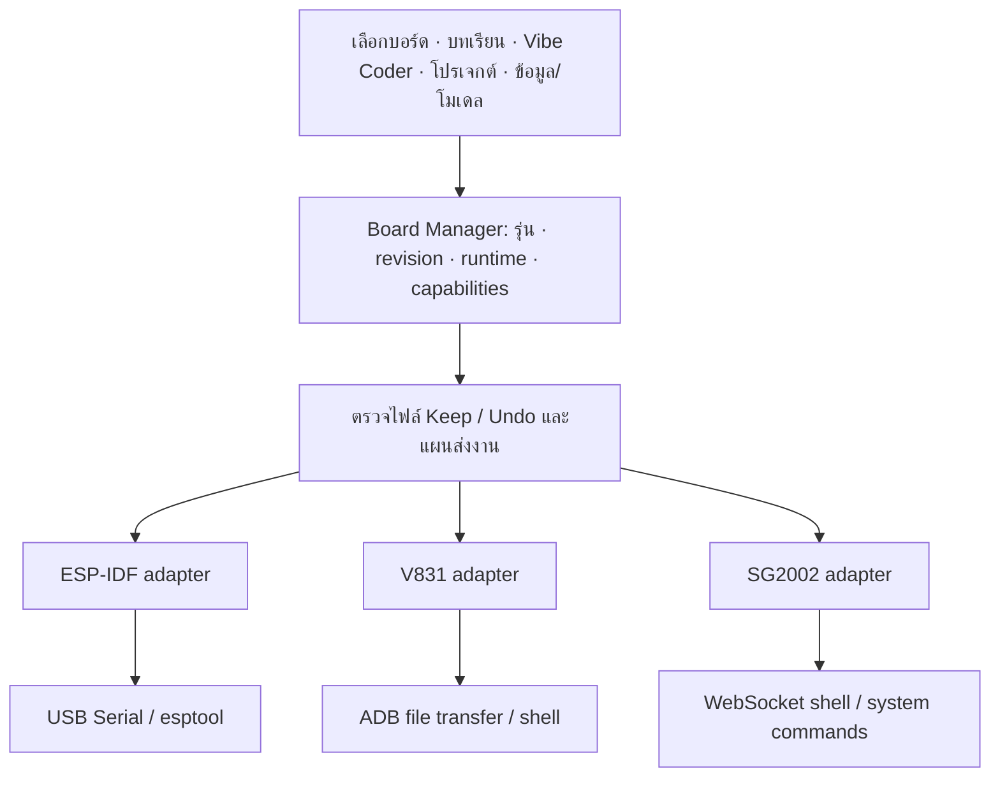

# แผนรวม KidBright32, KidBright μAI และ μAI Plus ใน vibeKidbright

วันที่ 17 ตุลาคม 2026 — Asia/Bangkok

## ข้อเสนอหลัก

ใช้ **หน้าการเรียนและระบบโปรเจกต์เดียวกัน พร้อมตัวเชื่อมต่อเฉพาะบอร์ด 3 กลุ่ม**: KidBright32/ESP-IDF, μAI/V831 และ μAI Plus/SG2002 นักเรียนเลือกชื่อและรูปบอร์ด จากนั้นใช้ปุ่มเชื่อมต่อ–ส่งและรัน–หยุดในตำแหน่งเดิม ระบบเลือกภาษา ไลบรารี การส่งโปรแกรม และโมเดลให้ตรงรุ่น

เอกสารนี้เป็นแบบสำหรับพัฒนาต่อ ยังไม่ได้เปิด deployment ของ μAI/Plus ลำดับเดิมยังคงเป็นทำ KidBright ให้สมบูรณ์ก่อน แล้วพัฒนา μAI/Plus บนโครงสร้างร่วมกัน การเพิ่มชื่อบอร์ดลงเมนูหรือเปิดเว็บ IDE ได้ยังไม่ถือว่ารองรับใช้งานจริง

## สิ่งที่ตรวจพบจริง

อ่านไฟล์ Plus และภาพที่ผู้ใช้ให้ เทียบ [หน้าผู้ผลิต INEX](https://inex.co.th/home/product/kidbright-microai-plus/) และอ่าน JavaScript สาธารณะจาก [IDE ที่ผู้ใช้ระบุ](https://kidbright-mai.web.app/) เป็นข้อความ/AST โดยไม่รันโค้ดนั้น ไม่เชื่อมต่อ IP บอร์ด ไม่เรียก ADB ไม่ส่งไฟล์และไม่เทรนโมเดล

[หลักฐานพร้อม SHA256 และตำแหน่งในซอร์ส](research/mai-integration-2026-10-17/source-evidence.json) และ [สำเนาข้อมูล Plus ที่ผู้ใช้ให้](research/mai-integration-2026-10-17/plus-user-specification.txt) แยกจากคำสั่งของผู้ใช้

ไฟล์เพิ่มล่าสุด: ตรวจคู่มือ Plus89หน้าและZIP4ไฟล์แล้ว ทุกZIPมี `.img`1ไฟล์ ไม่ใช่ซอร์สโฟลเดอร์ตรง ๆ ดู [ผลตรวจคู่มือ/อิมเมจ](KIDBRIGHT_MAI_SUPPLIED_FILES_AUDIT_2026-10-17.md) และ [หลักฐานไฟล์](research/mai-supplied-files-2026-10-17.json) ซึ่งเพิ่มข้อกำหนดการเตรียมOS/Runtimeด้านล่าง

| เรื่อง | สิ่งที่พบ | ผลต่อการออกแบบ |
|---|---|---|
| μAI รุ่น V831 | config `kidbright-mai`, protocol `web-adb`; ใช้ Python และไฟล์บอร์ดแยกชุด | พัฒนา adapter สำหรับ ADB file transfer/shell/stdout โดยเฉพาะ ไม่ใช้ logcat เป็นผลรัน Python |
| μAI Plus | config `kidbright-mai-plus`, protocol `websocket-shell`; handler เปิด `wsShell` ที่ `wss://10.155.55.1:5050` | พัฒนา WebSocket adapter และตรวจเวอร์ชัน/feature ของบริการบอร์ด |
| WebSocket command | มี `__SYSTEM__:` + JSON สำหรับ `version`, `stat`, `listdir`, `upload`, `download`, TCP relay | มี contract ให้เริ่มทดสอบได้ ไม่ต้องเดา REST API หรือใช้ `/upload` ของ training server แทนการส่งไฟล์บอร์ด |
| การส่งไฟล์ Plus | base64 แบ่ง chunk, `wb`/`ab`, รอ `uploaded` ตรง path | ต้องจัดลำดับคำขอ/timeout; client ที่อ่านไม่พบ request ID ใน envelope นี้ จึงไม่ควรยิงคำขอชนกัน |
| USB identification | ทั้งสอง config ระบุ VID=6353, PID=2 | ตรวจ board/runtime เพิ่ม หรือให้เลือกชื่อบอร์ดเมื่อยืนยันอัตโนมัติไม่ได้ ห้ามเลือก Plus จาก VID/PID อย่างเดียว |
| โมเดลภาพ/วัตถุ μAI | model backend `ncnn-int8`, `.bin` + `.param` | เก็บ manifest และ converter/runtime ของ V831 แยก |
| โมเดลเสียง μAI | snapshot เลือก `numpy-fp32`, `.npz` | เสียงต้องมี adapter/preprocessing เพิ่ม ไม่ใช้การส่งโมเดลภาพแทน |
| โมเดล Plus | `cvimodel`, `.cvimodel` + `.mud` | ต้องจับคู่ model metadata และ runtime SG2002 ไม่ส่งไฟล์ V831 แทน |
| เว็บ INEX | `microaithai.com/ide` ส่ง HTML ที่ redirect ด้วย JavaScript ไปเว็บที่ผู้ใช้ให้ | ใช้ URL ผู้ใช้เป็นแหล่งอ้างอิงปัจจุบัน ไม่อาศัยชื่อ URL ตัดสินรุ่น |
| เว็บเดิม V831 | direct request รอบนี้ได้ 404 ที่ URL meca | ต้องตรวจ URL/OS image ปัจจุบัน ไม่สรุปว่าบอร์ดใช้ไม่ได้ เพราะเว็บใหม่ยังมี config ของ μAI |
| ผลข้างเคียงของ client เดิม | connect อาจ sync scripts; ส่วน V831 มีคำสั่งหยุด Python ทุก process หลัง upload | แยก “เชื่อมต่อเพื่อตรวจ” ออกจาก “เตรียม/อัปเดตบอร์ด”; ติดตาม process งานตัวเองและมี Stop เฉพาะงาน |

config ยังมี `wsUrl` port7899 แยกจาก `wsShell`5050 และ camera MJPEG port8000 การพบค่าเหล่านี้ไม่พิสูจน์ว่าทุกบริการเปิดอยู่บน firmware ทุกชุด ต้องตรวจ service/capability ของเครื่องจริง

## ผล GitHub ที่เติมสัญญา implementation

ตรวจซอร์ส IDE/server ที่ตรึง commit เพิ่มแล้วใน [รายงาน GitHub](KIDBRIGHT_MAI_GITHUB_RESEARCH_2026-10-17.md) พร้อม [manifest/hash/API inventory](research/mai-github-reference-2026-10-17.json) ยืนยันโครงสร้าง3board adaptersตามแผน และเพิ่ม TrainingAdapter แยกจาก BoardSession: `/ping` → multipart `/upload` → `/train` → SSE `/listen` → `/convert` → ดาวน์โหลดไฟล์ตามModelFormat การส่งproject.zipให้trainingserverไม่ใช่การส่งPythonเข้าบอร์ด

จุดที่ต้องแก้ใน adapter contract ก่อนเริ่ม classroom: clientเรียก `GET /terminate` แต่serverมี `POST /terminate_training` และใช้joinรอthreadจบ ต้องมีการยกเลิกงานจริงและtimeout; globalstage/reporterต้องมีisolation หรือจำกัดหนึ่งงานต่อserviceinstance; modelmanifestต้องhashครบทุกไฟล์และปฏิเสธunknownformat ไม่คัดลอกsize-only skip/fallback NCNNมาเป็นเกณฑ์ผ่าน

Model matrixยืนยันจากcontrol flow: V831ภาพ/วัตถุNCNNและเสียงNumPyFP32; Plusทุกtaskเป็นcvimodel/mud ทั้งboard/runtime/task/modelTypeต้องตรงกัน คู่มือDrive ServerV2ปี2023ใช้EdgeTPU/TFLite จึงเป็นworkflow referenceเก่า ไม่ใช่หลักฐานว่าบอร์ดPlusใช้โมเดลเหล่านั้น

การมีซอร์สไม่ได้เพิ่มactiveprofileหรือผลทดสอบบอร์ดให้vibeKidbright และต้องตรวจสิทธิ์ก่อนbundleซอร์ส IDEไม่พบLICENSEในsnapshotนี้ ส่วนserverระบุGPL-2.0 รายงานใหม่แยกผลstatic inspectionกับสิ่งที่ยังต้องทดสอบจริงไว้แล้ว

## ฮาร์ดแวร์กำหนดชุดพัฒนา

| ส่วน | KidBright32 | μAI รุ่นข้อมูล V831 | μAI Plus รุ่นข้อมูล SG2002 |
|---|---|---|---|
| ระบบหลัก | ESP32/ESP-IDF ตาม revision ที่ยืนยัน | Allwinner V831, Cortex-A7 800MHz, Linux | SG2002, Linux/RTOS ตาม image ที่ติดตั้ง |
| RAM | ตรวจตามรุ่น/โมดูล | DDR2 64MB ตามเอกสาร | DDR3 256MB ตามไฟล์ผู้ใช้/INEX |
| โค้ดผู้เรียนที่เสนอ | `main/main.c` | `main/main.py` | `main/main.py` |
| จอ | โดยทั่วไป matrix16×8; อนุพันธ์ TFT ต้อง adapter ของตัวเอง | IPS1.3นิ้ว 240×240 | จอสัมผัส2.4นิ้ว; ภาพผู้ใช้ระบุ640×480 ต้องตรวจ driver/framebuffer จริงก่อนกำหนด API |
| การเคลื่อนไหว | แตกต่างรายรุ่น เช่น MC3479, MPU6050 หรือไม่มี | MSA301 หรือเทียบเท่าตามเอกสาร | QMI8658A accelerometer+gyro6แกน |
| กล้อง/เสียง | อุปกรณ์และ resource ตาม profile | OV2685 หรือเทียบเท่า, MEMS, speaker | OV2685 หรือเทียบเท่า, LMA2718T421, AW8010AFCR/speaker |
| ส่วนเพิ่ม Plus | — | — | BM8653 RTC; WiFi6 2.4/5GHz; ผู้ผลิตระบุ NPU1TOPS |
| Deploy | compile/link/flash | ส่งโปรแกรม/ไลบรารี/โมเดลให้ runtime ใน Linux | ส่งโปรแกรม/ไลบรารี/โมเดลให้ runtime SG2002 |

รายละเอียด CPU ในไฟล์ Plus กล่าวถึง ARM A53, C906 และ8051 แต่ไม่ใช้รายการแกนสมองเป็นตัวเลือก compiler อัตโนมัติ ต้องตรวจ ABI/สถาปัตยกรรมของ Linux image และ runtime ที่ใช้งานจริงก่อนเลือก binary/โมเดล ไม่สมมติว่าแกนทุกตัวทำงานเป็น CPU ของแอปพร้อมกัน ดู [ภาพรวมผู้ผลิตโมดูล SG2002](https://wiki.sipeed.com/) ประกอบ โดยไม่ใช้บอร์ด Sipeed แทน pinout ของ KidBright

ชื่อ sensor/library ใน bundle เช่น `msa311.py` หรือ `v831adc.py` ไม่พิสูจน์ว่าเป็นชิปที่ติดตั้งบน Plus ต้องยืนยัน BOM/driver จริง โดยเฉพาะ QMI8658A และ GPIO/ระดับลอจิก ไม่ถือเลข IO2–IO8 เป็นเลข GPIO ของ SG2002

## โครงสร้างโปรแกรมที่แนะนำ



แบ่งความรับผิดชอบเป็น 5 ส่วน:

1. **Board Registry:** ตัวตนบอร์ด, manufacturer/revision, capability, protocol และ version ที่ยอมรับ แยกสถานะ “ข้อมูลอ้างอิง/ทดลอง/ผ่านการทดสอบ” การเลือก KidBright32 ต้องเลือกรุ่นย่อยที่ตรง ไม่ให้ชื่อรวมแปลว่าผ่านทุกรุ่นแล้ว
2. **Device Manager:** อุปกรณ์ที่เสียบ, session, serial/USB identity หรือ network endpoint, การยืนยัน firmware/runtime และสถานะขาดการเชื่อมต่อ เก็บ binding เครื่องจริงในแอป ไม่ผูก serial number ลงโปรเจกต์ที่แจกนักเรียน
3. **Project Service:** สร้าง workspace ตาม family, เก็บบทเรียน/โค้ด/assets/model manifest และ review เดียวกัน ไม่ให้ factory ESP-IDF สร้าง CMake/sdkconfig สำหรับ Python/Linux
4. **Board Adapters ใน Rust backend:** เชื่อมต่อ, read-only probe, ตรวจ environment, ส่งไฟล์, run/stop, stdout/stderr/exit status และ camera/audio preview ตาม capability ใช้ frontend เดียว ไม่พึ่งการรองรับ WebUSB ภายใน WebView เพื่อเริ่ม native adapter
5. **Model Service:** dataset/label/version, training provider, converter และ artifact validation ตามบอร์ด รุ่นของโมเดลและ preprocessing เป็นส่วนของโปรเจกต์ ไม่ใช่เพียง path ไฟล์น้ำหนัก

API ร่วมที่เสนอคือ `discover`, `connect`, `describe`, `planDeploy`, `deploy`, `run`, `stop`, `subscribeOutput`, `disconnect` โดยมี optional `camera`, `microphone`, `modelDeploy` ตาม capability ของรุ่น ชื่อเหล่านี้เป็นแบบที่จะพัฒนา ยังไม่มี implementation ในแอปปัจจุบัน

ADB device ต้องเลือก serial ให้ชัด; Linux shell output ต้องไม่ถูกผูกกับ Android logcat ส่วน WebSocket รักษา TLS ตามอุปกรณ์ที่จับคู่ ไม่ปิดการตรวจ certificate ทั้งแอป และไม่ใช้ URL/IP คงที่แทนตัวตนบอร์ด

## หน้าตาที่ครูและเด็กใช้งาน

### เริ่มบทเรียน

เลือกบอร์ดจากรูปและชื่อ → เลือกบทเรียน → เชื่อมต่อ → แสดงชื่อรุ่นที่ตรวจได้และสถานะพร้อม → แก้โค้ด/สั่ง Vibe Coder → Keep/Undo → ส่งและรัน → ดูผล/หยุด

ข้อมูล ADB, WebSocket, compiler และ ABI อยู่ในหน้ารายละเอียดสำหรับครู ไม่ใช่ตัวเลือกที่เด็กต้องเรียนรู้ก่อนเริ่ม ปุ่มหลักใช้ชื่อเหมือนกัน แต่หน้าความคืบหน้าอธิบายสิ่งที่ทำจริง: ESP32 “คอมไพล์–ส่ง–เริ่มงาน”; Linux “ตรวจ runtime–ส่ง–เริ่มงาน”

### แถบโปรเจกต์

คงแสดงเฉพาะ `main` ตามที่ผู้ใช้ต้องการ C ใช้ `main.c`; Python ใช้ `main.py` ไฟล์ runtime, profile และ config ภายในซ่อนจากแถบโค้ดและเปิดอ่านได้ตามนโยบายเดิม ข้อมูลภาพ/เสียงกับโมเดลแสดงในแท็บ “ข้อมูลและโมเดล” โดยเฉพาะ ไม่ให้แก้ไฟล์กำกับภายในโดยไม่ตั้งใจ

ตัวอย่าง metadata ที่เสนอสำหรับอนาคตใน `.vibekidbright/project.json`:

```json
{
  "schema_version": 2,
  "board_id": "kidbright_uai_plus_sg2002",
  "profile_revision": "pending-verified-release",
  "language": "python",
  "entry_point": "main/main.py",
  "runtime_constraint": "pending-device-probe",
  "models": []
}
```

นี่เป็น schema/ID ที่เสนอ ไม่ใช่ค่าที่ backend ปัจจุบันยอมรับ ตัว profile นี้ยังเปิดใช้งานไม่ได้ จนกว่าจะมี runtime/version และผลทดสอบจริง ต้องมี migration สำหรับโปรเจกต์ C เดิมและ Python validation ที่ไม่บังคับ CMake

### Vibe Coding

AI รับข้อมูลจากโปรเจกต์และบอร์ดที่เชื่อมต่อ: family/revision, ภาษา, runtime, ไลบรารีที่มี, ชื่อพอร์ต, model format และ capabilities สั่ง “แสดงคำว่าสวัสดี” แล้วสร้าง C สำหรับบอร์ด32 หรือ Python ที่ตรง runtime ของ μAI/Plus ไม่เดาชื่อโมดูลหรือ API จากตัวอย่างอีกบอร์ด

บทเรียนร่วมใช้จุดประสงค์เดียวกันได้ แต่ต้องมีโค้ด/ข้อกำหนดของแต่ละบอร์ด เช่น จอ matrix กับ LCD มีข้อจำกัดฟอนต์/ตำแหน่งต่างกัน ไม่มีการรับรองว่าข้อความทุกภาษาจะแสดงบนฮาร์ดแวร์ทุกตัวเพียงเพราะ AI ตอบภาษานั้นได้

### ข้อมูลและโมเดล

หน้าร่วม “เก็บข้อมูล → ติดป้าย → ฝึก → ทดสอบ → ส่งโมเดล” ให้ครูแจกโมเดลที่ฝึกแล้วได้ เก็บ labels ตามลำดับ, input shape/color order, normalization, output schema, class IDs, quantization, compiler/runtime version และ checksum ไว้ด้วยกัน

V831 กับ Plus มี artifact ต่างกัน แม้ชื่อโมเดลคล้ายกันก็ต้องแปลง/ตรวจตาม target แยก ชื่อ YOLOv5/v8 ในเอกสารฮาร์ดแวร์ไม่รับรองว่า IDE snapshot ทุกเวอร์ชันมี model option นั้น: snapshot ที่อ่าน Plus มี yolo11n/yolo11s ส่วน V831 มี slim_yolo_v2 จึงให้ runtime/training adapter ประกาศรายการที่ผ่านจริง

เริ่มจาก **นำเข้าและรันโมเดลที่ตรวจแล้ว** ก่อนฝึกใหม่เต็มระบบ ใช้ training provider ภายนอกที่ตรวจ version/API ได้ต่อมา ไม่เริ่มด้วยการสร้าง training cloud ใหม่หมด Offline สำหรับห้องเรียนเริ่มที่เปิดบทเรียน–แก้–รัน–ใช้โมเดลสำเร็จรูป การฝึกที่ใช้ cloud ต้องแสดงว่าต้องต่ออินเทอร์เน็ต; local teacher server เป็นงานเพิ่มที่ต้องทดสอบ

## การส่งงานและการกู้คืน

- Connect ตรวจแบบ read-only ก่อน แสดง runtime ที่พบ การติดตั้ง/อัปเดต scripts หรือเปลี่ยน boot startup เป็น action “เตรียมบอร์ด” ของครูที่มีรายการไฟล์/เวอร์ชันและผลข้างเคียงให้ตรวจ ไม่แฝงไว้ในการกด Connect
- ก่อนส่ง ตรวจว่า project profile, device และ model format ตรงกัน ใช้ staging เฉพาะงานและตรวจไฟล์ครบก่อนเริ่ม ห้ามใช้แค่ขนาดไฟล์เท่ากันแทน checksum ถ้าบอร์ดยังไม่มีวิธีตรวจความครบให้แสดงข้อจำกัดและเพิ่มการทดสอบก่อนประกาศพร้อม
- แยก “ส่งสำเร็จ”, “runtime เริ่มแล้ว”, “โปรแกรมจบ” และ “error” ไม่แสดงรันสำเร็จเพียงเพราะสั่ง shell ได้
- Stop ส่ง interrupt แล้วจัดการเฉพาะ process/job ที่แอปสร้าง พร้อม timeout/exit status ไม่คัดลอก `killall python3` มาใช้เป็นคำสั่งหยุดทั่วไป
- Keep/Undo เดิมตรวจ source ในเครื่อง ไม่อ้างว่าถอน firmware หรือคืนผลบนอุปกรณ์ได้ย้อนหลังทั้งหมด การย้อน deployment ต้องมีเวอร์ชันก่อนหน้าและ restore flow แยก
- ถอดสาย/รีเซ็ต/ส่งไฟล์ขาดต้องเก็บต้นฉบับผู้เรียนและ retry ได้ ให้กลับมาเชื่อมต่อโดยไม่สร้างหรือเขียนทับโปรเจกต์เดิม

## การใช้งานในห้องเรียน

### เตรียมบอร์ดและจัดการอิมเมจของครู

เพิ่มImage Libraryที่รับไฟล์ในเครื่องหรือดาวน์โหลดเฉพาะรุ่นตามที่ครูเลือก ไม่bundleZIPทั้งหมด31GBลงinstaller และไม่แสดงimageในแถบmainของเด็ก ต้องเก็บtargetที่ยืนยัน, provenance, SHA256, compressed/expanded sizesและreleaseแยกจากprojectsource

คู่มือที่ผู้ใช้ให้แยกการลงOSกับInstall Runtime ภาพตัวอย่างแสดงMaixPy4.12.5และRuntime1.24.0 ซึ่งเป็นคนละversionกับimage releaseและwebsocket service จึงให้wizardตรวจทีละขั้น: การ์ด/OS → boot → USB network → transport → Runtime → Hello/Camera การเขียนการ์ดกับการส่งmain.pyเป็นคนละoperation

การเขียนการ์ดในอนาคตต้องเลือกและทบทวนอุปกรณ์ปลายทางจริงก่อนทำงาน ตรวจความจุเป็นbytesและอธิบายข้อมูลที่จะถูกแทนที่ ไม่รวมในConnectหรือปุ่มRunปกติ ส่วนJaxBot/NanoPi/RSPที่แนบเป็นreferenceimages ไม่เพิ่มเป็นV831หรือPlusprofileจากชื่อไฟล์

ตรวจ filesystem ของ RSP เพิ่มแล้วพบ Raspbian10/ARM32 พร้อม PM2 → Node/Express และ Python/Flask/ROS มีซอร์ส route สำหรับสร้างโปรเจกต์ รัน หยุด และ training/inference จึงใช้เปรียบเทียบ workflow ได้ แต่ยังไม่ได้ทดสอบ service, ตรวจ license ครบ หรือพิสูจน์ว่า API/โมเดลใช้ข้าม μAI/Plus ได้ หากจะรองรับตระกูลนี้เพิ่ม ให้มี adapter และ compatibility tests ของตัวเอง ดู [ผลตรวจอิมเมจ](KIDBRIGHT_MAI_SUPPLIED_FILES_AUDIT_2026-10-17.md)

NanoPi มี2Linux partitions; filesystem แรกที่อ่านเป็น Ubuntu18.04.2/ARM64 ขณะที่ RSP เป็น ARM32 พาร์ทิชันข้อมูล NanoPi มีโครงสร้าง `kbclientNew` และ PM2 dump ระบุ Node/Python entrypoints คล้าย RSP แต่ยังไม่ได้ตรวจเนื้อหา entrypoints/manifest ของ NanoPi ว่าเท่ากัน ดังนั้น Image Library ต้องเก็บหลักฐานแยกตามpartitionและABI ไม่กำหนด compatibility จากคำว่า Linux หรือชื่อไฟล์เพียงอย่างเดียว ยังต้องยืนยัน active root และฮาร์ดแวร์เป้าหมายก่อนเปิด deployment

### แจกบทเรียนและใช้งานประจำวัน

ครูเตรียม driver/board image/runtime และดาวน์โหลดบทเรียนไว้ครั้งเดียว แจก lesson package ที่มี main/assets/model manifest โดยไม่พกข้อมูลส่วนตัวหรือ device serial ของครูไปด้วย มีคำแนะนำเสียบ USB-OTG ให้ตรงกับรูปบอร์ด

เริ่มรองรับหนึ่งบอร์ด Linux ที่ทำงานต่อ session และเลือกอุปกรณ์อย่างชัดเจน เมื่อขยายหลายบอร์ดต่อคอมพิวเตอร์ ต้องทดสอบ routing แยก interface เพราะ Plus ใช้ default IP เดียวกัน การเสียบหลายเครื่องพร้อมกันยังไม่รับรองว่าจะระบุได้จาก IP นี้

เครื่องนักเรียนหนึ่งเครื่องต่อหนึ่งบอร์ดไม่ควรบังคับให้ติดตั้ง full Linux cross-SDK หากส่ง Python ไปยัง runtime ที่มีอยู่ได้ ส่วนเครื่องครูมีหน้าวินิจฉัยเวอร์ชันและ export log ของงานจริง ไม่ทำให้เด็กต้องแก้ไฟล์ระบบบอร์ดเอง

## ทางเลือกและเหตุผล

| วิธี | สิ่งที่ได้ | ขอบเขต/การเลือก |
|---|---|---|
| ปุ่มเปิดเว็บทางการ | ใช้งาน IDE เดิมเป็นทางผ่านและเทียบพฤติกรรม | ยังเป็นอีกหน้าต่าง ไม่ถือว่ารวม workflow โปรเจกต์/AI/Keep/Undo แล้ว |
| ฝังเว็บด้วย iframe/webview | อาจแสดง UI เดิมในหน้าต่างเดียว | ต้องพิสูจน์ WebUSB, origin, certificate, CSP, file exchange และสิทธิ์ remote content ก่อน ไม่ถือว่าใส่ iframe แล้ว upload ได้ทันที |
| UI ร่วม + native board adapters | workflow สอนเดียวกัน ผูกโค้ด/โมเดล/ผลรันกับโปรเจกต์ได้ตรง | **แนวหลักที่แนะนำ** เริ่มจาก reuse protocol/runtime ที่ตรวจได้ แล้วพอร์ตความสามารถทีละชุด |
| ย้ายทั้ง IDE ต้นฉบับมา bundle | ควบคุมเวอร์ชัน/offline ได้มากขึ้นเมื่อทำสำเร็จ | ต้องได้ source/license/dependencies และทดสอบครบก่อน ไม่สมมติว่าเว็บสาธารณะอนุญาตให้คัดลอกแจกได้ทันที |

ปัจจุบัน CSP ของแอปจำกัด `default-src 'self'` และ capabilities ผูกหน้าต่างหลัก [ข้อกำหนด Tauri](https://v2.tauri.app/security/capabilities/) ต้องออกแบบการแยก remote webview ก่อนให้สิทธิ์ใด ๆ การตรวจรอบนี้ยังไม่ได้พิสูจน์การฝังเว็บหรือสิทธิ์ WebUSB ใน WebView ของเครื่องเป้าหมาย

## ลำดับการลงมือและเกณฑ์ผ่าน

| ระยะ | งานที่ส่งมอบ | เกณฑ์ผ่าน |
|---|---|---|
| 0 — ฐาน KidBright32 | รุ่น/revision ที่ยืนยัน, driver/block contracts, project review/build และบทเรียนพื้นฐาน | ผลทดสอบต่อบอร์ดจริงตามขอบเขต; catalogue ทุกรุ่นไม่เท่ากับพร้อมทุกตัว ดูรายงานปัจจุบันประกอบ |
| 1 — Board Manager ร่วม | registry/session/project factory แยก3family และสถานะรายรุ่น | โปรเจกต์เดิมเปิดได้, เลือกผิดรุ่นไม่ส่งงาน, โหลด profile/Python ไม่ผ่าน ESP-IDF |
| 2 — Basic Linux adapter | V831 ADB และ Plus WSS, Python Hello, upload/run/stop/console | ทดสอบทั้งสองบอร์ดจริง: outputถูก, exit/errorถูก, ถอดเสียบใหม่, runtime mismatch และส่งไฟล์ขาด |
| 3 — บทเรียนอุปกรณ์ | จอ ปุ่ม กล้อง เสียง IMU I/O/I2C/UART ตามรุ่น | เห็นผล/อ่านค่าจริงและเทียบ reference; IO mappingถูก ไม่มี driver stub ที่พิมพ์ log อย่างเดียว |
| 4 — AI inference | import model ที่ผ่าน target, preview และผล classification/detection/voice | label/preprocessingตรง; รูป/เสียงชุดเดียวเทียบ reference, latency/RAMวัดจริง; modelผิดtargetถูกปฏิเสธ |
| 5 — ห้องเรียน/ฝึกโมเดล | lesson package, dataset/training provider, offline import, image/runtime recovery | เครื่องสะอาดติดตั้งได้; ครูสอนได้โดยไม่แก้ไฟล์ระบบ; เก็บข้อมูล/โมเดลกลับมาเปิดต่อได้ |

ผลต้องมี board revision, Linux image/runtime, source/model hash, log และสิ่งที่ผู้ทดสอบสังเกตจริง แยกจาก unit test/mock การเรียก training/LLM ภายนอกเป็นงานภายหลังที่มีค่าใช้จ่าย/ข้อมูลส่งออกตาม provider ไม่ถูกนับว่ารันจริงจากการอ่านซอร์ส

## ไฟล์ปัจจุบันที่ต้องแยกหน้าที่เมื่อเริ่ม implementation

| ไฟล์/ส่วน | สิ่งที่จะปรับ |
|---|---|
| `src/buildFlash.ts` | ย้าย policy ไป registry/action ตาม family โดยคง guard ไม่ส่ง Linux เข้า ESP-IDF |
| `src/App.tsx` | แยก board selection/device session ออกจาก Serial/ADB และแชร์หน้าความคืบหน้า |
| `src-tauri/src/esp_idf.rs` | คงส่วน ESP32; แยก ADB/Linux console ออก; เพิ่ม module transport แยกเมื่อเริ่มระยะ2 |
| `src-tauri/src/ai/compatibility.rs` และ `providers.rs` | tool/profile schema ใช้ registry; ไม่เพิ่ม enum ที่ดูรองรับแล้วโดยไม่มี adapter |
| `src-tauri/src/ai/tools.rs` | project factory/เขียนไฟล์/review แยก C กับ Python และไม่สร้าง CMake ให้ Linux |
| `system_prompt.txt` / support scope | รับ context ที่ตรวจแล้วรายโปรเจกต์ ไม่ใช้ prompt เดียวบังคับทุกบอร์ดเป็น ESP-IDF C |
| Project sidebar/editor | คง main-only, รองรับ Python/import ที่ถูกต้อง; assets/model ใช้แท็บเฉพาะ |

ข้อมูล Plus นี้จึงช่วยวางโครงสร้างที่จะใช้งานจริงได้ ส่วนถัดไปที่ต้องพิสูจน์คือการคุยกับ runtime บน **บอร์ดสองรุ่นจริง** ไม่ใช่เพิ่มชื่อบอร์ดหรือเพิ่มข้อความใน prompt อย่างเดียว
