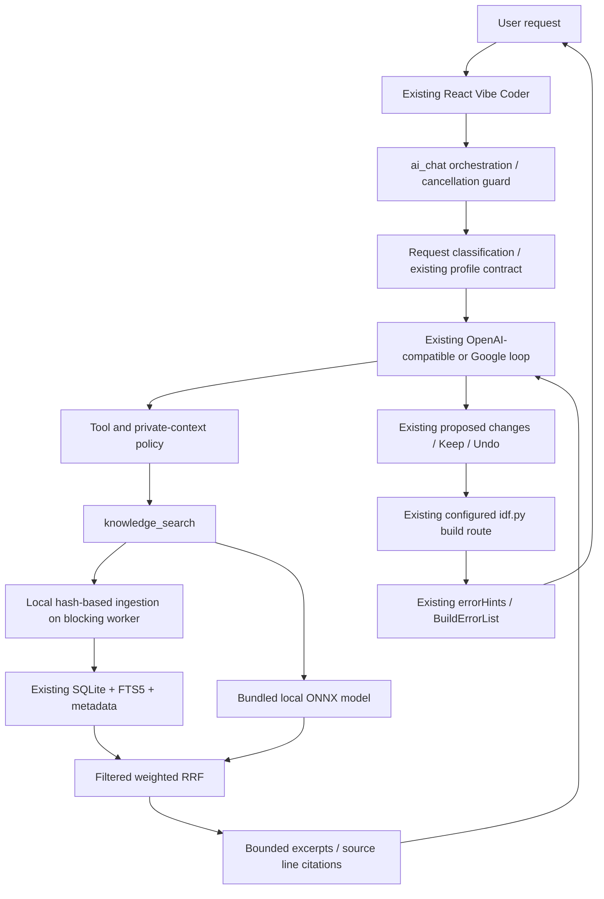

# Architecture and data flow

This increment implements the local knowledge foundation and integrates it into existing Vibe Coder. It does not implement the complete compiler auto-fix/product roadmap.

## Module responsibilities

- `intelligence/retrieval.rs`: source discovery, content fingerprints, per-file transactions, embedding cache, provenance, filters, BM25, RRF, result budgets.
- `intelligence/chunking.rs`: exact-byte paragraphs, pinned Tree-sitter C units/subchunks and an explicit lexical fallback. Syntax is not semantic identity.
- `intelligence/evaluation.rs`, `examples/knowledge_eval.rs`: deterministic metric formulas and a real-corpus runner with optional real local inference.
- `ai/kb.rs`: Tauri configuration commands and blocking-worker adapter. Existing `knowledge_search` tool result remains an array with additional metadata.
- `ai/orchestration.rs`: heuristic task selection from latest user prose; no source instructions copied into the system prompt.
- `ai/privacy.rs`: explicit private-context export consent, loopback detection, immutable public-source hashes, initial remote-history isolation.
- Existing modules keep ownership of providers, credential management, project review, editor, and SDK process setup.

## Failure behavior

Invalid configuration, UTF-8, corrupt database/metadata and unsupported schema return errors; original sources are not deleted. A source replacement commits atomically. Completed source transactions remain after cancellation. Embedding failure leaves lexical search available and is retried on the next ingestion. Cancellation is checked between files/batches; an ONNX inference already executing is not forcibly interrupted.

Vector and FTS work run on a blocking worker, not the React thread or an async executor worker. No retrieval network service is introduced. Query caching was removed to avoid stale/cross-workspace answers; changed-source and content-addressed embedding caches remain persistent.

## Boundaries

Only retrieval excerpts have a new character budget; the complete conversation/system prompt is not covered by a unified tokenizer budget. Request classification is a routing hint, not intent recognition certification. Durable revision-bound review and compiler repair are implemented; private project syntax indexing is separate from the KB. The unreleased editor has optional request-scoped local semantic navigation with exact SDK compile commands and syntax fallback; its native/UI probes are separate from desktop IPC qualification. Build success is separate from physical-board behavior.

## Safety and code intelligence increment (2026-10-18)

The existing provider/tool flow now also connects `intelligence/project.rs` (private per-project syntax index), `diagnostics.rs` (typed build evidence), `block_to_c.rs` (four-ID typed converter), `ai/change_journal.rs` (file recovery), `ai/project_review.rs` (created-tree recovery), `ai/repair.rs` (separate per-attempt authorization), and `sdk_process.rs` (workspace exclusion and bounded process trees). These reuse the existing Engine, reference core, editor diff and configured SDK route. No external retrieval/index server or runtime candidate-model service is introduced.
