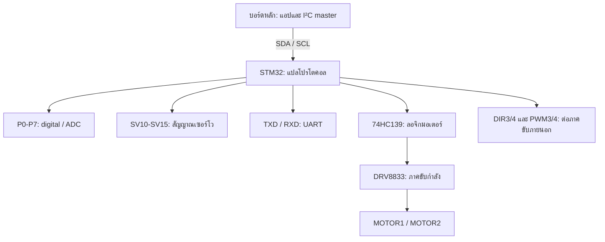
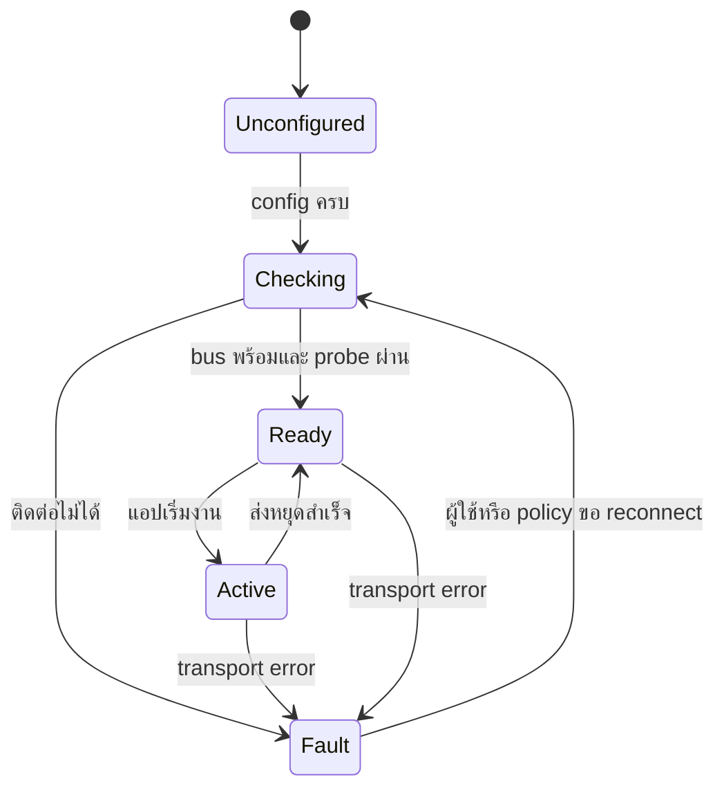

# iKB-1Z AI Coding Handbook: โครงสร้างวงจร โปรโตคอล และกฎพัฒนาโปรแกรม

ฉบับขยาย v2 | จัดทำจากเอกสารที่แนบ วันที่ 27 ตุลาคม 2569

> ใช้ไฟล์นี้เป็นข้อมูลอ้างอิงและกฎให้ AI/Codex พัฒนาโปรแกรมควบคุม iKB-1Z ได้ โดยต้องอ่านข้อจำกัดท้ายไฟล์ก่อนสร้างไดรเวอร์ เอกสารนี้เป็นการวิเคราะห์เอกสาร ไม่ใช่ผลทดสอบกับบอร์ดจริง

## 0. อ่านส่วนนี้ก่อนเริ่มเขียนโค้ด

### 0.1 บทบาทของ AI

คุณคือผู้พัฒนาซอฟต์แวร์ embedded ของ **บอร์ดหลักที่สั่ง iKB-1Z ผ่าน I²C** งานปกติคืออ่านโครงการเดิม ออกแบบแอป เพิ่มหรือปรับไดรเวอร์ และตรวจสอบการเข้ารหัสคำสั่ง ไม่ใช่เขียนเฟิร์มแวร์ STM32 ใหม่ เว้นแต่ผู้ใช้ระบุงานนั้นโดยตรง

คำว่า “ไวบ์โค้ด/vibe coding” ในเอกสารนี้หมายถึงผู้ใช้บอกพฤติกรรมที่ต้องการ แล้ว AI แปลงเป็นข้อกำหนดและโค้ดที่ตรวจได้ ไม่ใช่เดาฮาร์ดแวร์ให้โค้ดคอมไพล์ผ่าน

AI ต้องแยก 4 ขอบเขตเสมอ:

| ขอบเขต | ตัวอย่าง | เจ้าของการทำงาน |
|---|---|---|
| พฤติกรรมแอป | กดปุ่มแล้วหมุนมอเตอร์ตามเวลา | โปรแกรมบนบอร์ดหลัก |
| การสื่อสาร | ส่ง command/parameter และอ่าน response | ไดรเวอร์กับ I²C controller ของบอร์ดหลัก |
| การแปลคำสั่ง | เลือกช่อง ตั้งโหมด สร้างสัญญาณควบคุม | เฟิร์มแวร์ STM32 บน iKB-1Z |
| การจ่ายกำลัง/การเคลื่อนที่ | แรงดัน กระแส ทิศทาง การติดขัด | ภาคขับ แหล่งจ่าย และอุปกรณ์จริง |

### 0.2 วิธีอ่านไฟล์นี้ตามงาน

| งาน | ส่วนที่ต้องอ่าน |
|---|---|
| ทำความเข้าใจบอร์ด | 1-3, 16-17 |
| เขียน transport/ไดรเวอร์ | 4-10, 18-22 |
| ต่อกับ KidBright/ESP-IDF | 10, 17, 23-24 |
| เขียนคำสั่งให้ AI | 0, 25-26 |
| ทดสอบ/แก้บั๊ก/ตรวจรับ | 12-13, 21, 27-29 |

### 0.3 ความหมายของข้อกำหนด

- **MUST / ต้อง:** เงื่อนไขบังคับเพื่อไม่ให้ตีความฮาร์ดแวร์หรือโปรโตคอลผิด
- **MUST NOT / ห้าม:** พฤติกรรมที่ไม่ควรสร้างในโค้ด
- **SHOULD / ควร:** แนวทางออกแบบที่เปลี่ยนได้เมื่อมีเหตุผลและระบุไว้
- **PROJECT POLICY / นโยบายโครงการ:** ค่าหรือพฤติกรรมที่แอปเลือกเอง ไม่ใช่สเปก iKB-1Z
- **UNVERIFIED / ยังไม่ยืนยัน:** ต้องมีหลักฐานเพิ่มก่อนเปิดใช้ฟังก์ชันนั้นจริง

เมื่อหลักฐานขัดกัน ให้บันทึกความขัดแย้ง ตรวจ revision ของบอร์ด และเลือกใช้เฉพาะความสามารถที่มีหลักฐานรองรับ ห้ามทำให้ข้อมูลขัดกันหายไปด้วยการเลือกค่าที่สะดวกต่อโค้ด

### 0.4 สิ่งที่ AI ต้องทำก่อนแก้โค้ด

1. อ่านกฎของ repository และสำรวจโครงสร้างจริงก่อนเสนอชื่อไฟล์ใหม่
2. ระบุรุ่นบอร์ดหลัก framework เวอร์ชัน SDK และวิธี build จากไฟล์โครงการ
3. หาโค้ด I²C เดิม ผู้เป็นเจ้าของบัส ขาที่ใช้ อุปกรณ์ร่วมบัส และ address ที่ตั้งไว้
4. ทำรายการอุปกรณ์ต่อจริง: ปุ่มอยู่บอร์ดไหน มอเตอร์เสียบช่องไหน เซนเซอร์ชนิดใด แหล่งจ่ายมาจากไหน
5. สร้างตารางความต้องการ → อุปกรณ์ → API → command → หลักฐาน
6. แยกข้อมูลที่หาได้ในโครงการออกจากข้อมูลฮาร์ดแวร์ที่ผู้ใช้ยังไม่ระบุ
7. ถ้าข้อมูลหายแต่ไม่ขวางงาน ให้ทำ encoder/transport interface/test ที่ไม่ต้องเดาขาไปก่อน
8. หากการต่อฮาร์ดแวร์ที่หายไปขวางการทำงานจริง ให้ระบุช่องว่างเฉพาะจุด ห้ามสร้างเลข GPIO สมมติแล้วแสดงเป็นค่าพร้อมใช้

### 0.5 ข้อมูลขั้นต่ำที่ต้องมีในบริบทโครงการ

```yaml
# Template สำหรับกรอก ไม่ใช่ไฟล์ตั้งค่าพร้อมรัน
project_context:
  host_board_exact_model: null
  framework_and_version: null
  build_command: null
  i2c_bus_owner: null
  i2c_sda_gpio: null
  i2c_scl_gpio: null
  i2c_address_7bit: null  # 0x48 หรือ 0x49 ตามจัมเปอร์
  i2c_clock_hz: null     # นโยบายโครงการ ต้องตรวจ SDK/บัสจริง
  ikb_board_revision: "200425 in supplied schematic; verify physical board"
  power_source_and_voltage: null
  motors_connected: []
  servos_connected: []
  sensors_connected: []
  buttons_on_host: []
  existing_i2c_devices: []
  hardware_test_available: false
```

ห้ามนำ null ไปแทนด้วยเลข 0 แล้วเรียกว่า configuration สำเร็จ โดยเฉพาะ GPIO 0 อาจเป็นขาจริงที่มีหน้าที่อื่น

## 1. ขอบเขตและหลักฐาน

แหล่งข้อมูลหลักคือ `CamScanner 27-10-2026 13.57.pdf` จำนวน 2 หน้า:

- หน้า PDF 1 / เลขหน้าต้นฉบับ 4: รูปที่ 3 ตารางโปรโตคอล หัวข้อ 5 ใช้ชื่อ iKB-1 และคำบรรยายรูปใช้ iKB-1Z
- หน้า PDF 2 / เลขหน้าต้นฉบับ 5: รูปที่ 4 วงจร iKB-1Z ระบุ `Rev. 200425`

การอ้างอิงในไฟล์นี้ใช้ `[P1]` และ `[P2]` ตามหน้าของ PDF ข้างต้น ส่วน `[W1]` และ `[W2]` เป็นข้อมูลผู้ผลิตสำหรับตรวจสอบเสริม ดูลิงก์ท้ายไฟล์

สถานะข้อมูลแบ่งเป็น:

- **ยืนยันจากเอกสาร:** ชื่ออุปกรณ์ เส้นทางสัญญาณ และค่าที่พิมพ์ไว้
- **ตีความจากวงจร/รูปแบบบิต:** อธิบายหลักการหรือคำนวณไบต์จากตาราง ต้องตรวจสอบเมื่อใช้งานจริง
- **ยังไม่ระบุ:** ห้ามให้ AI เติมค่าขึ้นเองแล้วอ้างว่าเป็นสเปกของบอร์ด

## 2. ภาพรวม: บอร์ดนี้ทำอะไร

iKB-1Z เป็นบอร์ดขยายอินพุต/เอาต์พุตผ่าน I²C มีไมโครคอนโทรลเลอร์ STM32 ของตัวเอง บอร์ดหลัก เช่น KidBright ส่งคำสั่งไปทาง SDA/SCL แล้วเฟิร์มแวร์บน iKB-1Z จึงอ่านเซนเซอร์ ตั้งค่าพอร์ต หรือควบคุมเอาต์พุต [P1, P2]

โครงสร้างแบ่งเป็น 3 ชั้น:

1. **บอร์ดหลัก:** รันโปรแกรมของผู้ใช้ เป็น I²C master และกำหนดพฤติกรรมของระบบ
2. **iKB-1Z:** เป็น I²C slave แปล command/parameter แล้วควบคุมฮาร์ดแวร์
3. **อุปกรณ์ภายนอก:** เซนเซอร์ มอเตอร์ DC เซอร์โว และอุปกรณ์ UART

ตัวอย่าง: บอร์ดหลักส่ง `[0x21, 0x32]` ไปยัง address ของ iKB-1Z → เฟิร์มแวร์เลือก M1 และกำหนด speed +50 → ภาคขับจ่ายกำลังให้มอเตอร์ ตัวอย่างนี้เป็นการถอดความตารางคำสั่ง ไม่ใช่ผลทดสอบ [P1]

### 2.1 ความสามารถหลัก

| ส่วน | จำนวน/ขอบเขต | การใช้งาน |
|---|---|---|
| I/O อเนกประสงค์ | P0-P7 รวม 8 ช่อง | Digital input/output, input pull-up, analog input |
| ADC ผ่านโปรโตคอล | 8 บิต, เปอร์เซ็นต์, 10 บิต | อ่านเซนเซอร์แอนะล็อก |
| มอเตอร์ DC บนบอร์ด | MOTOR1 และ MOTOR2 | ปรับความเร็วแบบมีเครื่องหมาย เพื่อเลือกทิศทาง |
| Servo output | SV10-SV15 รวม 6 ช่อง | ส่งค่าตำแหน่งหรือปล่อย free |
| จุดต่อขับมอเตอร์ภายนอก | DIR3, DIR4, PWM3, PWM4 | ต้องมีวงจรขับกำลังเพิ่มเติม และมีทรัพยากรร่วมกับเซอร์โว [W1] |
| UART | TXD และ RXD | สะพานสื่อสาร UART ที่สั่งผ่าน I²C |
| I²C connectors | KB-CHAIN และ GROVE | จุดเชื่อมต่อบัส ไม่ได้หมายถึงมี slave คนละตัว |
| SWD | +3V3, SWCLK, GND, SWD | งานโปรแกรม/ดีบัก MCU บนบอร์ด |

ไม่มีหลักฐานในวงจรนี้ว่ามี Wi-Fi, Bluetooth, LED matrix, ปุ่ม SW1/SW2 สำหรับแอป หรือระบบวัดรอบมอเตอร์ในตัว ปุ่มที่เห็นคือ S1 RESET และ S2 POWER [P2]

## 3. วิเคราะห์โครงสร้างวงจร

### 3.1 หน่วยควบคุมกลาง

- MCU ระบุ `STM32F103C6T6` และข้อความ `IKB-1z Firmware` [P2]
- คริสตัล CR1 ระบุ 8 MHz เป็นแหล่งสัญญาณนาฬิกาภายนอก ไม่ได้แปลว่าความเร็ว CPU สุดท้ายต้องเป็น 8 MHz
- ไฟเลี้ยงลอจิกอยู่บนราง +3V3
- มีวงจร reset, จุด BOOT และจุด SWD สำหรับงานกับ MCU
- เลข 1-48 รอบสัญลักษณ์ MCU เป็นเลขขาแพ็กเกจ ไม่ใช่เลข GPIO ของ KidBright/ESP32
- ชื่อ P0-P7, PWM1-PWM4, DIR1-DIR4 และ SV10-SV15 เป็นชื่อสัญญาณในวงจร ห้ามแปลงเป็นเลข GPIO บอร์ดหลักโดยตรง

การใช้งานทั่วไปให้เขียนแอปบนบอร์ดหลักแล้วสั่งผ่าน I²C ไม่จำเป็นต้องแทนที่เฟิร์มแวร์ STM32 ของ iKB-1Z

### 3.2 ภาคจ่ายไฟ

วงจรแสดงทางเข้า K17 `Vin 7 to 9V Adaptor Input` ผ่าน S2 POWER และ Q1 FDS6675 แล้วไปยังภาคแปลงไฟ [P2]

| ชุดอุปกรณ์ | หน้าที่จากการอ่านวงจร |
|---|---|
| K17, S2 | ทางเข้าแหล่งจ่ายภายนอกและสวิตช์ไฟ |
| Q1 FDS6675 | อุปกรณ์ MOSFET ในทางเข้าไฟ; บทบาทป้องกันต้องตรวจร่วมกับการต่อจริง |
| IC2 278R05, Q2 2SB772, R11 | ภาคจ่ายไฟ +5V พร้อมทรานซิสเตอร์ช่วยในทางจ่ายไฟ |
| IC3 278R33 | ภาคจ่ายไฟ +3V3 |
| C7-C11 และตัวเก็บประจุใกล้โหลด | กรอง/พยุงไฟและลดสัญญาณรบกวน |
| LED1 ON | แสดงว่าราง +3V3 มีไฟ ไม่ใช่หลักฐานว่าระบบสื่อสารปกติ |
| D1 1N5819, ZD1 5V6 | ส่วนเชื่อมต่อ/ป้องกันในเส้นทางไฟ KB-CHAIN ตามวงจร |

ข้อแตกต่างที่ต้องบันทึก: [P2] ระบุที่แจ็ก 7-9V ขณะที่หน้าสินค้า [W1] ระบุแหล่งจ่ายเสริมสำหรับมอเตอร์ 6-9V 1A จึงควรใช้ช่วงร่วม 7-9V เป็นค่าตั้งต้นสำหรับบอร์ดตามแผ่นนี้ และตรวจคู่มือของบอร์ดจริงก่อนใช้ค่าที่ต่างออกไป

ห้ามสรุปว่ากระแสสูงสุดของทั้งระบบเท่ากับค่าพิกัด IC ตัวใดตัวหนึ่ง หรือว่าเสียบไฟจากบอร์ดหลักแล้วจะขับมอเตอร์/เซอร์โวทุกตัวได้เพียงพอ ต้องคิดภาระโหลด กระแสเริ่มหมุน และความร้อนร่วมด้วย

### 3.3 I²C และการเลือก address

| จุดต่อ | สัญญาณที่ระบุในรูป |
|---|---|
| K1 KB-CHAIN | +V, +3V3, SCL, SDA, GND |
| K2 I2C-GROVE | SCL, SDA, +3V3, GND |

ลำดับในตารางถอดจากแผนผัง ไม่ใช่คำแนะนำให้เสียบสายตามซ้าย/ขวาของภาพถ่าย ต้องตรวจทิศทางคอนเน็กเตอร์และสกรีนบอร์ดจริง

R1 และ R2 ระบุ 2k2 เป็น pull-up ของเส้นบัสไป +3V3 [P2] เมื่อรวมบอร์ดหลายตัวต้องพิจารณาค่า pull-up รวม ไม่เพิ่มตัวต้านทานโดยอัตโนมัติ

| ADDR SELECT | I²C address แบบ 7 บิต |
|---|---|
| CLOSE / ต่อจัมเปอร์ | `0x48` |
| OPEN / เปิดจัมเปอร์ | `0x49` |

SDA/SCL ของทั้งสองคอนเน็กเตอร์เชื่อมไปบัสเดียวกัน จึงเป็นทางเลือกการต่อสาย ไม่ใช่สอง I²C address แยกกัน [P2]

### 3.4 พอร์ต P0-P7

P0-P7 ต่อออกคอนเน็กเตอร์เซนเซอร์ 3 ขา แต่ละช่องมีสายสัญญาณ +3V3 และ GND [P2]

| ช่อง I/O | จุดต่อในรูป |
|---|---|
| P0 | K3 |
| P1 | K4 บริเวณกลุ่มเซนเซอร์ |
| P2 | K5 |
| P3 | K6 |
| P4 | K7 |
| P5 | K8 |
| P6 | K9 |
| P7 | K10 |

ภาพมี reference `K4` ซ้ำกับหัวต่อ SWD จึงควรอ้างชื่อฟังก์ชันและตำแหน่งร่วมด้วย ไม่ใช้ชื่อ K4 เพียงอย่างเดียวในการสั่งต่อสาย

โหมดของช่องเดียวกันเปลี่ยนตามคำสั่ง: output low/high, input, input pull-up, ADC8 หรือ ADC% [P1] ห้ามต่อเอาต์พุตของอุปกรณ์อื่นชนกับช่องที่ตั้งเป็น output

### 3.5 ภาคมอเตอร์ DC

เส้นทางการทำงานคือ STM32 → สัญญาณ DIR/PWM → IC4 74HC139 → IC5 DRV8833 → MOTOR1/MOTOR2 [P2]

- 74HC139 ช่วยแปลงลอจิกควบคุมก่อนเข้าภาคขับ ไม่ใช่อุปกรณ์จ่ายกระแสมอเตอร์
- DRV8833 เป็นภาคขับสองชุด มีขา OUT1A/OUT1B และ OUT2A/OUT2B
- MOTOR1 ใช้ K18A/K18B และ MOTOR2 ใช้ K19A/K19B เป็นจุดต่อของเอาต์พุตแต่ละชุด ไม่ใช่มอเตอร์ 4 ช่องอิสระ
- LED2 M1 และ LED3 M2 เป็นส่วนแสดงผลของทางมอเตอร์
- วงจรมี R16/R17 ค่า 0R18 ที่ขา ILIM ต้องใช้ข้อมูลอุปกรณ์เพิ่มเติมก่อนคำนวณกระแสจำกัด
- โปรโตคอลมี M1-M4 แต่ภาคขับในรูปมีเพียง M1/M2 ส่วน DIR3/4 และ PWM3/4 เป็นจุดต่อไปภาคขับภายนอก

การสั่ง speed เป็นการกำหนดค่าควบคุมกำลัง/ทิศทาง ไม่ได้ยืนยัน RPM จริง ค่า `last speed` เป็นค่าคำสั่งล่าสุด ไม่ใช่ข้อมูล encoder [P1, P2]

### 3.6 เซอร์โวและทรัพยากรที่ใช้ร่วมกัน

มีหัวต่อ SV10-SV15 รวม 6 ช่อง รางไฟเซอร์โว +5V และ GND พร้อมสายสัญญาณจาก STM32 [P2]

จุด DIR3, DIR4, PWM3, PWM4 สำหรับภาคขับมอเตอร์เพิ่มเติมใช้ทรัพยากรร่วมกับขาเซอร์โว [W1] ดังนั้นซอฟต์แวร์ต้องมีแนวคิดการจองทรัพยากร และห้ามถือว่าใช้งานมอเตอร์ 4 ช่องกับเซอร์โว 6 ช่องได้อิสระพร้อมกันทุกกรณี การจับคู่ที่แน่นอนของขาที่ซ้ำและเงื่อนไขสลับโหมดต้องตรวจต้นฉบับคมชัด/เฟิร์มแวร์ก่อนเปิดใช้ในไดรเวอร์

ค่า servo `0..200` ในตารางเรียกว่า **scaled angle** จึงไม่ควรรับรองว่า 200 เท่ากับมุมกายภาพ 200 องศา หรือตีความเป็นความกว้างพัลส์ไมโครวินาทีโดยไม่มีข้อมูลเพิ่ม [P1]

### 3.7 UART, RESET และ SWD

- K15 TXD และ K16 RXD ต่อกับ STM32 และมี pull-up ไป +3V3 [P2]
- เป็นจุดสัญญาณ UART ลอจิก ไม่พบวงจรแปลง RS-232 ในแผ่นนี้ ห้ามต่อ RS-232 โดยตรง
- UART ของ iKB-1Z กับ UART สำหรับ log ของบอร์ดหลักเป็นคนละส่วน การใช้ `ESP_LOGI` ไม่ได้หมายถึงส่งข้อมูลออก K15
- S1 RESET เป็นปุ่ม reset ของ iKB-1Z ไม่ใช่ปุ่ม SW1/SW2 บน KidBright
- SWD เป็นงานแฟลช/ดีบัก MCU; ไม่ใช้เป็น I²C และไม่แฟลชทับเฟิร์มแวร์เดิมโดยไม่มีเหตุจำเป็น

## 4. โครงสร้างการสื่อสาร I²C

### 4.1 Address กับ command เป็นคนละสิ่ง

`0x48` อาจเป็นทั้ง address ของอุปกรณ์ และ command สำหรับเลือก SV13 ได้ ขึ้นกับตำแหน่งในธุรกรรม ต้องแยกตัวแปรให้ชัด เช่น `device_address` กับ `command`

| Address 7 บิต | ไบต์ address บนสายเมื่อเขียน | ไบต์ address บนสายเมื่ออ่าน |
|---|---|---|
| `0x48` | `0x90` | `0x91` |
| `0x49` | `0x92` | `0x93` |

คำนวณจาก `(address << 1) | R/W` แต่เมื่อใช้ API ที่รับ address 7 บิต ให้ส่ง `0x48`/`0x49` โดยตรง อย่าส่ง `0x90` แทน address ของ API

### 4.2 Payload

คำสั่งส่วนใหญ่เป็น `command 1 byte` แล้วตามด้วย `parameter` ตามชนิดคำสั่ง ส่วน read เป็นการขอข้อมูลจาก slave หลังเขียนคำสั่ง ไม่พบหัวแพ็กเก็ต ความยาว หรือ checksum ระดับแอปในตารางนี้ [P1]

รูปแบบเชิงแนวคิด:

```text
Write: START → address+W → command → parameter(s) → STOP
Read:  START → address+R → response byte(s) → STOP
```

มี ACK/NACK ตามกลไก I²C ซึ่งละไว้ในภาพย่อ การเขียนสำเร็จระดับบัสไม่ได้รับรองว่าอุปกรณ์กลไกเคลื่อนที่ถึงตำแหน่งจริง

เอกสารแนบไม่บอก timing ระหว่าง write/read, I²C clock สูงสุด หรือข้อบังคับ repeated START ไลบรารีผู้ผลิตที่ตรวจเสริมใช้ write แล้ว read แยกธุรกรรมในฟังก์ชันอ่าน [W2] การพอร์ตต้องเริ่มจากพฤติกรรมนี้และทดสอบจริง ไม่อ้างว่าทุกเฟิร์มแวร์รองรับทั้งสองรูปแบบเหมือนกัน

## 5. ตารางคำสั่งทั้งหมด

ตารางถอดจาก [P1] โดยคำว่า last หมายถึงค่าที่ส่ง/ตั้งล่าสุดตามเอกสาร ไม่ใช่ feedback ทางกล

| กลุ่ม | Command | Parameter | ข้อมูลอ่านกลับ |
|---|---|---|---|
| RESET | `0x00` | ไม่มี | ไม่ได้กำหนดค่าตอบกลับที่ชัดเจน |
| UART available | `0x01` | ไม่มี | จำนวนไบต์ UART ที่รออ่าน |
| UART read | `0x02` | Byte to read | ข้อมูล UART; รายละเอียดจำนวนไบต์ต่อ request ยังไม่ชัด |
| UART write/config | `0x04 | baud_code` | ข้อมูล UART ที่เขียน | last write |
| I/O | `0x08 + channel` | โหมด `0..5` | สถานะหรือค่า ADC 1 ไบต์ |
| Motor | `0x20 | motor_mask` | speed `-100..100` | last speed 1 ไบต์ |
| Servo | `0x40 | servo_mask` | scaled angle `0..200`, `-1` = free | last angle 1 ไบต์ |
| ADC10 | `0x80 | (channel << 4)` | ไม่มี | 2 ไบต์: high ก่อน low |

ภาพจัด UART read อยู่ในกลุ่ม 1 byte return แต่ช่อง parameter เขียน Byte to read จึงห้ามสมมติการอ่านหลายไบต์รวดเดียวหรือขนาดบัฟเฟอร์จากตารางนี้เพียงอย่างเดียว

## 6. I/O และ ADC

### 6.1 Command ของแต่ละช่อง

| ช่อง | I/O command | ADC10 command |
|---|---|---|
| 0 | `0x08` | `0x80` |
| 1 | `0x09` | `0x90` |
| 2 | `0x0A` | `0xA0` |
| 3 | `0x0B` | `0xB0` |
| 4 | `0x0C` | `0xC0` |
| 5 | `0x0D` | `0xD0` |
| 6 | `0x0E` | `0xE0` |
| 7 | `0x0F` | `0xF0` |

### 6.2 Parameter ของ I/O

| Parameter | โหมด | ค่าที่อ่านได้ |
|---|---|---|
| `0x00` | Output LOW | `0` |
| `0x01` | Output HIGH | `1` |
| `0x02` | Input | สถานะดิจิทัล |
| `0x03` | Input pull-up | สถานะดิจิทัล |
| `0x04` | ADC 8 บิต | `0..255` |
| `0x05` | ADC เปอร์เซ็นต์ | `0..100` |

ตัวอย่าง payload: `[0x08, 0x01]` ตั้ง P0 HIGH; `[0x0B, 0x03]` เลือก P3 เป็น input pull-up แล้วอ่าน 1 ไบต์; `[0x0A, 0x04]` อ่าน P2 แบบ ADC8 [P1]

### 6.3 ADC 10 บิต

ส่ง command ของช่องอย่างเดียว จากนั้นอ่าน 2 ไบต์ตามลำดับ high, low:

```c
uint16_t raw = ((uint16_t)rx[0] << 8) | rx[1];
// ข้อมูลถูกต้องตามตารางควรอยู่ในช่วง 0..1023
```

ตัวอย่าง high=`0x02`, low=`0xAB` → raw=`0x02AB` = 683 เป็นตัวอย่างคำนวณ ไม่ใช่ค่าที่วัดจากบอร์ด

ตารางระบุ right-justified: ไบต์ high มีข้อมูล D9,D8 ที่บิต 1,0 ส่วนบิต 7..2 เป็น 0 ต้องตรวจความยาวข้อมูลและช่วงค่าก่อนใช้งาน อย่ากลบความผิดพลาดด้วยการ mask ทุกกรณี

ยังไม่มีข้อมูล ADC reference voltage ที่ยืนยันครบ จึงอย่าแสดงค่าโวลต์เป็นค่าที่รับรองแล้ว หากประเมินโดยสมมติ Vref=3.3V ต้องระบุสมมติฐานและคาลิเบรต ห้ามถือว่าอ่านแรงดัน 5V ได้เพียงเพราะขาอื่นบางประเภทอาจรองรับ 5V

## 7. คำสั่งมอเตอร์: ใช้ bitmask

`M` ใน `0x20 + M` เป็นชุดบิตเลือกมอเตอร์ ไม่ใช่เลขช่องโดยตรง:

| สิ่งที่เลือก | Mask | Command | ฮาร์ดแวร์ |
|---|---|---|---|
| M1 | `0x01` | `0x21` | ภาคขับบนบอร์ด |
| M2 | `0x02` | `0x22` | ภาคขับบนบอร์ด |
| M1 และ M2 | `0x03` | `0x23` | ทั้งสองช่องได้ speed เดียวกัน |
| M3 | `0x04` | `0x24` | ต้องมีภาคขับภายนอก/ตรวจทรัพยากรร่วม |
| M4 | `0x08` | `0x28` | ต้องมีภาคขับภายนอก/ตรวจทรัพยากรร่วม |

หลักการคำนวณ: `motor_mask = 1 << (motor_number - 1)` ดังนั้น M3 ไม่ใช่ command `0x23`

### 7.1 การเข้ารหัส speed

รับค่าระดับแอปเป็น signed integer `-100..100` แล้วเข้ารหัสเป็นไบต์ two's complement; รูปแบบค่าลบตรวจสอบเสริมได้จากไลบรารีผู้ผลิต [W2]

| Speed | ไบต์ที่ส่ง |
|---|---|
| +100 | `0x64` |
| +50 | `0x32` |
| 0 | `0x00` |
| -50 | `0xCE` |
| -100 | `0x9C` |

ตัวอย่าง:

| งาน | Payload |
|---|---|
| M1 speed +50 | `[0x21, 0x32]` |
| M2 speed -50 | `[0x22, 0xCE]` |
| หยุด M1/M2 | `[0x23, 0x00]` |

ต้องสร้างอาร์เรย์ไบต์แยก command/parameter ก่อนส่ง เช่น `tx[0]=command; tx[1]=(uint8_t)speed;` หลังตรวจช่วงค่าแล้ว อย่าแพ็กด้วย `command*256 + signed_speed` เพราะค่าลบอาจยืมไปเปลี่ยน command byte

ค่า 0 ใช้สั่งหยุด แต่เอกสารนี้ไม่ระบุว่าหยุดแบบ brake หรือ coast รวมถึงไม่ระบุ ramp, watchdog หรือการหยุดอัตโนมัติเมื่อ I²C หลุด ห้ามรับรองคุณสมบัติเหล่านี้โดยไม่มีหลักฐานเพิ่ม

## 8. คำสั่งเซอร์โว: ใช้ bitmask เช่นกัน

| ช่อง | Mask | Command |
|---|---|---|
| SV10 | `0x01` | `0x41` |
| SV11 | `0x02` | `0x42` |
| SV12 | `0x04` | `0x44` |
| SV13 | `0x08` | `0x48` |
| SV14 | `0x10` | `0x50` |
| SV15 | `0x20` | `0x60` |
| ทุกช่อง | `0x3F` | `0x7F` |

สูตรเลือกช่องเดียว: `command = 0x40 | (1 << (servo_number - 10))`

ตัวอย่าง SV10 ตั้ง scaled angle 100 → `[0x41, 0x64]`; SV10 และ SV11 พร้อมกันใช้ mask `0x03` → `[0x43, 0x64]` [P1]

ตารางระบุ `-1 = free` การแทน signed -1 ในไบต์จะได้ `0xFF` ดังนั้น payload ที่ตีความตามรูปแบบไบต์คือ `[0x41, 0xFF]` สำหรับ free SV10 แต่ต้องยืนยันพฤติกรรมกับเฟิร์มแวร์จริงก่อนใช้กับกลไก การ free ไม่ได้หมายถึงตัดไฟ +5V ของเซอร์โว

ห้ามยึดวิธีแพ็กเลข 16 บิตของตัวอย่างไลบรารีมาใช้กับค่าติดลบโดยไม่ตรวจไบต์ที่ได้ เช่น `0x41*256 + (-1)` ให้ไบต์ `0x40,0xFF` ซึ่ง command เปลี่ยนจากที่ตั้งใจ ต้องเก็บ command กับ parameter แยกกัน

## 9. คำสั่ง UART

### 9.1 Baud code

| baud_code | Baud rate | Command write/config |
|---|---|---|
| `0b00` | 2400 bps | `0x04` |
| `0b01` | 9600 bps ค่าเริ่มต้นตามตาราง | `0x05` |
| `0b10` | 57600 bps | `0x06` |
| `0b11` | 115200 bps | `0x07` |

ตัวอย่างเชิงตาราง: ส่งตัวอักษร A ที่ 9600 bps → payload เริ่มด้วย `[0x05, 0x41]` การรองรับข้อมูลหลายไบต์ในธุรกรรมเดียวและขนาดสูงสุดยังต้องตรวจ implementation [P1]

### 9.2 ลำดับอ่านที่ควรใช้เป็นจุดเริ่มต้น

1. ส่ง `0x01` แล้วอ่านจำนวนไบต์ที่รออยู่
2. ถ้ามีข้อมูล จึงใช้ `0x02` กับ parameter ตามความหมาย Byte to read ของเฟิร์มแวร์
3. ตรวจความยาวและ timeout ของผลอ่าน
4. ห้ามวนรอไม่สิ้นสุด และอย่าใช้ข้อมูลเก่าปลอมเป็นการอ่านสำเร็จ

ตารางที่แนบยังไม่เพียงพอสำหรับสร้าง UART read แบบใช้งานจริงโดยไม่ตรวจเฟิร์มแวร์/ไลบรารีเพิ่มเติม: ไม่ได้ระบุ FIFO capacity, overflow, parity, stop bits, flow control หรือพฤติกรรมเมื่อร้องขอเกินข้อมูลที่มี จึงต้องแสดงสถานะยังไม่ยืนยันสำหรับส่วนนี้

## 10. กฎบังคับสำหรับ AI/Codex

ใช้ส่วนนี้เป็นกฎของโครงการเมื่อพัฒนาแอปบนบอร์ดหลักที่ต่อ iKB-1Z

### 10.1 ข้อกำหนดฮาร์ดแวร์

1. ต้องถือว่า iKB-1Z เป็นอุปกรณ์ I²C แยกจาก MCU หลัก ไม่ใช้ GPIO ของ ESP32 ควบคุมภาคขับภายในโดยตรง
2. ต้องรับ I²C bus, SDA, SCL และ address จากการตั้งค่าโครงการ ห้ามเดาขา KidBright จากชื่อรุ่นกว้างๆ
3. ต้องใช้ address 7 บิต `0x48` หรือ `0x49` ตามจัมเปอร์ และแยก address ออกจาก command
4. ต้องต่อ GND ร่วมและตรวจระดับลอจิก/แหล่งจ่ายตามวงจร ห้ามให้ซอฟต์แวร์อ้างว่ามีวงจรแปลงระดับแรงดันที่ไม่ปรากฏ
5. ให้ความสามารถเริ่มต้นเป็น I/O 8 ช่อง, มอเตอร์บนบอร์ด 2 ช่อง, เซอร์โว 6 ช่อง และ UART; M3/M4 ต้องเปิดใช้ชัดเจนเมื่อมีภาคขับภายนอกและตรวจทรัพยากรร่วมแล้ว
6. ห้ามสมมติว่าขาเซนเซอร์รับ 5V ได้ หรือใช้พอร์ต I/O จ่ายไฟให้มอเตอร์โดยตรง
7. ห้ามเปลี่ยนเฟิร์มแวร์ STM32 เพื่อทำงานแอปทั่วไปโดยไม่มีความต้องการเฉพาะ

### 10.2 ข้อกำหนดไดรเวอร์

1. ใช้ชื่อค่าคงที่และฟังก์ชันสร้างคำสั่ง แทนการกระจาย magic number ทั่วแอป
2. ตรวจ channel `0..7`, motor mask ที่อนุญาต, servo mask `0x01..0x3F`, speed `-100..100` และ servo value `0..200` หรือ `-1` ก่อนเข้ารหัส
3. motor/servo ต้องเลือกช่องด้วย bitmask ห้ามบวกหมายเลขช่องโดยตรง
4. สร้าง payload เป็นอาร์เรย์ไบต์ โดยแยก command กับ parameter เพื่อป้องกัน signed arithmetic เปลี่ยน command
5. ADC10 ต้องอ่าน 2 ไบต์และประกอบ high ก่อน low ตรวจช่วง `0..1023`
6. ต้องตรวจ error และความยาวผลอ่านทุกครั้ง แยกสถานะอ่านผิดพลาดออกจากค่าเซนเซอร์ 0
7. หากหลาย task ใช้บัสร่วม ต้องล็อกครอบ write-command และ read-response เป็นคู่ ห้ามให้คำสั่งอื่นแทรกเปลี่ยนคำตอบกลางทาง
8. ตั้ง timeout แบบมีขอบเขต และ retry เท่าที่กำหนด ห้าม retry การสั่งเคลื่อนที่ไม่สิ้นสุด
9. I²C clock, startup delay และเวลารอคำตอบต้องตั้งค่าได้ ระบุว่าเป็นค่าของโครงการหากไม่มีสเปกยืนยัน
10. ค่าตอบกลับ last speed/angle เป็นค่าคำสั่งล่าสุด ไม่ใช้ยืนยันว่ามอเตอร์หมุนหรือเซอร์โวถึงเป้า
11. งาน UART ที่เอกสารไม่ครบต้องตรวจแหล่งเพิ่มก่อนเปิดใช้จริง ห้ามแต่งคำสั่งเพิ่ม

### 10.3 ข้อกำหนดพฤติกรรมแอป

1. ออกแบบให้เริ่มต้นโดยมอเตอร์หยุด และส่งคำสั่งหยุดอย่างชัดเจนเมื่อสื่อสารพร้อม อย่าถือว่าค่าเริ่มต้นของเฟิร์มแวร์ปลอดภัยเสมอ
2. เมื่อเกิดปัญหาให้ลองสั่งหยุดหากบัสยังใช้ได้ แต่ต้องรายงานว่าหยุดทาง I²C ไม่อาจรับรองได้เมื่อสายหลุด
3. เริ่มทดสอบด้วยความเร็วต่ำและโหลดที่เหมาะสม ตรวจทิศทางจริงก่อนเรียกว่าหน้า/หลังของหุ่นยนต์
4. การกด SW1/SW2, debounce, LED matrix และ log เป็นความรับผิดชอบบอร์ดหลัก ต้องอ่าน pin mapping ของบอร์ดนั้นแยกต่างหาก
5. ถ้าใช้ ESP-IDF ให้เลือก I²C API ตามเวอร์ชัน/โค้ดที่มีอยู่ในโครงการ ไม่ผสมไดรเวอร์คนละชุดโดยไม่ตรวจ และไม่แย่งตั้งค่าบัสที่ส่วนอื่นใช้อยู่
6. ต้องรายงานสิ่งที่ตรวจด้วยซอฟต์แวร์และสิ่งที่ตรวจบนฮาร์ดแวร์แยกกัน ห้ามกล่าวว่าทดสอบบอร์ดจริงแล้วเมื่อไม่มีบอร์ด

## 11. โครงสร้างซอฟต์แวร์ที่เสนอ

รายการต่อไปนี้เป็นข้อเสนอการออกแบบ ไม่ใช่ API ที่มีอยู่ในเฟิร์มแวร์:

| ชั้น | ความรับผิดชอบ |
|---|---|
| Board config | กำหนดบัส ขา address และความสามารถที่เปิดใช้ |
| I²C transport | รับส่งไบต์ timeout ล็อก และรายงาน error |
| iKB-1Z driver | สร้าง command/parameter และแปลผลตอบกลับ |
| Application | พฤติกรรมปุ่ม เซนเซอร์ มอเตอร์ และหน้าจอ |

ฟังก์ชันที่เหมาะสม เช่น `set_output(channel, level)`, `read_input(channel, pullup)`, `read_adc10(channel)`, `set_motor(mask, speed)`, `stop_motors()` และ `set_servo(mask, scaled_value)` ควรคืนสถานะสำเร็จ/ผิดพลาดแยกจากค่าที่อ่าน

## 12. กรณีตรวจสอบก่อนใช้งาน

| รายการ | ผลที่ควรตรวจ | วิธี |
|---|---|---|
| การแพ็กมอเตอร์ | M1 +50 → `21 32`, M2 -50 → `22 CE` | Unit test/ตรวจไบต์ |
| เลือกช่อง | M3 → `24`; SV12 → `44` | Unit test/ตรวจไบต์ |
| แพ็ก free | SV10 -1 ยังคง command `41` | Unit test; ยืนยัน free บนบอร์ดอีกครั้ง |
| รวม ADC | `02 AB` → 683 | Unit test |
| ค่าผิดช่วง | ปฏิเสธ channel 8 และ speed 101 | Unit test |
| I²C address | พบอุปกรณ์ตรงสถานะจัมเปอร์ | ตรวจบนบอร์ด |
| อินพุต | เปลี่ยนตามสัญญาณที่ทราบค่า | ตรวจบนบอร์ด |
| ADC | เทียบแรงดัน/เซนเซอร์อ้างอิง | ตรวจบนบอร์ด |
| มอเตอร์ | ทิศทาง ความเร็ว และคำสั่งหยุด | ตรวจบนบอร์ด |
| เซอร์โว | การเคลื่อนที่ ขอบเขต และ free | ตรวจบนบอร์ด |
| แหล่งจ่าย | ไม่รีเซตเมื่อโหลดเริ่มทำงาน | ตรวจบนบอร์ด |

## 13. สิ่งที่เอกสารยังไม่พอให้ยืนยัน

- GPIO SDA/SCL ของบอร์ดหลักและรุ่นย่อยที่ใช้งาน
- เวอร์ชันเฟิร์มแวร์และรายละเอียดการเปลี่ยนโหมดของทรัพยากรเซอร์โว/มอเตอร์ภายนอก
- I²C clock สูงสุด, timeout ภายใน, startup time และค่ารอระหว่างคำสั่ง
- สถานะทุกพอร์ตหลังเปิดเครื่องหรือ RESET และผลอ่านกลับของ RESET
- UART read semantics, จำนวนไบต์ตอบกลับต่อ request และขนาดบัฟเฟอร์
- ความถี่ PWM มอเตอร์ ความกว้างพัลส์เซอร์โว และการแปลง scaled angle เป็นมุมจริง
- พฤติกรรม brake/coast และการหยุดเมื่อสื่อสารขาด
- ADC reference/accuracy และช่วงแรงดันที่อนุญาตรายขา
- ขีดจำกัดกระแสรวมของเซอร์โว ความร้อน และกำลังที่จ่ายได้ในสภาวะใช้งานจริง

ต้องรักษารายการนี้ไว้เป็นข้อจำกัด ห้ามเติมข้อมูลด้วยการเดาเพื่อทำให้ไดรเวอร์ดูสมบูรณ์

## 14. สรุปสำหรับใช้งานเร็ว

iKB-1Z รับคำสั่งผ่าน I²C ที่ `0x48` หรือ `0x49` ใช้ STM32 แปลงคำสั่งเป็นการทำงานของ I/O 8 ช่อง ภาคขับมอเตอร์บนบอร์ด 2 ช่อง เซอร์โว 6 ช่อง และ UART จุดสำคัญคือ motor/servo ใช้ bitmask, speed ติดลบต้องเข้ารหัสเป็นไบต์ให้ถูก, ADC10 อ่าน high ก่อน low และต้องตรวจไฟเลี้ยงกับทรัพยากรที่ใช้ร่วมกันก่อนใช้งาน

## 15. แหล่งอ้างอิง

- [P1, P2] ไฟล์แนบ `CamScanner 27-10-2026 13.57.pdf` หน้า 1-2 เป็นแหล่งหลักของรายละเอียดวงจรและโปรโตคอลทั้งหมดในเอกสารนี้
- [W1] [INEX: iKB-1Z](https://inex.co.th/home/product/ikb-1z/) ใช้ยืนยันจำนวนช่อง ลอจิก 3.3V ภาคขับมอเตอร์ และการใช้ทรัพยากรร่วม รวมถึงตรวจความต่างของช่วงไฟเข้ากับแผ่นวงจร
- [W2] [INEX: iKB-1z.ts](https://github.com/inexglobal/pxt-iKB1z/blob/main/iKB-1z.ts) ใช้ตรวจรูปแบบไบต์ address และตัวอย่าง write/read; เป็นตัวอย่างไลบรารี ไม่ใช่หลักฐานแทนการทดสอบเฟิร์มแวร์ทุกเวอร์ชัน

ข้อสังเกตเมื่ออ่านแหล่งเสริม: README ของไลบรารีมีข้อความเรื่องแรงดัน ADC ที่ปะปนชื่อบอร์ดอื่น จึงไม่ใช้ข้อความนั้นยืนยันว่าอินพุตแอนะล็อกของ iKB-1Z รับ 5V ได้ และรูปแบบแพ็กเลขของตัวอย่างต้องตรวจ signed parameter ก่อนนำมาใช้

## 16. โครงสร้างบอร์ดในมุมที่ AI ต้องเข้าใจ

### 16.1 เส้นทางข้อมูลและเส้นทางพลังงาน



เส้นในภาพเป็นความสัมพันธ์ระดับหน้าที่ ไม่ใช่สายที่ต้องเดินเพิ่มในบอร์ด และไม่ได้แสดง ownership ของขาที่ใช้ร่วมกันครบทุกเส้น

I²C ส่งข้อมูล ไม่ได้ทำให้กระแสมอเตอร์ไหลผ่าน SDA/SCL ขณะที่ PWM เป็นสัญญาณควบคุม ส่วนกระแสโหลดไหลผ่านภาคขับและแหล่งจ่าย ต้องแยกสองเรื่องนี้เมื่อ AI วินิจฉัยว่ามอเตอร์ไม่หมุน

| โดเมน | สิ่งที่เห็นใน [P2] | ผลต่อการเขียนโค้ด |
|---|---|---|
| ไฟเข้า | K17, S2, Q1, ทาง Vin | ไม่ใช่ค่า PWM และไม่ได้เปลี่ยนด้วยคำสั่ง I²C |
| +3V3 | MCU, pull-up, ลอจิก, หัวต่อเซนเซอร์ | ต้องตรวจระดับสัญญาณของอุปกรณ์ที่ต่อ |
| +5V | เซอร์โวและรางที่ต่อขา VDD ของ IC5 ในรูป | คำสั่ง speed 100 ไม่ใช่คำสั่งให้มอเตอร์รับ Vin ตรง |
| กราวด์ | GND/AGND/PGND ตามส่วนของวงจร | มี reference ร่วม แต่กระแสโหลดอาจทำให้เกิด noise ในการวัด |

**ข้อสังเกตเฉพาะ revision:** เมื่อขยาย [P2] เห็นขา 12 ที่ระบุ VDD ของ DRV8833 ต่อราง +5V อย่าเหมารวมว่าแจ็กเข้า 9V แปลว่าแรงดันที่มอเตอร์เป็น 9V หรือว่า speed เป็นเปอร์เซ็นต์ของ Vin โดยตรง ต้องตรวจบอร์ดจริงเมื่อข้อมูลหน้าสินค้าและวงจรระบุขอบเขตแรงดันต่างกัน

### 16.2 การอ่านชื่ออุปกรณ์และค่าใน schematic

| รูปแบบ | ตัวอย่าง | ความหมาย |
|---|---|---|
| IC | IC4, IC5 | reference ของวงจรรวม ไม่ใช่ address |
| K | K1, K17 | จุดต่อ/คอนเน็กเตอร์ ไม่ใช่ GPIO |
| R | R1 2k2, R16 0R18 | ตัวต้านทาน 2.2 kΩ และ 0.18 Ω |
| C | 0.1µF, 470µF 16V | ค่าความจุและแรงดันพิกัดของชิ้นส่วน |
| Q | Q1, Q2 | ทรานซิสเตอร์/MOSFET |
| D / ZD | D1, ZD1 | ไดโอด/ซีเนอร์ |
| CR | CR1 8MHz | คริสตัล |
| จุดทึบที่สาย | จุดร่วมสาย | สายที่ตัดกันเฉยๆ อาจไม่ได้เชื่อมกัน |
| net label | +3V3, +5V, GND | จุดชื่อเดียวกันอยู่บนโหนดไฟ/สัญญาณเดียวกันตามแบบ |

แรงดัน 16V ที่เขียนบน capacitor ไม่ใช่การอนุญาตให้จ่ายไฟเข้าบอร์ด 16V เช่นเดียวกับค่า 8MHz ของคริสตัลไม่ใช่ I²C clock

### 16.3 ตารางขาสัญลักษณ์ MCU สำหรับอ่านวงจร

ตารางนี้ถอด **ชื่อสัญญาณที่พิมพ์รอบสัญลักษณ์ MCU** จาก [P2] ไม่ใช่ pinout PA/PB ของชิป และไม่ใช่ GPIO ของบอร์ดหลัก จึงใช้วิเคราะห์บทบาทได้ แต่ห้ามนำไปสร้าง firmware pin mapping ของ STM32 โดยไม่ตรวจ datasheet และ PCB

| เลขขาสัญลักษณ์ | ชื่อในรูป | บทบาทในแบบ |
|---|---|---|
| 1 | NC | ไม่กำหนดใช้ในแบบ |
| 2-4 | DIR2, DIR3, DIR4 | สัญญาณทิศทางมอเตอร์ |
| 5-6 | OSC, OSC | วงจรคริสตัล |
| 7 | RST | reset |
| 8-9 | AGND, AVDD | ไฟ/กราวด์ส่วนแอนะล็อก |
| 10-17 | P0-P7 | พอร์ตอเนกประสงค์ 8 ช่อง |
| 18-19 | NC, NC | ไม่กำหนดใช้ในแบบ |
| 20 | BOOT1 | สัญญาณ boot ตามชื่อในรูป |
| 21-22 | NC, NC | ไม่กำหนดใช้ในแบบ |
| 23-24 | GND, VDD | ไฟเลี้ยง MCU |
| 25 | SV15 | สัญญาณเซอร์โว |
| 26 | 0x48 | ทางเลือก address; ไม่ใช่ขาส่งค่าคงที่ 0x48 |
| 27 | NC | ไม่กำหนดใช้ในแบบ |
| 28 | DIR1 | สัญญาณทิศทางมอเตอร์ |
| 29-32 | PWM3, PWM4, PWM1, PWM2 | สัญญาณ PWM มอเตอร์ |
| 33 | SV14 | สัญญาณเซอร์โว |
| 34 | SWD | สัญญาณ debug ตามชื่อในรูป |
| 35-36 | GND, VDD | ไฟเลี้ยง MCU |
| 37 | SWCLK | clock สำหรับ debug |
| 38-41 | SV13, SV12, SV11, SV10 | สัญญาณเซอร์โว |
| 42-43 | TXD, RXD | UART |
| 44 | BOOT0 | สัญญาณ boot |
| 45-46 | SCL, SDA | I²C |
| 47-48 | GND, VDD | ไฟเลี้ยง MCU |

ชื่อ DIR3/PWM3 และ SVxx ที่ปรากฏคนละขาในสัญลักษณ์ ไม่ได้พิสูจน์ว่าเฟิร์มแวร์หรือ timer ใช้งานพร้อมกันได้ทั้งหมด ทรัพยากรร่วมอาจเป็นระดับ peripheral/timer จึงต้องตรวจทั้งวงจรและเฟิร์มแวร์ ไม่สรุปจากเลขขาเพียงอย่างเดียว

### 16.4 หน่วยความเข้าใจที่ต้องแยกออกจากกัน

| สิ่งที่ผู้ใช้พูด | สิ่งที่ต้องแปลงให้ชัด |
|---|---|
| “ช่อง 1” | P1, MOTOR1 หรือ SV11? ตัวเลขคนละระบบ |
| “พัดลม” | มอเตอร์ DC 2 สาย, โมดูลพัดลม, หรือพัดลม 4 สาย? ไม่ใช่โหลดชนิดเดียวกัน |
| “หมุน 50%” | ค่าควบคุม speed=50; ไม่ใช่รับรองครึ่งหนึ่งของ RPM สูงสุด |
| “เซอร์โว 90” | ค่า scaled 90 ตามโปรโตคอล; มุมจริงต้องคาลิเบรต |
| “อ่านปุ่ม” | ปุ่มของ host หรือสวิตช์ภายนอกที่ต่อ Pn? |
| “ไฟติดแล้ว” | ไฟเลี้ยงมี แต่ยังต้องตรวจ address และการรับส่ง |
| “หยุด” | ส่ง speed=0, servo free หรือปิดไฟ? ต้องระบุพฤติกรรม |

## 17. โปรไฟล์ความสามารถและการต่อใช้งาน

### 17.1 โปรไฟล์ที่เสนอสำหรับไดรเวอร์

```yaml
# ข้อมูลอ้างอิงสำหรับ AI ไม่ใช่ผลตรวจฮาร์ดแวร์อัตโนมัติ
board_profile:
  model: iKB-1Z
  schematic_revision: "200425"
  control_plane: i2c_slave
  host_controls_internal_gpio_directly: false
  address_7bit_options: [0x48, 0x49]
  io_channels: [0, 1, 2, 3, 4, 5, 6, 7]
  io_operations: [output_low, output_high, input, input_pullup, adc8, adc_percent]
  adc10:
    response_bytes: 2
    byte_order: high_then_low
    range: [0, 1023]
  onboard_motor_mask: 0x03
  protocol_motor_mask: 0x0F
  servo_mask: 0x3F
  servo_labels: [10, 11, 12, 13, 14, 15]
  motor_speed_range: [-100, 100]
  servo_scaled_range: [0, 200]
  servo_free_value: -1
  external_motors:
    default_enabled: false
    require_external_driver: true
    resource_conflicts_verified: false
  uart:
    baud_options: [2400, 9600, 57600, 115200]
    read_contract_verified: false
  unknowns:
    i2c_max_clock_hz: null
    adc_reference_volts: null
    servo_pulse_mapping: null
    motor_pwm_frequency_hz: null
    automatic_stop_on_i2c_loss: null
```

`protocol_motor_mask` บอกจำนวนบิตที่รูปแบบรองรับ ไม่อนุญาตให้แอปใช้ทุกช่องทันที; capability ของชุดต่อจริงเป็นตัวจำกัดการใช้

### 17.2 ตารางบันทึกการต่อจริงของโครงการ

| อุปกรณ์ | อยู่บนบอร์ดไหน | ขา/ช่อง | ไฟเลี้ยง | พฤติกรรม | สถานะ |
|---|---|---|---|---|---|
| ปุ่มเริ่ม | host | ต้องอ่านจากโครงการ | ตาม host | กดแล้วเริ่ม | รอยืนยัน |
| มอเตอร์/พัดลม | iKB-1Z | เช่น MOTOR1 เมื่อผู้ใช้ยืนยัน | ตามภาคขับ/โหลด | หมุนตามเวลา | รอยืนยัน |
| เซนเซอร์ | iKB-1Z | P0-P7 ตามการต่อ | ตรวจรุ่น | analog/digital | รอยืนยัน |
| จอหรือ LED matrix | host/โมดูลแยก | ตามไดรเวอร์เดิม | ตามอุปกรณ์ | แสดงสถานะ | รอยืนยัน |

ตารางนี้เป็นแบบฟอร์มสำหรับ AI กรอก ไม่ใช่การระบุว่าผู้ใช้ต่ออุปกรณ์ตามตัวอย่างแล้ว

### 17.3 กฎการเลือกแหล่งข้อมูล pin mapping

1. ใช้ board definition หรือ config ของโครงการจริงที่ผู้ใช้ระบุ
2. เทียบกับ schematic ของ host รุ่นย่อยและ PCB revision ที่ตรงกัน
3. เทียบอุปกรณ์ I²C เดิมเพื่อป้องกัน address/ขาชนกัน
4. เก็บค่าที่ตรวจแล้วไว้ที่จุดเดียว พร้อมแหล่งข้อมูลใน comment
5. หาก pin mapping ยังไม่รู้ ให้ build ไม่ผ่านด้วย configuration error ที่อธิบายชัด หรือยังไม่สร้าง adapter สำหรับฮาร์ดแวร์นั้น ห้ามให้ null/ค่าจำลองไหลเข้าระบบจริง

### 17.4 หลายบอร์ดบนบัสเดียวกัน

สอง iKB-1Z อาจใช้ address ต่างกันเป็น `0x48` กับ `0x49` ตามจัมเปอร์ได้ แต่ยังต้องตรวจอุปกรณ์อื่นที่ address เดียวกัน สายไฟ และ pull-up รวม หากมีมากกว่าสองตัว ห้ามแต่ง address ตัวที่สามขึ้นเอง อาจต้องใช้บัสแยกหรือ I²C multiplexer ซึ่งเป็นฮาร์ดแวร์เพิ่มเติม ไม่ใช่คำสั่งที่บอร์ดนี้มีอยู่แล้ว

การพบ ACK ที่ `0x48` ไม่ใช่การพิสูจน์ model/firmware เพราะไม่มีคำสั่งอ่าน chip ID/version ที่ยืนยันในเอกสารแนบ

## 18. ข้อกำหนดของฟังก์ชันไดรเวอร์

ชื่อ API ในส่วนนี้เป็น **API ที่เสนอให้โครงการสร้าง** ไม่ใช่ชื่อฟังก์ชันที่เฟิร์มแวร์ให้เรียกโดยตรง

| ฟังก์ชันที่เสนอ | อินพุต | Payload | ผลลัพธ์/เงื่อนไข |
|---|---|---|---|
| `set_output(ch, high)` | ch 0-7, boolean | `[08+ch, 00/01]` | สถานะการส่ง; ไม่จำเป็นต้องอ่านค่าล่าสุดทุกครั้ง |
| `read_input(ch, pullup)` | ch 0-7, boolean | `[08+ch, 02/03]` | อ่าน 1 ไบต์; validate 0/1 ตามสัญญาณที่เฟิร์มแวร์คืน |
| `read_adc8(ch)` | ch 0-7 | `[08+ch, 04]` | อ่าน 1 ไบต์ ค่า 0-255 |
| `read_adc_percent(ch)` | ch 0-7 | `[08+ch, 05]` | อ่าน 1 ไบต์ ค่า 0-100 |
| `read_adc10(ch)` | ch 0-7 | `[80+(ch<<4)]` | อ่าน 2 ไบต์ high/low ค่า 0-1023 |
| `set_motor(mask, speed)` | mask ตาม capability, speed -100..100 | `[20|mask, speed_byte]` | สถานะการส่ง |
| `stop_onboard_motors()` | ไม่มี | `[23, 00]` | หยุดเฉพาะ M1/M2; ไม่หยุดเซอร์โว/มอเตอร์ภายนอก |
| `set_servo(mask, scaled)` | mask 1-3F, scaled 0-200 | `[40|mask, scaled]` | สถานะการส่ง; ตรวจ resource reservation |
| `free_servo(mask)` | mask 1-3F | `[40|mask, FF]` ตามการตีความ | ต้องผ่านการยืนยัน free semantics บนบอร์ดก่อนเปิดใช้จริง |
| `reset_device()` | ไม่มี | `[00]` | ทำให้ state cache ที่พึ่งพาสถานะบอร์ดใช้ไม่ได้; ไม่สมมติคำตอบ/เวลารอ |

### 18.1 การเปลี่ยนโหมด I/O

โหมดอยู่ใน parameter ของคำสั่ง I/O ดังนั้นแอปที่อ่านช่องหนึ่งเป็น ADC แล้วอีกส่วนสั่งช่องเดิม HIGH อาจเปลี่ยนทั้งค่าที่อ่านและพฤติกรรมไฟฟ้าของพอร์ต

- ต้องมี owner ของแต่ละช่องใน configuration เช่น `P0 = line_sensor`
- ห้ามหลายส่วนของแอปแย่งเปลี่ยนโหมดพอร์ตโดยไม่ผ่านบริการกลาง
- `read_input(..., true)` อาจทำให้เซนเซอร์ที่ต้องการสัญญาณแอนะล็อกถูกรบกวน จึงไม่เปิด pull-up ให้ทุกช่องโดยอัตโนมัติ
- การอ่านค่า ADC% เป็นข้อมูลคนละสเกลกับ ADC8/ADC10 ห้ามนำ threshold ของอีกสเกลมาใช้ตรงๆ
- ห้ามกำหนด LOW เพื่อ “ปิดเซนเซอร์” เพราะช่องสัญญาณไม่ใช่ power switch ของเซนเซอร์

### 18.2 การใช้ mask หลายช่อง

mask หลายบิตหมายถึงใช้ **parameter เดียวกับทุกช่องที่ถูกเลือก** ไม่ได้ตามด้วย parameter แยกต่อช่อง เช่น `[0x23, 0x32]` กำหนด M1 และ M2 +50 พร้อมกัน ส่วน M1 +50 และ M2 -50 ต้องเป็นสองคำสั่ง

ถ้าส่งสองคำสั่งแยกกันแล้วคำสั่งที่สองล้มเหลว หุ่นยนต์อาจเหลือมอเตอร์ทำงานข้างเดียว จึงต้องมีแผนจัดการ partial failure เช่น พยายามหยุด M1/M2 และแจ้ง fault ห้ามรายงานว่า “ตั้งทั้งสองข้างสำเร็จ” จากผลคำสั่งแรกเพียงอย่างเดียว

### 18.3 ค่าตอบกลับสำหรับหลายช่อง

เอกสารระบุ last speed/angle เพียงหนึ่งไบต์ แต่ไม่ได้อธิบายอย่างครบถ้วนว่าเลือกหลายช่องแล้วคืนสถานะของช่องใด ห้ามสร้าง API อ้างว่าอ่านค่าทุกช่องคืนจากคำสั่งเดียว หากต้องใช้ feedback ต้องหาหลักฐานเพิ่มเติม

### 18.4 API ที่ยังไม่ควรเปิดใช้โดยปริยาย

| ฟังก์ชัน | เหตุผล | ทางออก |
|---|---|---|
| UART bulk read | จำนวนคำตอบ/parameter ไม่ชัดครบ | ทำ interface และคืน NOT_SUPPORTED จนยืนยัน |
| อ่านแรงดันเป็นโวลต์แบบแม่นยำ | ไม่ทราบ Vref/calibration | คืน raw หรือค่า estimate ที่มี metadata |
| set_servo_microseconds | ไม่มี pulse mapping | อย่าสร้าง command ใหม่ |
| set_motor_rpm | ไม่มี encoder loop ในหลักฐาน | ต้องเพิ่มเซนเซอร์/ระบบควบคุมแยก |
| read_motor_current | ไม่มี command ยืนยัน | ต้องเพิ่มวงจรวัดหรือหลักฐานโปรโตคอล |
| enable_external_motors | ต้องตรวจวงจร/ทรัพยากรร่วม | ใช้ capability gate |
| identify_firmware | ไม่มี command ยืนยัน | เก็บ version ที่ผู้ใช้/การตรวจภายนอกระบุ |

## 19. การเข้ารหัสไบต์และตัวอย่าง C แบบไม่ผูกกับ SDK

### 19.1 ขอบเขตของตัวอย่าง

โค้ดด้านล่างทำเฉพาะ **validate → encode/decode** ไม่แตะ I²C ไม่ผูก GPIO และไม่สั่งมอเตอร์ จึงใช้ทดสอบบนคอมพิวเตอร์ได้ การนำไปใช้งานจริงต้องเพิ่ม transport และตรวจ capability/resource ownership ตามส่วนอื่นของเอกสาร

การส่งค่าติดลบเป็นไบต์อาศัยการแปลงไป `uint8_t` หลังตรวจช่วงแล้ว ไม่คำนวณเลข 16 บิตที่อาจยืมข้าม command โค้ดนี้สร้างขึ้นเพื่ออธิบายกฎจาก [P1] ไม่ใช่การคัดลอก firmware

```c
/* BEGIN IKB_CODEC_EXAMPLE */
#include <stdbool.h>
#include <stddef.h>
#include <stdint.h>

typedef enum {
    IKB_OK = 0,
    IKB_INVALID_ARGUMENT,
    IKB_NOT_SUPPORTED,
    IKB_BAD_RESPONSE
} ikb_status_t;

typedef struct {
    uint8_t bytes[2];
    size_t len;
} ikb_frame_t;

static bool ikb_valid_mask(unsigned mask, unsigned allowed)
{
    return mask != 0u && (mask & ~allowed) == 0u;
}

ikb_status_t ikb_encode_io(unsigned channel, unsigned mode,
                            ikb_frame_t *out)
{
    if (out == NULL || channel > 7u || mode > 5u) {
        return IKB_INVALID_ARGUMENT;
    }
    out->bytes[0] = (uint8_t)(0x08u + channel);
    out->bytes[1] = (uint8_t)mode;
    out->len = 2u;
    return IKB_OK;
}

ikb_status_t ikb_encode_adc10(unsigned channel, ikb_frame_t *out)
{
    if (out == NULL || channel > 7u) {
        return IKB_INVALID_ARGUMENT;
    }
    out->bytes[0] = (uint8_t)(0x80u | (channel << 4));
    out->bytes[1] = 0u; /* not transmitted: len is 1 */
    out->len = 1u;
    return IKB_OK;
}

ikb_status_t ikb_encode_motor(unsigned mask, int speed,
                               bool external_motors_verified,
                               ikb_frame_t *out)
{
    if (out == NULL || !ikb_valid_mask(mask, 0x0Fu) ||
        speed < -100 || speed > 100) {
        return IKB_INVALID_ARGUMENT;
    }
    if ((mask & 0x0Cu) != 0u && !external_motors_verified) {
        return IKB_NOT_SUPPORTED;
    }
    out->bytes[0] = (uint8_t)(0x20u | mask);
    out->bytes[1] = (uint8_t)speed;
    out->len = 2u;
    return IKB_OK;
}

ikb_status_t ikb_encode_servo(unsigned mask, int scaled,
                               bool free_semantics_verified,
                               ikb_frame_t *out)
{
    if (out == NULL || !ikb_valid_mask(mask, 0x3Fu) ||
        scaled < -1 || scaled > 200) {
        return IKB_INVALID_ARGUMENT;
    }
    if (scaled == -1 && !free_semantics_verified) {
        return IKB_NOT_SUPPORTED;
    }
    out->bytes[0] = (uint8_t)(0x40u | mask);
    out->bytes[1] = (uint8_t)scaled;
    out->len = 2u;
    return IKB_OK;
}

ikb_status_t ikb_decode_adc10(const uint8_t *rx, size_t len,
                               uint16_t *out)
{
    if (rx == NULL || out == NULL) {
        return IKB_INVALID_ARGUMENT;
    }
    if (len != 2u) {
        return IKB_BAD_RESPONSE;
    }
    uint16_t value = (uint16_t)(((uint16_t)rx[0] << 8) | rx[1]);
    if (value > 1023u) {
        return IKB_BAD_RESPONSE;
    }
    *out = value;
    return IKB_OK;
}
/* END IKB_CODEC_EXAMPLE */
```

เงื่อนไขของตัวอย่าง:

- `out` อาจมีข้อมูลเดิมเมื่อคืน error ผู้เรียกต้องตรวจ return code ก่อนอ่าน/ส่งเสมอ
- ตัวแปร `external_motors_verified` ต้องมาจากการตั้งค่าและการตรวจ resource ที่ทำแล้ว ไม่ใช่ตั้ง true เพื่อข้าม error
- ตัวแปร `free_semantics_verified` เป็นข้อจำกัดสำหรับการตีความ free ที่ยังไม่ได้ทดสอบกับบอร์ดนี้
- ตัวอย่างไม่คุม ownership ของ servo/timer ด้วยตัวเอง ต้องทำในชั้น driver/service
- ห้ามใช้ `sizeof(frame.bytes)` แทน `frame.len` เพราะ ADC10 ส่งแค่ 1 ไบต์

### 19.2 เวกเตอร์อ้างอิงสำหรับตรวจ encoder

ตัวเลขในคอลัมน์ payload เป็นเลขฐานสิบหกทั้งหมด

| อินพุต | Payload | เหตุผล |
|---|---|---|
| P0 LOW | `08 00` | I/O channel 0, mode 0 |
| P7 HIGH | `0F 01` | I/O channel 7, mode 1 |
| P3 input pull-up | `0B 03` | channel 3, mode 3 |
| P2 ADC8 | `0A 04` | channel 2, mode 4 |
| P4 ADC% | `0C 05` | channel 4, mode 5 |
| ADC10 channel 0 | `80` | ไม่มี parameter |
| ADC10 channel 7 | `F0` | ไม่มี parameter |
| M1 +100 | `21 64` | mask 01 |
| M2 -100 | `22 9C` | mask 02, signed byte |
| M1/M2 stop | `23 00` | mask 03 |
| SV10 0 | `41 00` | servo mask 01 |
| SV15 200 | `60 C8` | servo mask 20 |
| SV10/SV11 100 | `43 64` | servo mask 03 |
| ทุกเซอร์โว 100 | `7F 64` | servo mask 3F |
| SV10 free | `41 FF` | การตีความไบต์ ต้องยืนยัน free ก่อนเปิดใช้ |

### 19.3 ตัวอย่างข้อผิดพลาดที่ AI ต้องตรวจจับ

| โค้ด/ความเข้าใจผิด | ผลที่ผิด | วิธีแก้ |
|---|---|---|
| `0x20 + 3` เพื่อเลือก M3 | เลือก M1 และ M2 | แปลงช่อง 3 เป็น mask 04 |
| `0x40 + 10` เพื่อเลือก SV10 | ได้ command 4A เลือกหลายบิต | SV10 ใช้ mask 01 |
| `(cmd << 8) + (-1)` | command ถูกยืมลดลง | แยก bytes[0], bytes[1] |
| `256-speed` เมื่อ speed=0 แล้วบวก word | ค่าพารามิเตอร์ 256 ล้นไป command | ใช้ signed speed แล้วแปลง uint8_t |
| ส่ง 2 ไบต์ให้ ADC10 เพราะ buffer ยาว 2 | ส่ง parameter เกินที่กำหนด | ใช้ความยาว frame.len |
| `rx[0] | rx[1]<<8` | สลับ endian ของ ADC10 | high ก่อน low |
| `adc & 1023` ทุกครั้ง | ซ่อนคำตอบผิดรูป | ตรวจช่วงแล้วแจ้ง error |
| รีเทิร์น 0 เมื่อ timeout | แอปตีความว่าแสงมืด/ค่าเซนเซอร์ต่ำ | คืนสถานะแยกจากข้อมูล |
| แสดง “motor running” หลัง ACK | ไม่รู้ว่ากลไกหมุนจริง | แสดง “command sent” หรือใช้เซนเซอร์จริง |

## 20. สัญญาของ I²C transport

### 20.1 ฟังก์ชัน transport ที่เสนอ

| ฟังก์ชัน | สัญญา |
|---|---|
| `lock(deadline)` | จองสิทธิ์ทั้งชุดคำสั่งและผลอ่าน ไม่ค้างไม่สิ้นสุด |
| `write(addr7, bytes, len, timeout)` | เขียน payload ตาม len และจบ STOP ตาม baseline ที่ตรวจจากตัวอย่าง |
| `read(addr7, bytes, len, timeout)` | ขอข้อมูลตามความยาวที่สัญญาของคำสั่งกำหนด |
| `unlock()` | คืนสิทธิ์ในทุกเส้นทางหลังล็อกสำเร็จ |
| `probe(addr7, timeout)` | ตรวจการตอบ address หาก SDK รองรับ โดยไม่ส่งคำสั่ง reset/เคลื่อนที่ |

การล็อกเพียงตอน write และปล่อยก่อน read ไม่เพียงพอสำหรับ device เดียวกัน แม้แต่ละ I²C call จะปลอดภัยใน SDK เพราะ task อื่นอาจส่ง command แทรกก่อนอ่าน response

### 20.2 ลำดับอ่าน ADC10 แบบเป็นขั้นตอน

```text
1. validate channel and output pointer
2. encode one command byte
3. acquire transaction ownership with finite deadline
4. write command, end with STOP
5. if write fails: record error and skip read
6. if a project-verified delay exists: apply only that configured delay
7. read exactly two bytes in a separate transaction
8. validate transport result and response format
9. publish value with timestamp only on success
10. release ownership on every exit after successful acquisition
```

รายการนี้เป็น pseudocode ไม่ใช่โค้ดพร้อมคอมไพล์ และไม่ได้กำหนดว่าต้องหน่วงกี่มิลลิวินาที

### 20.3 Deadline และ retry

- แยกเวลา lock, write, read และกำหนด deadline รวม เพื่อไม่ให้ retry ทำให้เวลาจริงบานปลาย
- การส่งคำสั่ง output/motor/servo ซ้ำด้วยค่าเดิมมักมีลักษณะตั้งค่าเดิม แต่ห้ามเหมารวมว่า reset หรือ UART write/read retry ได้อย่างไม่มีผลข้างเคียง
- UART write timeout อาจแปลว่าส่งบางส่วนแล้ว การ retry อาจทำให้ข้อมูลปลายทางซ้ำ
- UART read อาจดึงข้อมูลออกจาก FIFO แล้ว การ retry อาจอ่านข้อมูลถัดไป ไม่ใช่ข้อมูลเดิม
- การส่งคำสั่งตั้ง speed แล้ว timeout ต้องถือว่าสถานะมอเตอร์ **ไม่ทราบแน่ชัด** เพราะอุปกรณ์อาจรับข้อมูลแล้ว แต่ host ไม่ได้ผลสำเร็จครบ
- ไม่แก้ timeout ด้วยการเพิ่ม delay ยาวทุกคำสั่งโดยไม่มีการวัด

### 20.4 การใช้หลายอุปกรณ์บนบัส

ให้ bus manager เป็นเจ้าของ SDA/SCL และวงจรชีวิตบัส ส่วน driver ถือ handle ของ device ห้ามไดรเวอร์ iKB-1Z ลบบัสทั้งเส้นเมื่อ deinit ถ้าบัสยังมีจอ/เซนเซอร์อื่นใช้อยู่

ล็อกระดับ device transaction ร่วมกับ bus manager ตามโครงสร้างโครงการ โดยต้องระวัง deadlock จากการ lock ซ้อนลำดับไม่คงที่ ห้ามถือ mutex แล้วเรียก callback ของแอปที่อาจกลับมาเรียก driver ซ้ำ

## 21. สถานะ ข้อมูล cache และการจัดการข้อผิดพลาด

### 21.1 สถานะระบบที่เสนอ



นี่คือ state machine ของซอฟต์แวร์โครงการ ไม่ใช่สถานะภายในเฟิร์มแวร์ Ready หมายถึง host ติดต่อได้ตามเงื่อนไขที่ตั้ง ไม่ได้รับรองแหล่งจ่ายโหลดหรือกลไก ส่วน Active หมายถึงแอปมีคำสั่งทำงาน ไม่ใช่ยืนยันว่ามอเตอร์หมุนจริง

### 21.2 โครงสร้างสถานะคำสั่ง

ควรแยก `requested_value`, `last_transport_success_value`, `physical_feedback` และ `valid/timestamp` ออกจากกัน:

- requested: แอปอยากได้ค่าใด
- last transport success: คำสั่งใดส่งสำเร็จตาม transport ล่าสุด
- physical feedback: ค่าเซนเซอร์จริง ถ้ามีฮาร์ดแวร์ให้วัด
- valid: ข้อมูลยังเชื่อถือได้หรือไม่ โดยเฉพาะหลัง reset/reconnect

ไม่มี physical feedback ให้ใช้สถานะ unknown ห้ามคัดลอก requested ไปใส่ measured โดยอัตโนมัติ

### 21.3 Error taxonomy ที่เสนอ

| Error ของโครงการ | ความหมาย | การจัดการ |
|---|---|---|
| INVALID_ARGUMENT | ช่อง/mask/ค่าไม่ถูกต้อง | ไม่ส่ง I²C และแจ้งผู้เรียก |
| NOT_CONFIGURED | ยังไม่ตั้งค่าบัส/ขา/address | ไม่เรียกฮาร์ดแวร์ |
| NOT_SUPPORTED | capability หรือ semantics ยังไม่ยืนยัน | แจ้งสาเหตุ ไม่ fallback ไปคำสั่งอื่น |
| RESOURCE_CONFLICT | ช่อง/ทรัพยากรถูกจองคนละงาน | ปฏิเสธก่อนส่งคำสั่ง |
| LOCK_TIMEOUT | รอสิทธิ์ใช้งานเกิน deadline | บันทึกงานที่ค้างและคืน error |
| BUS_ERROR / NACK | I²C ส่งไม่สำเร็จตาม SDK | เก็บรายละเอียด SDK และนับ failure |
| RESPONSE_ERROR | ความยาว/รูปแบบ/ช่วงผิด | ไม่เผยแพร่ค่าเป็น measurement ใหม่ |
| STATE_UNKNOWN | ไม่อาจทราบผลปลายทางแน่ชัด | จัดการ fault ไม่แสดงว่าสำเร็จ |

ชื่อตารางนี้เป็นสิ่งที่โครงการออกแบบเอง ไม่ใช่ error code ที่ iKB-1Z ส่งกลับมา

### 21.4 Reset และ reconnect

หลังส่ง RESET หรือสงสัยว่าไฟบอร์ดตก:

1. ทำเครื่องหมาย cache ของโหมดพอร์ตและค่าเอาต์พุตเป็นไม่ยืนยัน
2. หยุดการส่งคำสั่งใหม่จากแอปจนขั้นตอน reconnect ของโครงการเสร็จ
3. ตรวจการตอบ address ใหม่ตามระยะเวลาที่วัด/ยืนยันแล้ว ไม่เดา boot time
4. ตั้งค่าเริ่มต้นที่จำเป็นอย่างชัดเจน และพยายามสั่งหยุดมอเตอร์ตาม policy
5. กลับมารับงานเมื่อเงื่อนไขครบ ไม่ถือว่ามี ACK ครั้งเดียวแปลว่าทุกอย่างฟื้นแล้ว

ห้ามใช้ RESET วนแก้ทุก NACK เพราะอาจทำให้เอาต์พุตเปลี่ยนโดยไม่ตั้งใจ และทำให้สาเหตุไฟตก/สายหลวมถูกซ่อน

## 22. โครงสร้างโค้ดและการแบ่งความรับผิดชอบ

### 22.1 โครงสร้างเชิงแนวคิด

| ส่วน | ตัวอย่างไฟล์ | ทำอะไร | ไม่ควรทำอะไร |
|---|---|---|---|
| Board configuration | `board_config.*` | เก็บรุ่น ขา address capability | เดาขาภายในไดรเวอร์ |
| Protocol codec | `ikb1z_codec.*` | validate และสร้าง/ถอดไบต์ | include API หน้าจอหรือ FreeRTOS โดยไม่จำเป็น |
| Transport adapter | `ikb1z_transport.*` | I²C, lock, timeout, lifecycle | ตัดสินใจว่ากดปุ่มแล้วควรหมุนกี่วินาที |
| Device driver | `ikb1z.*` | API ระดับอุปกรณ์และตรวจ capability | แทรกเลข GPIO ปุ่มของ host |
| Application service | `motor_service.*` | เวลา ทิศทาง การยกเลิก และ fault | สร้างไบต์คำสั่งเองซ้ำกับ driver |
| Input/UI | `buttons.*`, `display.*` | อ่านปุ่ม/แสดงสถานะ | ค้างรอให้มอเตอร์ทำงานจบ |

ชื่อไฟล์เป็นตัวอย่าง ให้ปรับตาม repository ที่มีอยู่ อย่าสร้างโครงสร้างซ้ำทั้งชุดหากโครงการมีไดรเวอร์และ bus manager ที่เหมาะสมแล้ว

### 22.2 Public API กับรายละเอียดภายใน

Application ควรเรียก `motor_service_start(...)` หรือ `ikb1z_set_motor(...)` ไม่เขียน `[0x21, speed]` กระจายหลายไฟล์ ขณะเดียวกัน API ควรสื่อว่าต้องส่ง `motor_mask` หรือ `motor_number` ให้ชัด หากมีทั้งสองแบบต้องตั้งชื่อต่างกันและแปลงในจุดเดียว

ตัวอย่างชื่อที่ชัด:

- `ikb1z_set_motor_mask(mask, signed_speed)` รับ mask
- `ikb1z_set_motor_channel(channel_1_to_2, signed_speed)` รับเลขช่องและแปลงเป็น mask
- `ikb1z_set_servo_channel(label_10_to_15, scaled_value)` รับ label ที่พิมพ์บนบอร์ด

ห้ามชื่อ `set_motor(3, 50)` โดยไม่อธิบายว่า 3 หมายถึง M3 หรือ M1/M2

### 22.3 Memory และ lifecycle

- ใช้บัฟเฟอร์ขนาดคงที่กับคำสั่งสั้นเมื่อเหมาะสม ไม่จำเป็นต้อง malloc ทุกการอ่านเซนเซอร์
- ถ้า transport เป็น asynchronous ต้องคงอายุ buffer จน callback เสร็จ ห้ามส่ง pointer ไปยัง stack ที่หมดอายุ
- deinit ต้องไม่ทิ้ง task ที่ยังเรียก device handle ที่ถูกลบแล้ว
- กำหนด owner ของ handle และ lock ให้ชัด เพื่อไม่ double free/delete
- ถ้ามีหลาย iKB-1Z แต่ละ instance ต้องมี address/state แยกกัน ห้ามใช้ global address ที่เปลี่ยนแล้วกระทบทุกตัวโดยไม่ตั้งใจ

### 22.4 ขอบเขตการขยายความสามารถ

การเพิ่ม UART, มอเตอร์ภายนอก หรือการอ่านค่าล่าสุดต้องเพิ่มทั้ง contract, validation และ test ไม่เพิ่มแค่ enum ให้ผู้ใช้กดได้ ทั้งนี้ไม่ควรเปลี่ยนพฤติกรรม API เดิมโดยเงียบ เช่น จากรับ speed 0..100 เป็น signed -100..100 โดยไม่มีการปรับผู้เรียก

## 23. แนวทางต่อกับ ESP-IDF และ KidBright

ส่วนนี้เป็นแนวทางออกแบบซอฟต์แวร์ ไม่กำหนดชื่อ API ของ SDK เวอร์ชันใดโดยอัตโนมัติ AI ต้องเปิดเอกสารทางการที่ตรงเวอร์ชันเมื่อจะเขียน adapter จริง

### 23.1 สิ่งที่ต้องสำรวจในโครงการ

1. `CMakeLists.txt`, โครงสร้าง components และจุดเข้า `app_main`
2. configuration/board support ที่กำหนด SDA/SCL และปุ่ม
3. การตั้ง I²C เดิม รวมถึงไลบรารีจอ เซนเซอร์ และ LED matrix
4. รูปแบบ error handling, log และ task ที่โครงการใช้อยู่
5. SDK version และ API generation ที่เลือก เพื่อไม่สร้างไดรเวอร์ I²C สองระบบทับกัน

### 23.2 กฎ adapter สำหรับ ESP-IDF

- ค่าขาจากโครงการต้องส่งเข้า driver เป็น configuration ไม่ hardcode ขาของบอร์ดรุ่นอื่น
- ถ้าบัสถูกสร้างไว้แล้วให้ใช้ handle/manager เดิมตามสัญญา ownership
- ถ้า helper ของ SDK รวม write/read ด้วย repeated START แต่ baseline ต้องการ STOP ระหว่างสองช่วง ให้ใช้งานที่ให้รูปแบบถูกต้องและตรวจบนบอร์ดก่อนอ้างว่าใช้แทนกันได้
- ตรวจ error ตาม SDK; อย่าแปลงทุกอย่างเป็น false โดยทำรหัสสาเหตุหาย
- อย่าส่ง I²C transaction จาก button ISR โดยตรง ให้ส่ง event ไป task ที่ทำงานกับ driver
- งานแสดงข้อความเลื่อนควรแยกจากการอ่านปุ่ม/ควบคุมมอเตอร์ เพื่อไม่ทำให้ stop event ล่าช้า
- ใน log แยก target address, command, payload และผลส่ง ตัวอย่างด้านล่างเป็นรูปแบบที่เสนอ ไม่ใช่ log ที่วัดแล้ว:

```text
ikb1z: addr7=0x48 tx=[21 32] len=2 result=OK
motor: requested=M1 speed=50 state=command_sent
ikb1z: adc_channel=2 raw=683 valid=true
```

อย่า log ตัวอย่าง measurement เหล่านี้เป็นค่าจริงในโค้ด production

### 23.3 ปุ่มและ debounce

โปรแกรมต้องทราบ active level จากวงจร host ก่อนแปลง raw GPIO เป็น pressed หากไม่รู้ ห้ามถือว่าปุ่มทุกตัว active-low โดยอัตโนมัติ

debounce เป็น **นโยบายของแอป** ไม่ใช่ parameter ของ iKB-1Z ค่าตั้งต้นต้องระบุชื่อ หน่วย และเหตุผล ใช้ timer/event หรือ polling ที่ไม่ block งานสำคัญ และทดสอบว่าการกดหนึ่งครั้งไม่สั่งเริ่มซ้ำหลายครั้ง

### 23.4 จอและ log เป็นส่วนแสดงสถานะ

คำว่า `RUNNING` บนจอควรหมายถึงสถานะที่แอปกำหนดชัด หากไม่มีเซนเซอร์ยืนยัน ให้ใช้ข้อความที่ไม่อ้างผลกลไกเกินจริง เช่น “Motor command sent” ส่วน log ควรมี error code เมื่อสั่งไม่สำเร็จ ไม่ให้จอแสดงสำเร็จจากเจตนาของแอปเพียงอย่างเดียว

## 24. แปลงคำขอแบบภาษาคนเป็นข้อกำหนดที่เขียนโค้ดได้

### 24.1 ตัวอย่าง: กด SW1 แล้วพัดลมหมุน

ต้องแยกคำถามทางเทคนิคต่อไปนี้ก่อนผูกกับฮาร์ดแวร์:

| ประเด็น | สิ่งที่ AI ต้องหา/กำหนด |
|---|---|
| SW1 | อยู่บน host รุ่นใด ใช้ GPIO ใด active level เท่าไร |
| พัดลม | เป็นโหลดประเภทใด พิกัดแรงดัน/กระแสเหมาะกับภาคขับหรือไม่ |
| ช่องต่อ | MOTOR1 หรือช่องอื่นตามการต่อจริง |
| ความเร็ว | signed speed ที่แอปต้องการ ไม่สัญญา RPM |
| เวลา | หมุนค้างจนกดหยุด หรือทำงานตาม duration |
| กดซ้ำ | ไม่รับคำสั่งซ้ำ, เริ่มนับใหม่ หรือ toggle ต้องระบุ |
| หยุด | หมดเวลา, ปุ่มหยุด, ยกเลิก และ fault |
| UI | แสดงข้อความตามสถานะและผลส่งจริง |

นโยบายตัวอย่างสำหรับสาธิต: ผู้ใช้ยืนยันพัดลม DC 2 สายที่เหมาะกับ MOTOR1, กดเริ่มแล้วส่ง +50 เป็นเวลา 3 วินาที, กดซ้ำระหว่างทำงานแล้วไม่เริ่มซ้ำ, มีคำสั่งยกเลิกได้ ทั้งหมดนี้เป็น **ตัวอย่างสเปกแอป** ไม่ใช่ข้อมูลการต่อของผู้ใช้ที่ทราบแล้ว

ลำดับที่ควรได้:

1. boot → โหลด config → เตรียมบัส → ตรวจ address
2. ส่ง `[23 00]` เพื่อเริ่มจากมอเตอร์บนบอร์ดหยุดตาม policy
3. รับ event pressed ที่ผ่าน debounce
4. ถ้า ready ส่ง `[21 32]`; ถ้าส่งสำเร็จจึงตั้ง deadline
5. ทำงาน UI และอ่าน input ต่อได้ระหว่างรอ deadline
6. เมื่อหมดเวลา/ยกเลิก ส่ง `[21 00]`
7. หากสั่งหยุดผิดพลาด ให้แสดงสถานะ unknown/fault ไม่แสดงว่ายืนยันหยุดแล้ว

ห้ามใช้ blocking delay 3 วินาทีใน task ที่ต้องอ่านปุ่มหยุด เพราะทำให้แอปไม่ตอบสนองระหว่างนั้น

### 24.2 ตัวอย่าง: อ่านเซนเซอร์แล้วสั่งมอเตอร์

การเขียนเงื่อนไขต้องระบุสเกลชัดเจน เช่น ADC10 threshold อยู่ใน 0..1023 ไม่เทียบ ADC8 กับ threshold 600

ควรมี hysteresis หากค่าแกว่งรอบ threshold เช่น threshold เปิดกับปิดคนละค่า ซึ่งเป็นนโยบายแอปที่ต้องคาลิเบรต ไม่ใช่คุณสมบัติในคำสั่ง I²C และเมื่อการอ่านล้มเหลวต้องเลือกพฤติกรรม fault ชัดเจน ไม่ใช้ค่าที่อ่านครั้งก่อนโดยไม่บอกว่า stale

### 24.3 ตัวอย่าง: หุ่นยนต์เลี้ยวซ้าย

“ซ้าย” ขึ้นกับตำแหน่ง M1/M2 และขั้วมอเตอร์ที่ต่อจริง AI ต้องมี mapping ของล้อและ sign calibration ก่อนสรุปว่าคำสั่ง M1 บวก/M2 ลบเป็นการเลี้ยวซ้าย ห้ามคัดลอกทิศทางจากไลบรารีของหุ่นอีกตัวแล้วถือว่าถูกต้องทุกชุด

## 25. ขั้นตอนทำงานของ AI เมื่อได้รับงานใหม่

### 25.1 ขั้นที่ 1: ทำความเข้าใจและบันทึกสัญญา

ก่อนแก้โค้ดให้สร้างบันทึกสั้นๆ ในงานของตนเอง:

```text
Goal:
Host board / SDK:
iKB address and evidence:
Connected channels and evidence:
Power / load assumptions:
Existing driver / bus owner:
Required behavior and stop conditions:
Unknowns that block hardware use:
Software-only work that can proceed now:
```

หากโครงการเดิมมีข้อมูลแล้ว ให้ใช้ข้อมูลนั้นโดยไม่ถามซ้ำ ตัวเลือกด้านซอฟต์แวร์ที่ย้อนกลับง่ายและไม่เปลี่ยนการต่อฮาร์ดแวร์ให้ตัดสินใจตามรูปแบบโครงการแล้วระบุไว้

### 25.2 ขั้นที่ 2: วางแผนระดับการเปลี่ยนที่จำเป็น

เลือกแก้เฉพาะส่วนที่เกี่ยวข้องและตรวจความเข้ากันกับแอปเดิม เช่น ถ้ามี driver ถูกต้องแล้ว งานกดปุ่มควรเพิ่ม application behavior ไม่เขียนไดรเวอร์ใหม่ทั้งหมด

ถ้าไม่มี driver ให้ทำ codec กับ transport abstraction ก่อน แล้วผูก SDK เมื่อ config ครบ ถ้าข้อมูล UART ไม่ครบให้ระงับเฉพาะ UART ที่ยังไม่ชัด ไม่ทำให้งานมอเตอร์ที่ยืนยันแล้วหยุดตามไปด้วย

### 25.3 ขั้นที่ 3: Implement และตรวจผล

1. ตรวจช่วงค่าและ capability ก่อนเข้ารหัส
2. ตรวจ frame กับเวกเตอร์อ้างอิง
3. ผูก transport และ error propagation
4. เพิ่ม app state machine, เวลา และการยกเลิกตามข้อกำหนด
5. build/lint ตามโครงการ
6. ทดสอบ mock สำหรับการรับส่งที่เกี่ยวข้อง
7. ถ้ามีฮาร์ดแวร์ ให้ทดสอบตามรายการที่ทำได้จริง

### 25.4 ขั้นที่ 4: รายงานให้ผู้ใช้ตรวจรับ

ต้องบอกไฟล์ที่เปลี่ยน พฤติกรรมที่ได้ ค่าที่ต้องตั้ง วิธี build/test และผลทดสอบจริง โดยแยก:

- ตรวจจากเอกสาร
- ตรวจด้วย unit test/mock/build
- ตรวจบนฮาร์ดแวร์
- ยังไม่ตรวจและเหตุผลเฉพาะจุด

ห้ามแสดงผลทดสอบจำลองเป็น screenshot/log ของบอร์ดจริง หรืออ้าง “ใช้งานได้แน่นอน” จากการ compile เพียงอย่างเดียว

## 26. พรอมพ์พร้อมใช้กับ AI/Codex

### 26.1 พรอมพ์สำหรับเริ่มงานบนโครงการที่มีอยู่

```text
อ่าน IKB1Z_BOARD_RULES.md ทั้งไฟล์ก่อนทำงาน และใช้เป็นข้อมูลอ้างอิงฮาร์ดแวร์/โปรโตคอลของ iKB-1Z

บทบาทของคุณคือพัฒนาแอปบนบอร์ดหลักที่ควบคุม iKB-1Z ผ่าน I2C ไม่ใช่เขียนเฟิร์มแวร์ STM32 ใหม่
อ่านกฎ repository และสำรวจโครงการจริงก่อนแก้โค้ด หา host board, SDK version, I2C bus owner, SDA/SCL,
device address, driver เดิม, pin mapping ของปุ่ม และอุปกรณ์ที่ใช้บัสร่วมจากหลักฐานในโครงการ

งานที่ต้องการ:
[ใส่พฤติกรรมที่ต้องการ]

ข้อมูลการต่อที่ยืนยันแล้ว:
[ใส่บอร์ดหลัก ช่องมอเตอร์/เซอร์โว/เซนเซอร์ และแหล่งจ่ายที่ทราบ]

ให้แยก application, driver, transport และ codec ตามรูปแบบโครงการ ใช้ driver/bus manager เดิมถ้าเหมาะสม
ห้ามเดา GPIO ห้ามใช้เลขช่อง motor/servo แทน bitmask และห้ามแพ็ก signed parameter จน command byte เปลี่ยน
ตรวจ error/timeout ทุกครั้งและแยกผลส่งคำสั่งออกจาก feedback ของกลไก

ถ้าข้อมูลฮาร์ดแวร์ไม่ครบ ให้ทำส่วนที่ไม่ต้องเดาไปก่อน แล้วระบุเฉพาะข้อมูลที่ยังขวางงานจริง
ห้ามแทนค่าขาที่ยังไม่รู้ด้วยเลขสมมติหรือ hardcode ขาของบอร์ดรุ่นอื่น
ใช้โครงสร้าง state machine ที่ยังรับ event หยุด/ยกเลิกได้ และกำหนดพฤติกรรมเมื่อเกิด I2C error

ตรวจ encoding กับตารางอ้างอิง รัน build/test ที่เหมาะสม และรายงานสิ่งที่ยังไม่ได้ทดสอบบนบอร์ดจริง
ส่งมอบการแก้โค้ด วิธีตั้งค่า วิธี build/run และรายการตรวจรับพฤติกรรม
```

### 26.2 พรอมพ์สำหรับงานกดปุ่มควบคุมมอเตอร์

```text
ใช้ IKB1Z_BOARD_RULES.md เป็นข้อกำหนดหลักด้านฮาร์ดแวร์และโปรโตคอล
ตรวจรุ่นบอร์ดหลัก ขาปุ่ม และบัส I2C จากโครงการก่อนเขียนโค้ด

พฤติกรรมที่ต้องการ:
- เมื่อกดปุ่มเริ่มหนึ่งครั้ง ให้ส่งคำสั่งควบคุมมอเตอร์ช่องที่กำหนด
- รองรับ duration และ signed speed ผ่าน config
- ต้องยังอ่านปุ่มยกเลิกและอัปเดต UI ได้ระหว่างมอเตอร์ทำงาน
- กำหนดพฤติกรรมการกดซ้ำอย่างชัดเจนและทำ debounce ตามวงจรของ host
- หลังส่งคำสั่งสำเร็จจึงเปลี่ยนสถานะเป็น command_sent
- เมื่อครบเวลา/ยกเลิกให้สั่ง speed=0 และรายงาน error หากยืนยันการส่งไม่ได้

ใช้ค่าที่ผู้ใช้ยืนยันสำหรับช่องที่ต่อจริงและแหล่งจ่าย ไม่สมมติว่าพัดลมทุกแบบต่อกับ MOTOR1 ได้
หากใช้ M1 ให้ตรวจ payload ตัวอย่าง +50 เป็น 21 32 และหยุดเป็น 21 00
ให้ log ที่บอก address, payload, ผลส่ง และ state; ไม่ปลอม measurement
ทดสอบการกดครั้งเดียว กดซ้ำ ยกเลิก timeout และคำสั่งหยุดล้มเหลวด้วย mock ก่อนตรวจฮาร์ดแวร์
```

### 26.3 พรอมพ์สำหรับตรวจโค้ดที่ AI สร้างแล้ว

```text
ตรวจโค้ดนี้เทียบ IKB1Z_BOARD_RULES.md โดยเน้นความถูกต้องทางฮาร์ดแวร์และโปรโตคอล
หา address 7-bit ผิด, GPIO ที่ไม่มีหลักฐาน, mask สับสนกับเลขช่อง, signed-byte overflow/borrow,
ADC endian/length ผิด, write/read ที่ถูก task อื่นแทรกได้, timeout ที่ถูกคืนเป็นค่า 0,
state/UI ที่อ้างว่าสำเร็จแม้ส่งไม่ผ่าน, retry UART ที่ทำให้ข้อมูลซ้ำ,
resource conflict ของมอเตอร์ภายนอก/เซอร์โว, และการลบบัสที่อุปกรณ์อื่นยังใช้
ระบุปัญหาเป็นไฟล์/ตำแหน่ง ผลกระทบ และแนวทางแก้
ห้ามอ้างว่าได้ทดสอบบนบอร์ดหากทำแค่ build หรือ mock
```

## 27. แผนทดสอบเชิงพฤติกรรมและโปรโตคอล

### 27.1 การทดสอบบนคอมพิวเตอร์

| กลุ่ม | กรณีสำคัญ | สิ่งที่ต้องยืนยัน |
|---|---|---|
| Validation | ช่อง 0/7/8, mode 0/5/6, mask 0/นอกช่วง | ปฏิเสธค่าผิดก่อนเรียก transport |
| Signed byte | speed -100/-1/0/100 และนอกช่วง | command ไม่เปลี่ยน ไบต์ถูกต้อง |
| Servo | scaled -1/0/200/201 | free ถูก gate; ค่าอื่นไม่หลุดช่วง |
| Capability | M3/M4 เมื่อปิด external support | ไม่ส่งคำสั่งออกบัส |
| ADC decode | 0, 1023, 1024, ข้อมูลสั้น, null | ค่า valid หรือ error ตามสัญญา |
| Transaction | write fail, read fail, lock fail | ไม่อ่านต่อหลัง write fail; unlock ถูกครั้ง |
| Concurrency | สอง task อ่านคนละช่อง | command/response ไม่ถูกสลับคู่ |
| Partial failure | มอเตอร์ตัวแรกส่งผ่าน ตัวที่สอง fail | fault และมีความพยายามหยุดตาม policy |
| UI state | สั่งไม่ผ่าน/หยุดไม่ผ่าน | ไม่แสดงสำเร็จลวง |
| Reset | reset/reconnect | cache invalid และตั้งค่าที่จำเป็นใหม่ |

mock ต้องเก็บ frame/len/address ที่ส่งและมีระบบใส่ failure ตามจุด ไม่ใช่คืน OK ทุกครั้งจนไม่ตรวจเส้นทางผิดพลาด

### 27.2 ลำดับทดสอบบนฮาร์ดแวร์

1. ตรวจรุ่น revision จัมเปอร์ และการต่อไฟจากรูปบอร์ดจริง
2. เตรียม I²C ของ host และตรวจการตอบ address แบบไม่สั่งเคลื่อนที่
3. ตรวจคำสั่งอ่านช่องที่มีสัญญาณอ้างอิง; แยกปัญหาเซนเซอร์จากปัญหาบัส
4. ตรวจมอเตอร์ทีละตัวด้วยโหลด/ความเร็วเริ่มต้นที่เหมาะสม และมีวิธีหยุดที่เข้าถึงได้
5. ตรวจ sign ของแต่ละช่องก่อนใช้คำว่า forward/backward ในแอป
6. ตรวจเซอร์โวทีละช่องภายในช่วงกลไกที่ยืนยันแล้ว ไม่เริ่มด้วย sweep เต็มช่วง 0..200 โดยอัตโนมัติ
7. ตรวจระบบรวมว่า UI, ปุ่มยกเลิก และเซนเซอร์ยังตอบสนองขณะขับโหลด
8. ตรวจ fault ที่เกี่ยวข้องกับสภาพใช้งานจริง และบันทึกวิธีกลับสู่ ready

การถอดสาย I²C อาจทำให้สั่งหยุดผ่านซอฟต์แวร์ไม่ได้ ต้องวางวิธีตัดกำลังที่เหมาะกับชุดทดสอบก่อนทดลอง failure นี้ ห้ามให้ AI รับรองว่ามี hardware watchdog โดยไม่มีหลักฐาน

### 27.3 เกณฑ์ผ่านก่อนส่งมอบโค้ด

- config ที่จำเป็นครบหรือแจ้ง missing configuration ชัดเจน
- command, parameter, len และ endian ผ่านกรณีอ้างอิง
- ไม่มีการ hardcode ขาที่ไร้แหล่งข้อมูล
- API ที่ข้อมูลไม่ครบถูกปิดหรือแสดง NOT_SUPPORTED อย่างชัดเจน
- เริ่ม/ทำงาน/หยุด/ยกเลิก/fault ตรงกับข้อกำหนด
- ไม่ทำให้อุปกรณ์ I²C เดิมเสียการใช้งานโดยไม่ตั้งใจ
- ไม่มี placeholder log/ค่าทดลองที่ปลอมเป็นข้อมูลจริง
- ระบุผล build/mock/hardware test ตามที่ได้ทำจริง

## 28. คู่มือแก้ปัญหาโดยแยกชั้น

| อาการ | ชั้นที่ควรตรวจ | สิ่งที่ตรวจต่อ |
|---|---|---|
| ไม่พบ address | ไฟ/สาย/address/host bus | +3V3, GND, SDA/SCL, จัมเปอร์, บัสที่เลือก |
| บางครั้ง ACK บางครั้ง NACK | สัญญาณ/ไฟ/การใช้ร่วม | สาย, pull-up รวม, noise, deadline, concurrency |
| มี ACK แต่มอเตอร์ไม่หมุน | payload/ภาคกำลัง/โหลด | command mask, speed, ไฟโหลด, ช่องต่อ, มอเตอร์ติดขัด |
| M1/M2 ทำงานพร้อมกันทั้งที่อยากได้ M3 | codec | ใช้เลข 3 แทน mask 04 หรือไม่ |
| เซอร์โวผิดช่องเมื่อ free | signed packing | command ถูกยืมจากการบวก -1 หรือไม่ |
| ADC มากกว่า 1023 | response/codec/transaction | จำนวนไบต์ endian คำสั่งแทรก และข้อมูลเก่า |
| ADC เป็น 0 ตลอด | หลายชั้น | อย่าเริ่มด้วยสรุปเซนเซอร์เสีย ตรวจ timeout ที่คืน 0 ก่อน |
| มอเตอร์หมุนแล้วบอร์ดรีเซต | ไฟ/โหลด/noise | ไฟตก กระแสเริ่มหมุน สายและแหล่งจ่าย รวมถึง log reset |
| ปุ่มหยุดช้า | application scheduling | blocking delay, จอเลื่อนข้อความ, lock ค้าง |
| จอเดิมหยุดหลังเพิ่ม iKB | bus ownership/config | ตั้งบัสซ้ำ เปลี่ยน clock/ขา หรือลบ shared handle |
| ค่าเซนเซอร์สลับช่อง | concurrency | lock ครอบคู่ write/read หรือไม่ |
| UART ข้อมูลซ้ำ | retry semantics | ส่งไปแล้วบางส่วนก่อน timeout หรือไม่ |
| reconnect แล้ว output แปลก | state recovery | cache ที่ไม่ invalidate และการตั้งโหมดใหม่ |

ควรเริ่มแก้ชั้นที่มีหลักฐานผิดชัดเจนก่อน ไม่เปลี่ยน address, GPIO, delay และแหล่งจ่ายพร้อมกันจนหาสาเหตุไม่ได้

## 29. ขอบเขตความครบถ้วนและการอัปเดตกฎ

ไฟล์นี้ครอบคลุมโครงสร้างและโปรโตคอลเท่าที่ถอดได้จากเอกสารแนบสองหน้า พร้อมแนวทางออกแบบโค้ดที่เพิ่มเพื่อให้ AI ทำงานได้เป็นระบบ **ไม่ใช่ source code ของ firmware ภายใน และไม่ใช่ข้อมูลทุก revision ของบอร์ด**

### 29.1 ถ้าได้ข้อมูลใหม่ ให้เพิ่มหลักฐานแบบนี้

| รายการ | สิ่งที่ต้องบันทึก |
|---|---|
| แหล่งข้อมูล | ชื่อไฟล์/URL/commit และตำแหน่ง |
| ฮาร์ดแวร์ | รุ่น revision และชุดต่อที่ทดสอบ |
| การทดลอง | ไบต์ที่ส่ง ความยาว รูปแบบ STOP/START และผลที่อ่าน |
| เงื่อนไข | ไฟเลี้ยง โหลด clock และระยะเวลาที่ใช้ |
| ข้อสรุป | ยืนยันอะไรได้และยังยืนยันอะไรไม่ได้ |
| ผลต่อโค้ด | ต้องเปลี่ยน capability, codec, adapter หรือ app ตรงไหน |

ตัวอย่าง: หากยืนยัน UART read แล้ว ต้องระบุว่า `Byte to read` หมายถึงอะไร จำนวน response ที่ได้เท่าไร เมื่ออ่านเกิน available เกิดอะไร และการอ่านดึงข้อมูลออกจาก FIFO อย่างไร ก่อนเปิดใช้ bulk read

### 29.2 ข้อห้ามสำคัญที่สุดสำหรับ AI

1. ห้ามสลับบทบาท host กับ iKB-1Z
2. ห้ามใช้เลขขาสัญลักษณ์ MCU เป็น GPIO ของ ESP32
3. ห้ามสลับ I²C address กับ command แม้ค่าจะเท่ากัน
4. ห้ามใช้เลขช่องแทน motor/servo mask
5. ห้ามให้ signed arithmetic ทำให้ command byte เปลี่ยน
6. ห้ามยืนยัน feedback ทางกลจาก ACK/last command
7. ห้ามเติมสเปกที่ไม่ทราบเพื่อให้ฟังก์ชันดูพร้อมใช้งาน
8. ห้ามอ้างว่าทดสอบฮาร์ดแวร์แล้วจากผล compile หรือ mock

### 29.3 วิธีนำไฟล์ไปใช้จริง

ใส่ไฟล์นี้ไว้ในบริบทของ AI เช่นแนบพร้อมคำขอ หรือเก็บใน `docs/` ของ repository แล้วบอกให้ AI อ่านก่อนแก้โค้ด การมีไฟล์ `.md` อยู่เฉยๆ ไม่รับรองว่าเครื่องมือจะอ่านอัตโนมัติ หาก repository ใช้ `AGENTS.md` อยู่แล้ว สามารถเพิ่มคำสั่งให้อ่านไฟล์นี้เมื่อทำงานกับ iKB-1Z ได้ตามรูปแบบของโครงการ

ให้แนบไฟล์ config ของ host และภาพ/รายการการต่อจริงร่วมด้วยเมื่อต้องการโค้ดที่นำไปใช้กับบอร์ดทันที เพราะ schematic ของ iKB-1Z เพียงอย่างเดียวไม่ระบุ GPIO ของ host และชนิดโหลดที่ผู้ใช้ต่ออยู่

### 29.4 ผลตรวจของเอกสารฉบับนี้

- ตรวจลำดับหัวข้อ 0-29 และคู่ code fence ของ Markdown แล้ว
- ดึงตัวอย่าง C ในหัวข้อ 19.1 ออกมาคอมไพล์ด้วย C11 พร้อม `-Wall -Wextra -Werror -pedantic` ผ่าน
- ตรวจ encoder ครบทุกช่อง I/O และทุกโหมดที่ระบุ, motor mask 1-15 กับ speed -100..100, servo mask 1-63 กับค่า -1..200 และ ADC10 raw 0..1023 พร้อมกรณีผิดช่วงและ capability gate ที่เกี่ยวข้อง ผ่าน
- การตรวจนี้ยืนยันความสอดคล้องของการคำนวณไบต์ตามกฎในเอกสาร ไม่ยืนยันการตอบสนองของเฟิร์มแวร์หรือขีดจำกัดทางไฟฟ้า
- ยังไม่ได้ทดสอบ I²C adapter, ปุ่ม, มอเตอร์, เซอร์โว หรือ UART บนบอร์ดจริง
